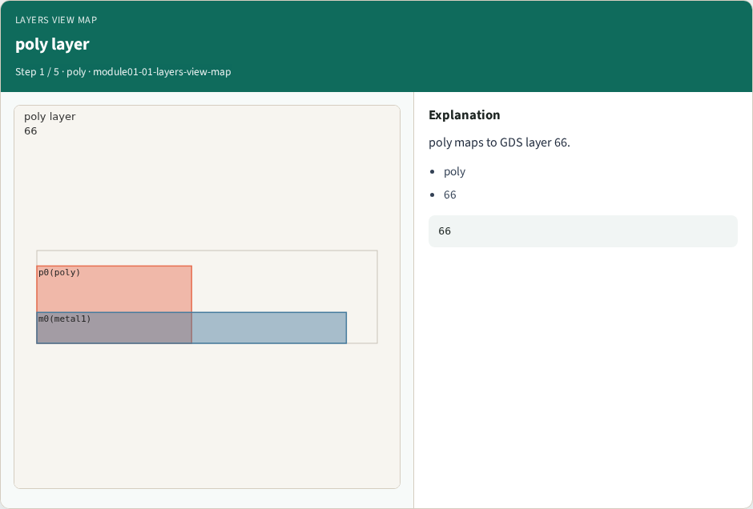
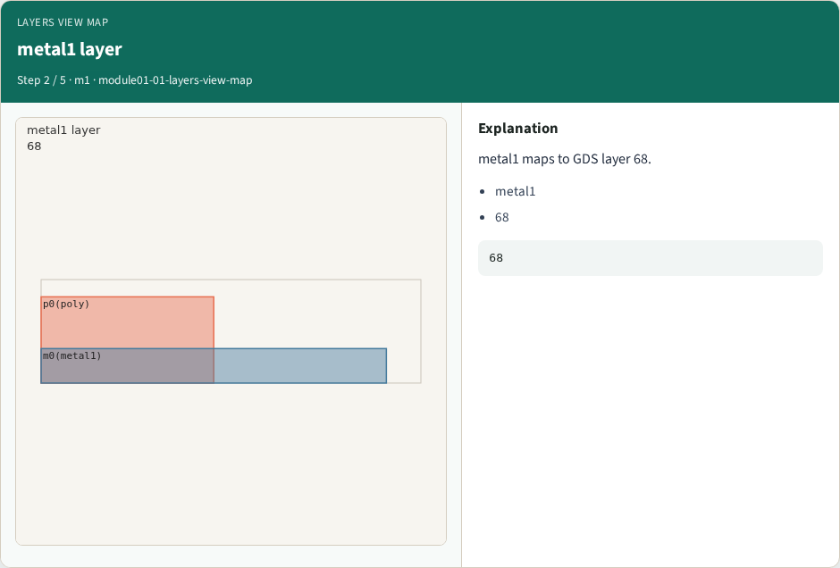
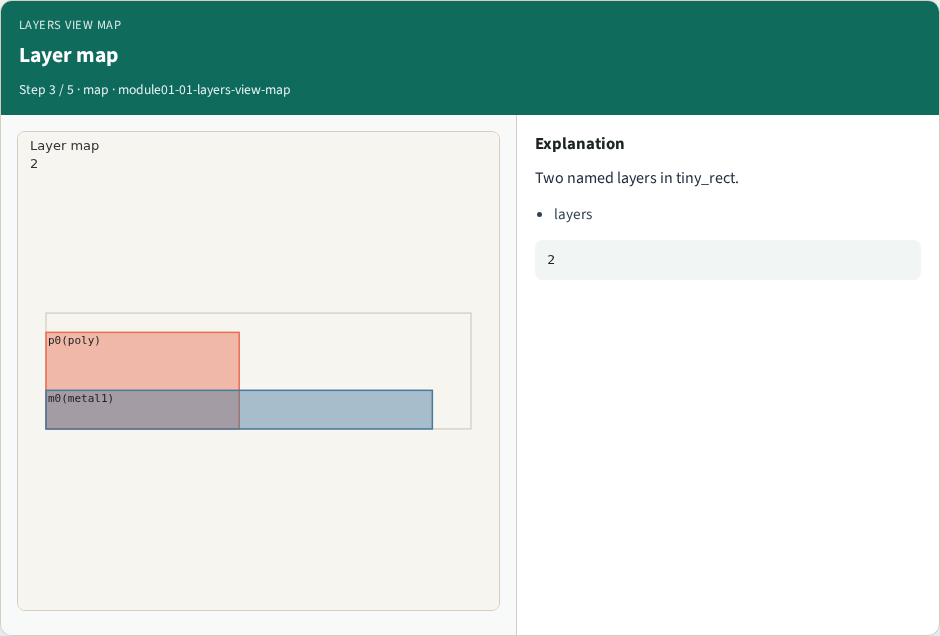
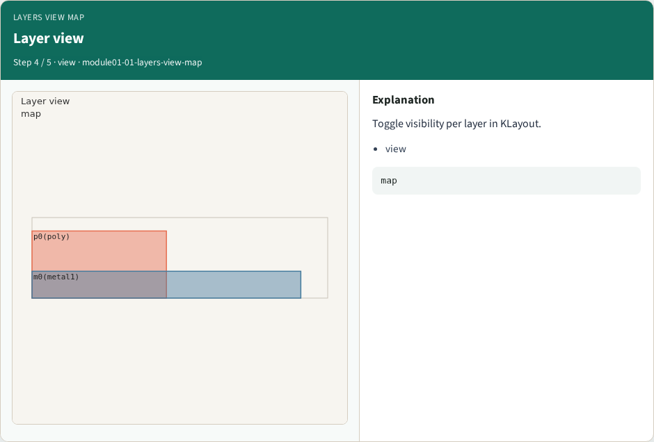
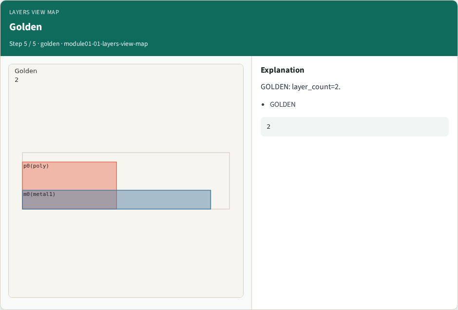

# Layers view map

**Module id:** module01-01-layers-view-map
**Lab:** layers-view-map
**Tracks:** A (implement) · B (browser lab)

## Slide 1 — Why Layers

View layer palette and GDS layer numbers for tiny_rect.

## Slide 2 — The idea

GOLDEN: layer_count=2 (poly, metal1).

<!-- algorithm-walkthrough -->

## Slide 3 — poly layer



poly maps to GDS layer 66.

## Slide 4 — metal1 layer



metal1 maps to GDS layer 68.

## Slide 5 — Layer map



Two named layers in tiny_rect.

## Slide 6 — Layer view



Toggle visibility per layer in KLayout.

## Slide 7 — Golden



GOLDEN: layer_count=2.

<!-- /algorithm-walkthrough -->


## Slide 8 — Browser lab track

Open **layers-view-map**. Run the stage buttons and Check the goldens.

## Slide 9 — Implement track

From common/, run solvers.py and confirm KLAYOUT_PARTA_OK.

## Slide 10 — Pitfalls

Confusing layer numbers with layer names. Forgetting m0 width violation on tiny_rect.

## Slide 11 — Try these

From the common folder, run the KLayout map self-test.

```bash
cd courses/learn_klayout/common
python3 solvers.py
```

## Slide 12 — Pseudocode

Here is the check in plain steps.

```text
layer_count=2 (poly, metal1).
ok if goldens match
```


## See also

See also: [learn_magic paint layers](../../learn_magic/module01-01-paint-layers/README.md) for layer/paint meaning.

## Slide 13 — Next

Continue the KLayout Part A map, then the real CLI track.
