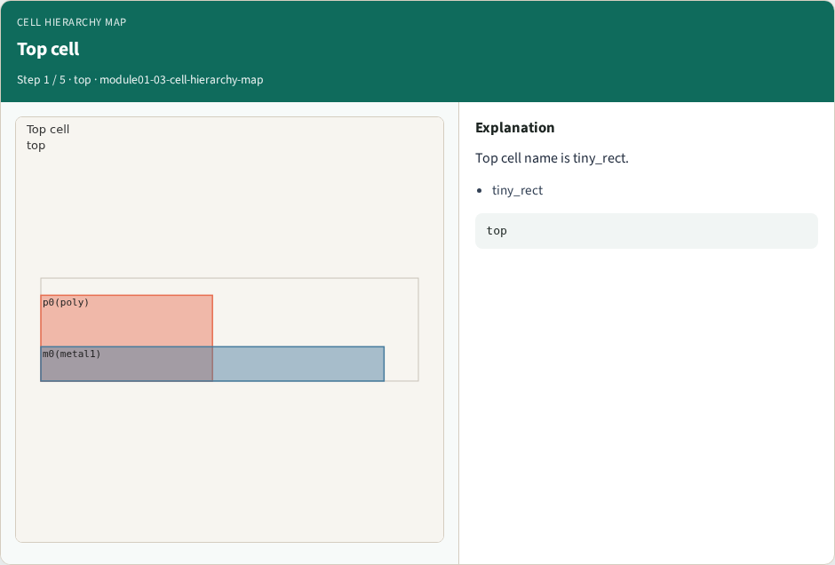
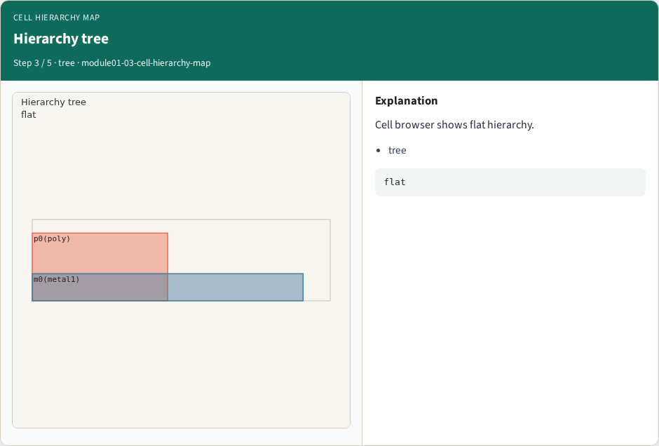
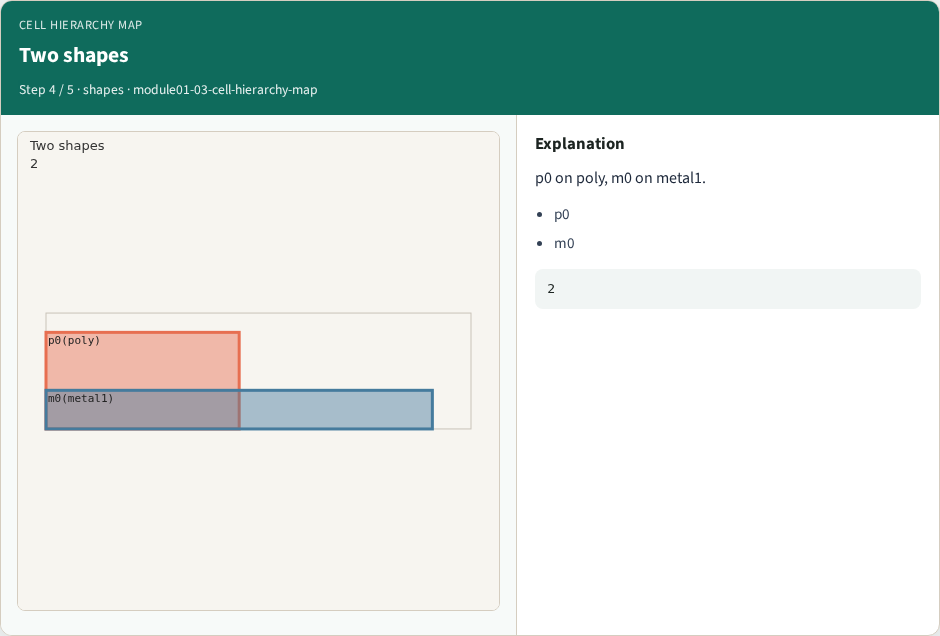
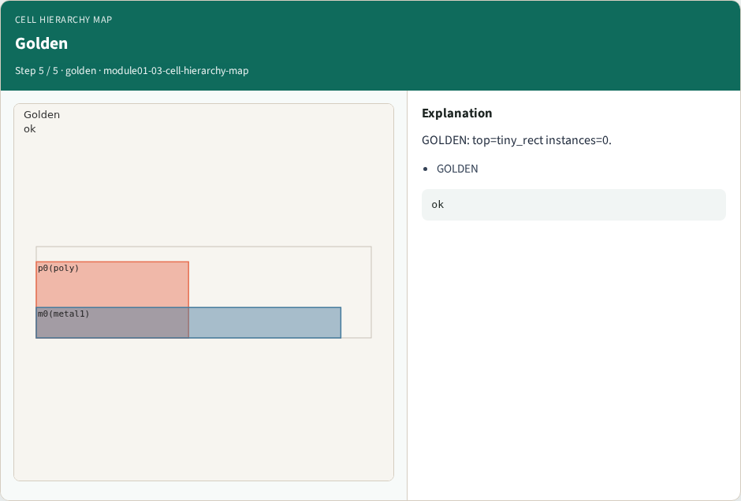

# Cell hierarchy map

**Module id:** module01-03-cell-hierarchy-map
**Lab:** cell-hierarchy-map
**Tracks:** A (implement) · B (browser lab)

## Slide 1 — Why Cell

Navigate top cell and instance hierarchy.

## Slide 2 — The idea

GOLDEN: top=tiny_rect; instances=0.

<!-- algorithm-walkthrough -->

## Slide 3 — Top cell



Top cell name is tiny_rect.

## Slide 4 — Zero instances


No child cell instances on teaching layout.

## Slide 5 — Hierarchy tree



Cell browser shows flat hierarchy.

## Slide 6 — Two shapes



p0 on poly, m0 on metal1.

## Slide 7 — Golden



GOLDEN: top=tiny_rect instances=0.

<!-- /algorithm-walkthrough -->


## Slide 8 — Browser lab track

Open **cell-hierarchy-map**. Run the stage buttons and Check the goldens.

## Slide 9 — Implement track

From common/, run solvers.py and confirm KLAYOUT_PARTA_OK.

## Slide 10 — Pitfalls

Confusing layer numbers with layer names. Forgetting m0 width violation on tiny_rect.

## Slide 11 — Try these

From the common folder, run the KLayout map self-test.

```bash
cd courses/learn_klayout/common
python3 solvers.py
```

## Slide 12 — Pseudocode

Here is the check in plain steps.

```text
top=tiny_rect; instances=0.
ok if goldens match
```

## Slide 13 — Next

Continue the KLayout Part A map, then the real CLI track.
