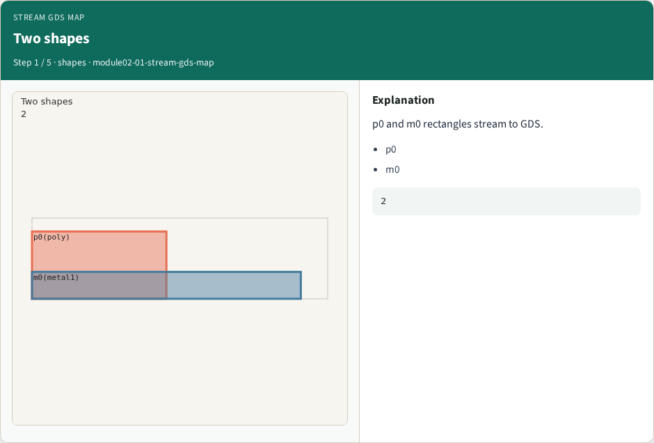
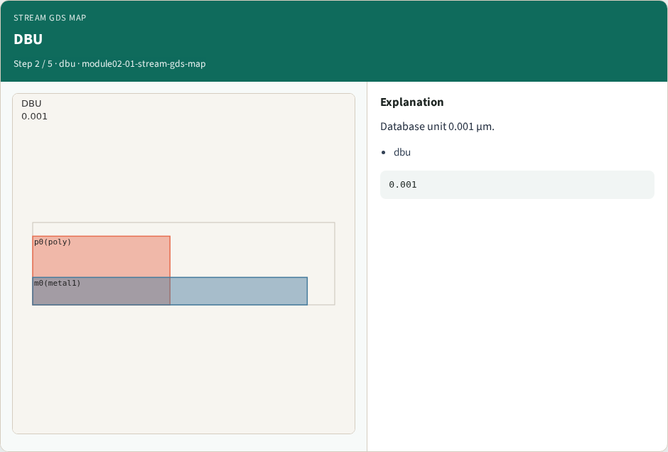
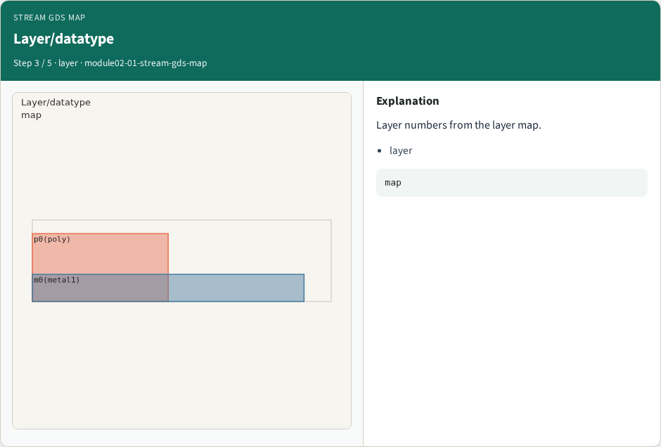
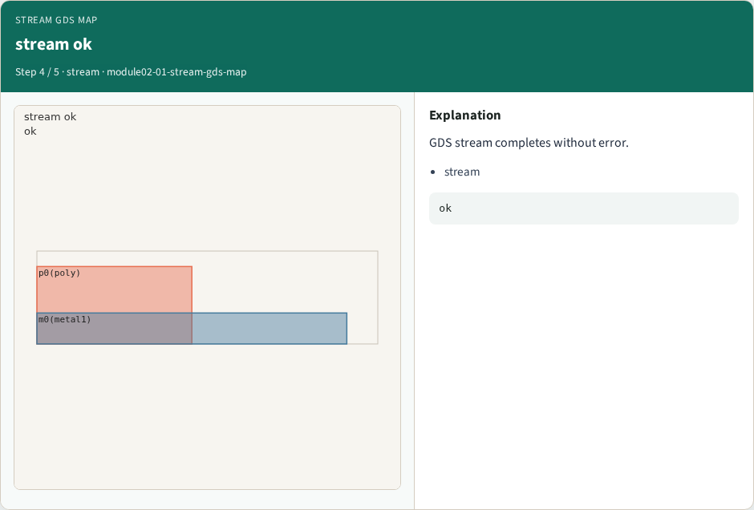

# Stream GDS map

**Module id:** module02-01-stream-gds-map
**Lab:** stream-gds-map
**Tracks:** A (implement) · B (browser lab)

## Slide 1 — Why Stream

Stream shapes to GDS with layer map.

## Slide 2 — The idea

GOLDEN: shape_count=2; stream_ok=True.

<!-- algorithm-walkthrough -->

## Slide 3 — Two shapes



p0 and m0 rectangles stream to GDS.

## Slide 4 — DBU



Database unit 0.001 µm.

## Slide 5 — Layer/datatype



Layer numbers from the layer map.

## Slide 6 — stream ok



GDS stream completes without error.

## Slide 7 — Golden


GOLDEN: shape_count=2 stream_ok=True.

<!-- /algorithm-walkthrough -->


## Slide 8 — Browser lab track

Open **stream-gds-map**. Run the stage buttons and Check the goldens.

## Slide 9 — Implement track

From common/, run solvers.py and confirm KLAYOUT_PARTA_OK.

## Slide 10 — Pitfalls

Confusing layer numbers with layer names. Forgetting m0 width violation on tiny_rect.

## Slide 11 — Try these

From the common folder, run the KLayout map self-test.

```bash
cd courses/learn_klayout/common
python3 solvers.py
```

## Slide 12 — Pseudocode

Here is the check in plain steps.

```text
shape_count=2; stream_ok=True.
ok if goldens match
```


## See also

See also: [learn_magic GDS write map](../../learn_magic/module03-01-gds-write-map/README.md) for GDS write side.

## Slide 13 — Next

Continue the KLayout Part A map, then the real CLI track.
