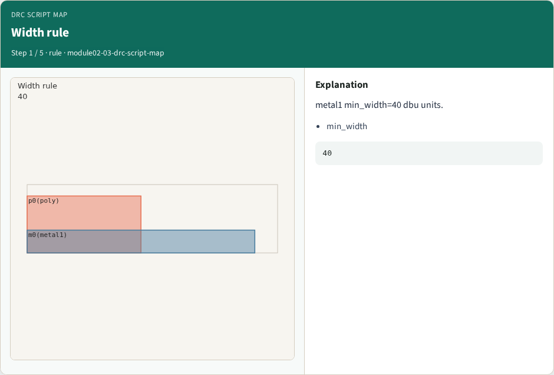
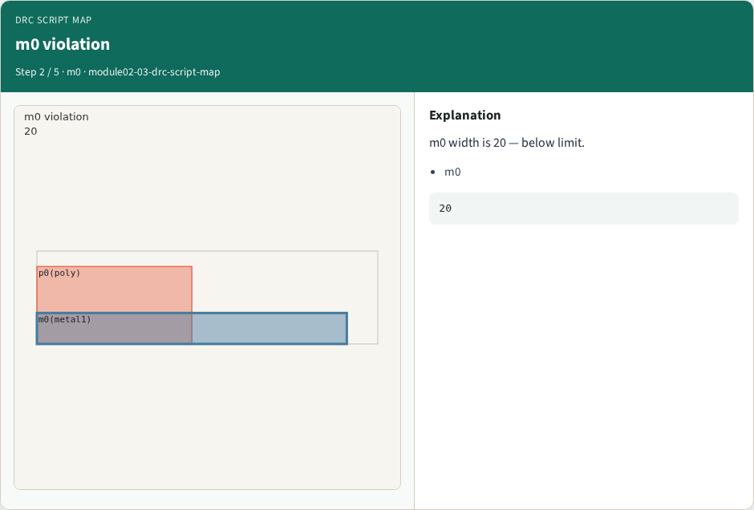
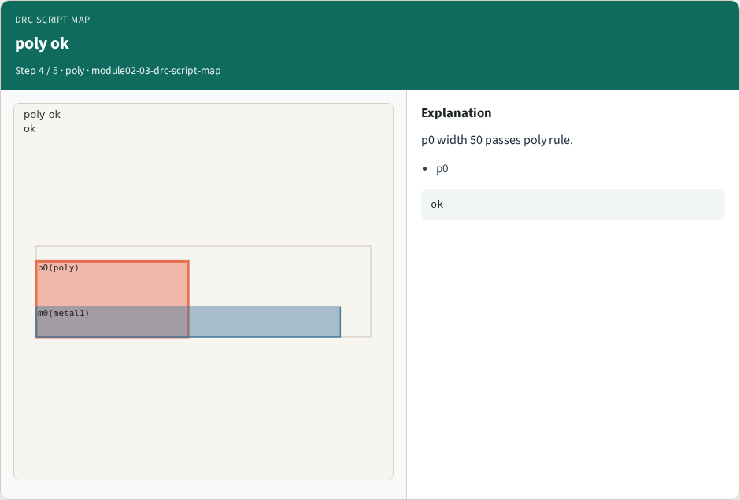

# DRC script map

**Module id:** module02-03-drc-script-map
**Lab:** drc-script-map
**Tracks:** A (implement) · B (browser lab)

## Slide 1 — Why DRC

Run width rules; find violations.

## Slide 2 — The idea

GOLDEN: width_violations=1 on m0.

<!-- algorithm-walkthrough -->

## Slide 3 — Width rule



metal1 min_width=40 dbu units.

## Slide 4 — m0 violation



m0 width is 20 — below limit.

## Slide 5 — DRC script


Ruby DRC finds one width violation.

## Slide 6 — poly ok



p0 width 50 passes poly rule.

## Slide 7 — Golden


GOLDEN: width_violations=1 on m0.

<!-- /algorithm-walkthrough -->


## Slide 8 — Browser lab track

Open **drc-script-map**. Run the stage buttons and Check the goldens.

## Slide 9 — Implement track

From common/, run solvers.py and confirm KLAYOUT_PARTA_OK.

## Slide 10 — Pitfalls

Confusing layer numbers with layer names. Forgetting m0 width violation on tiny_rect.

## Slide 11 — Try these

From the common folder, run the KLayout map self-test.

```bash
cd courses/learn_klayout/common
python3 solvers.py
```

## Slide 12 — Pseudocode

Here is the check in plain steps.

```text
width_violations=1 on m0.
ok if goldens match
```


## See also

See also: [learn_magic DRC map](../../learn_magic/module02-03-magic-drc-map/README.md) for Magic DRC contrast.

## Slide 13 — Next

Continue the KLayout Part A map, then the real CLI track.
