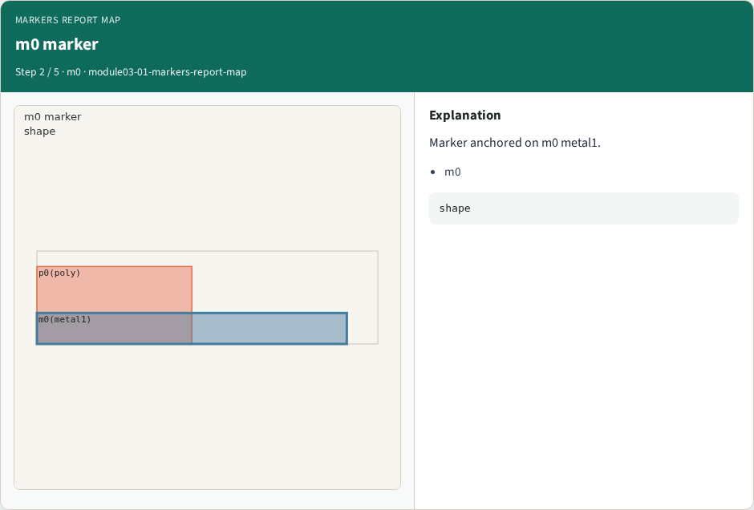
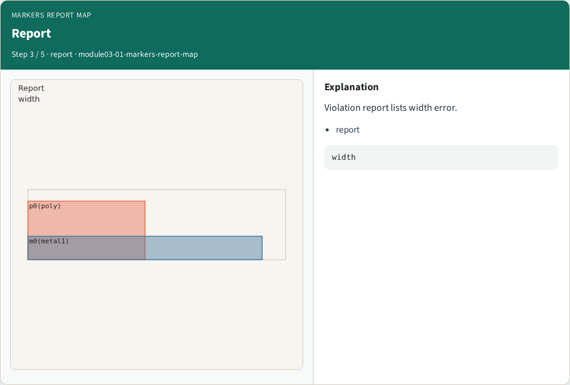
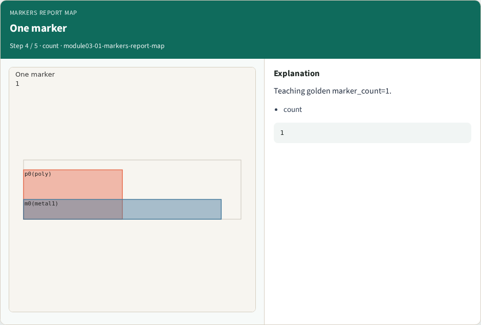
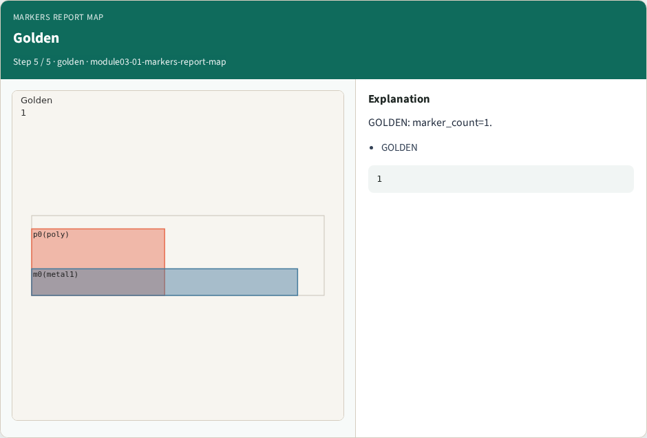

# Markers report map

**Module id:** module03-01-markers-report-map
**Lab:** markers-report-map
**Tracks:** A (implement) · B (browser lab)

## Slide 1 — Why Markers

DRC markers and violation report.

## Slide 2 — The idea

GOLDEN: marker_count=1 on m0.

<!-- algorithm-walkthrough -->

## Slide 3 — Emit marker


DRC emits marker on violating shape.

## Slide 4 — m0 marker



Marker anchored on m0 metal1.

## Slide 5 — Report



Violation report lists width error.

## Slide 6 — One marker



Teaching golden marker_count=1.

## Slide 7 — Golden



GOLDEN: marker_count=1.

<!-- /algorithm-walkthrough -->


## Slide 8 — Browser lab track

Open **markers-report-map**. Run the stage buttons and Check the goldens.

## Slide 9 — Implement track

From common/, run solvers.py and confirm KLAYOUT_PARTA_OK.

## Slide 10 — Pitfalls

Confusing layer numbers with layer names. Forgetting m0 width violation on tiny_rect.

## Slide 11 — Try these

From the common folder, run the KLayout map self-test.

```bash
cd courses/learn_klayout/common
python3 solvers.py
```

## Slide 12 — Pseudocode

Here is the check in plain steps.

```text
marker_count=1 on m0.
ok if goldens match
```


## See also

See also: [learn_drc rule deck](../../learn_drc/module01-01-rule-deck/README.md), [width checker](../../learn_drc/module01-03-width-checker/README.md), [spacing checker](../../learn_drc/module01-05-spacing-checker/README.md), [violation markers](../../learn_drc/module02-03-violation-markers/README.md).

## Slide 13 — Next

Continue the KLayout Part A map, then the real CLI track.
