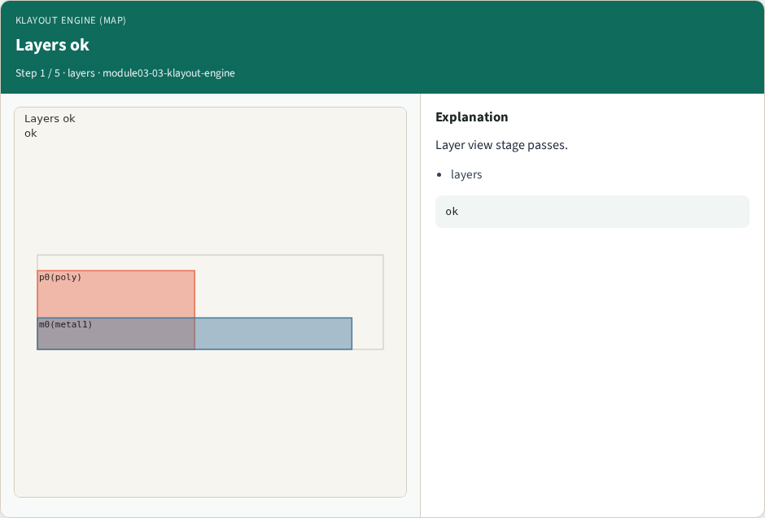
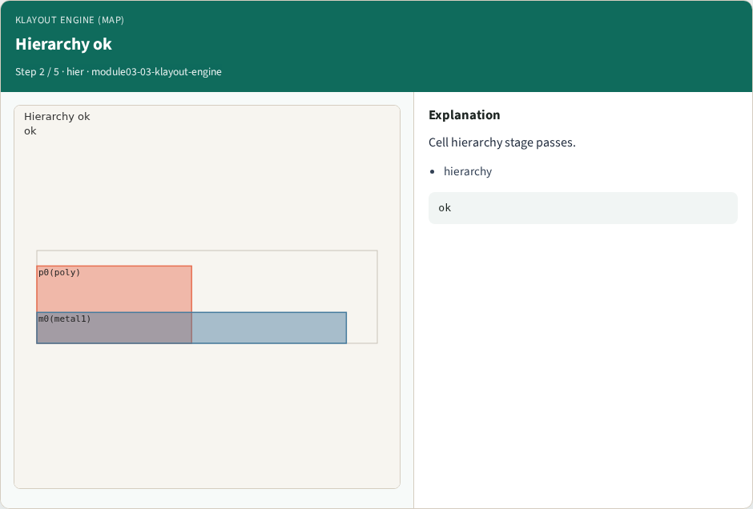
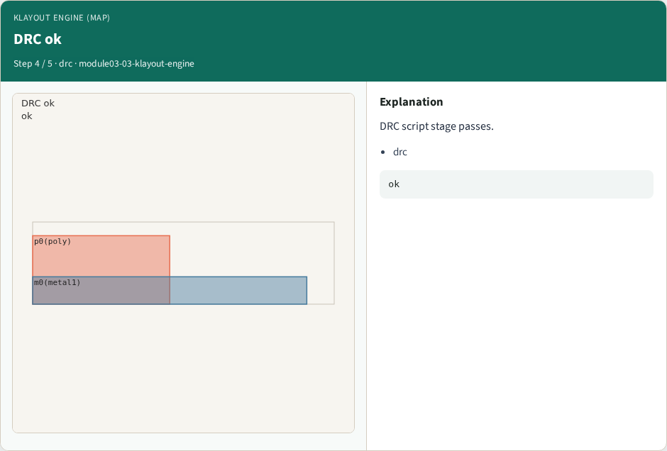

# KLayout engine (map)

**Module id:** module03-03-klayout-engine
**Lab:** klayout-engine
**Tracks:** A (implement) · B (browser lab)

## Slide 1 — Why KLayout

Run the full Part A engine; ok when every golden matches.

## Slide 2 — The idea

GOLDEN: klayout_engine ok=True.

<!-- algorithm-walkthrough -->

## Slide 3 — Layers ok



Layer view stage passes.

## Slide 4 — Hierarchy ok



Cell hierarchy stage passes.

## Slide 5 — Stream ok


Stream GDS stage passes.

## Slide 6 — DRC ok



DRC script stage passes.

## Slide 7 — Engine golden


GOLDEN: klayout_engine ok=True.

<!-- /algorithm-walkthrough -->


## Slide 8 — Browser lab track

Open **klayout-engine**. Run the stage buttons and Check the goldens.

## Slide 9 — Implement track

From common/, run solvers.py and confirm KLAYOUT_PARTA_OK.

## Slide 10 — Pitfalls

Confusing layer numbers with layer names. Forgetting m0 width violation on tiny_rect.

## Slide 11 — Try these

From the common folder, run the KLayout map self-test.

```bash
cd courses/learn_klayout/common
python3 solvers.py
```

## Slide 12 — Pseudocode

Here is the check in plain steps.

```text
klayout_engine ok=True.
ok if goldens match
```

## Slide 13 — Next

Continue the KLayout Part A map, then the real CLI track.
