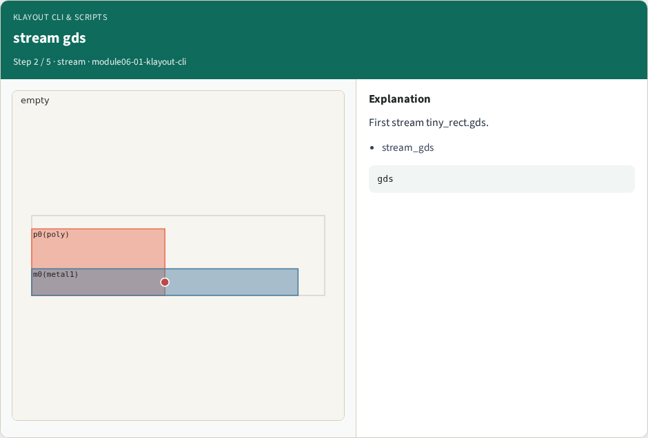
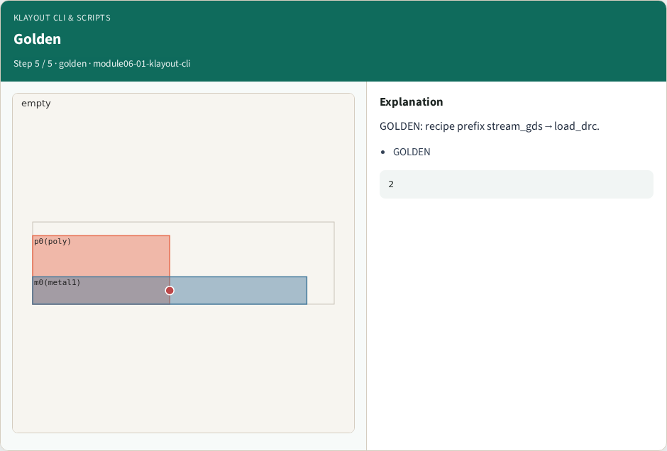

# KLayout CLI & scripts — step-by-step (for slides / transcript)

**Module:** `module06-01-klayout-cli`  
**Lab / algo:** `klayout-cli`  
**Viewer:** `/tools/algorithm-walkthrough/?algo=klayout-cli&step=1`

Use each **Caption** as spoken prose (or a shortened slide note).
Use **Bullets** on the PPT; pair with the PNG in `assets/steps/`.

## Step 1 — klayout -b


**Caption (transcript):** KLayout runs batch mode with -r script.drc.

**Slide bullets:**

- klayout

**On-screen metrics:**

```
CLI
```

## Step 2 — stream gds



**Caption (transcript):** First stream tiny_rect.gds.

**Slide bullets:**

- stream_gds

**On-screen metrics:**

```
gds
```

## Step 3 — load drc


**Caption (transcript):** Then load DRC Ruby script.

**Slide bullets:**

- load_drc

**On-screen metrics:**

```
drc
```

## Step 4 — run drc


**Caption (transcript):** Run width/spacing checks.

**Slide bullets:**

- run_drc

**On-screen metrics:**

```
check
```

## Step 5 — Golden



**Caption (transcript):** GOLDEN: recipe prefix stream_gds→load_drc.

**Slide bullets:**

- GOLDEN

**On-screen metrics:**

```
2
```

