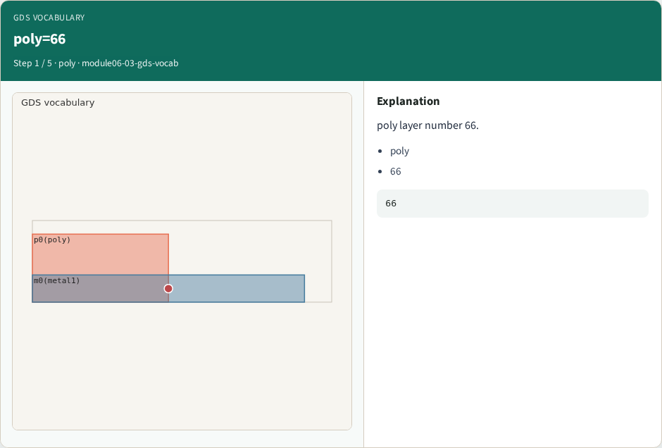
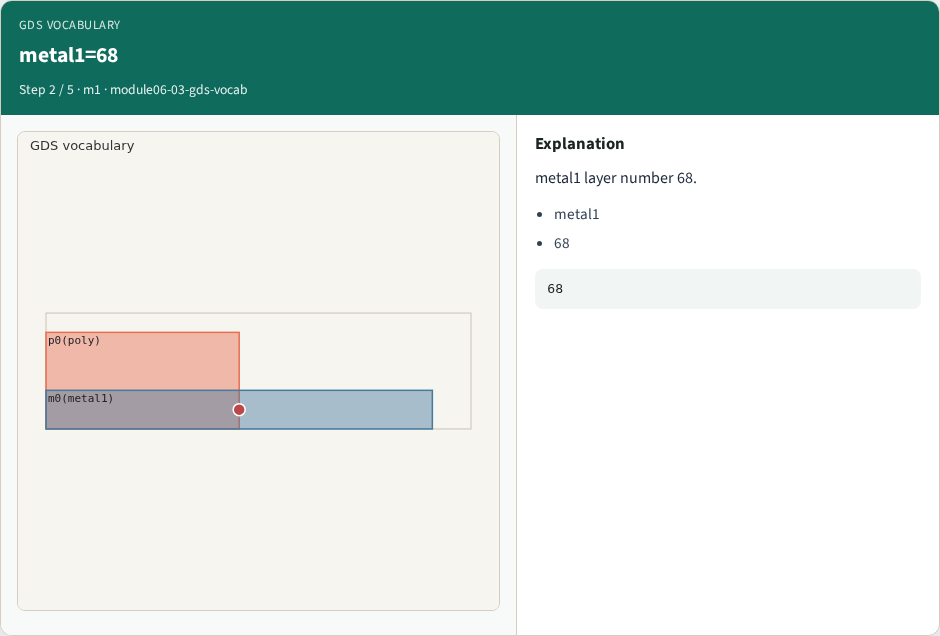
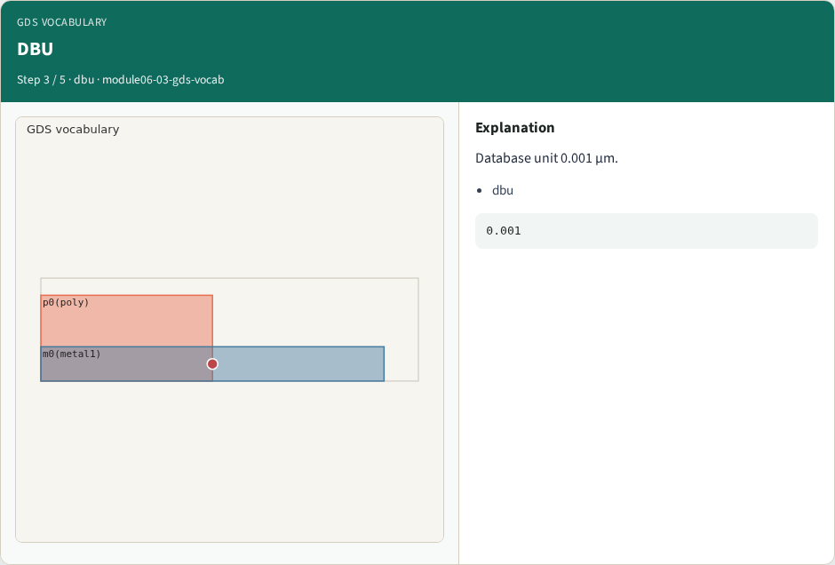
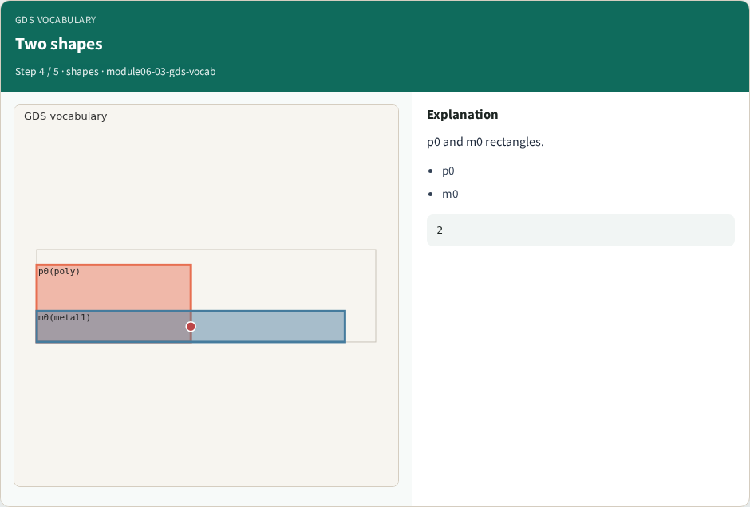
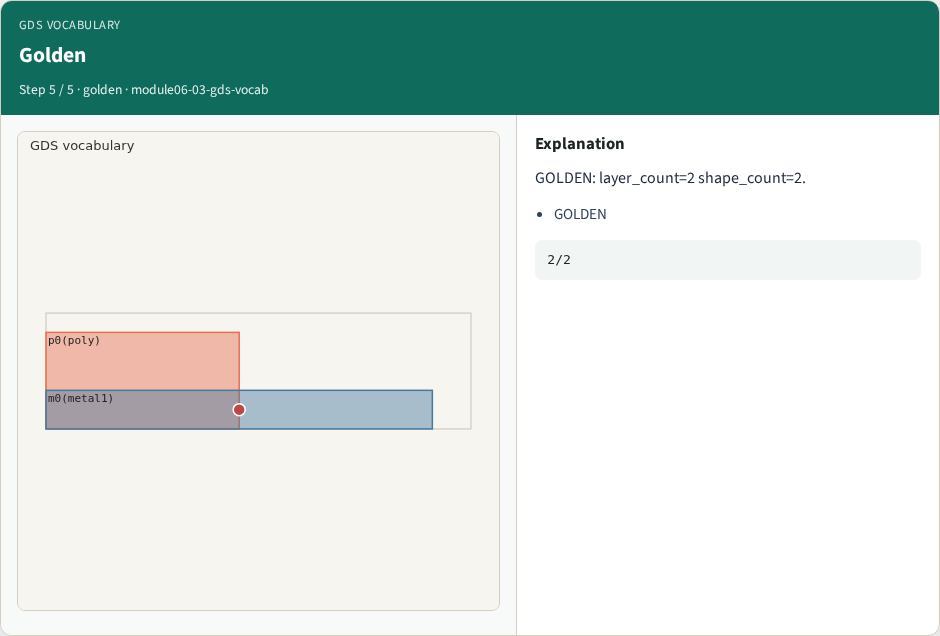

# GDS vocabulary — step-by-step (for slides / transcript)

**Module:** `module06-03-gds-vocab`  
**Lab / algo:** `gds-vocab`  
**Viewer:** `/tools/algorithm-walkthrough/?algo=gds-vocab&step=1`

Use each **Caption** as spoken prose (or a shortened slide note).
Use **Bullets** on the PPT; pair with the PNG in `assets/steps/`.

## Step 1 — poly=66



**Caption (transcript):** poly layer number 66.

**Slide bullets:**

- poly
- 66

**On-screen metrics:**

```
66
```

## Step 2 — metal1=68



**Caption (transcript):** metal1 layer number 68.

**Slide bullets:**

- metal1
- 68

**On-screen metrics:**

```
68
```

## Step 3 — DBU



**Caption (transcript):** Database unit 0.001 µm.

**Slide bullets:**

- dbu

**On-screen metrics:**

```
0.001
```

## Step 4 — Two shapes



**Caption (transcript):** p0 and m0 rectangles.

**Slide bullets:**

- p0
- m0

**On-screen metrics:**

```
2
```

## Step 5 — Golden



**Caption (transcript):** GOLDEN: layer_count=2 shape_count=2.

**Slide bullets:**

- GOLDEN

**On-screen metrics:**

```
2/2
```

