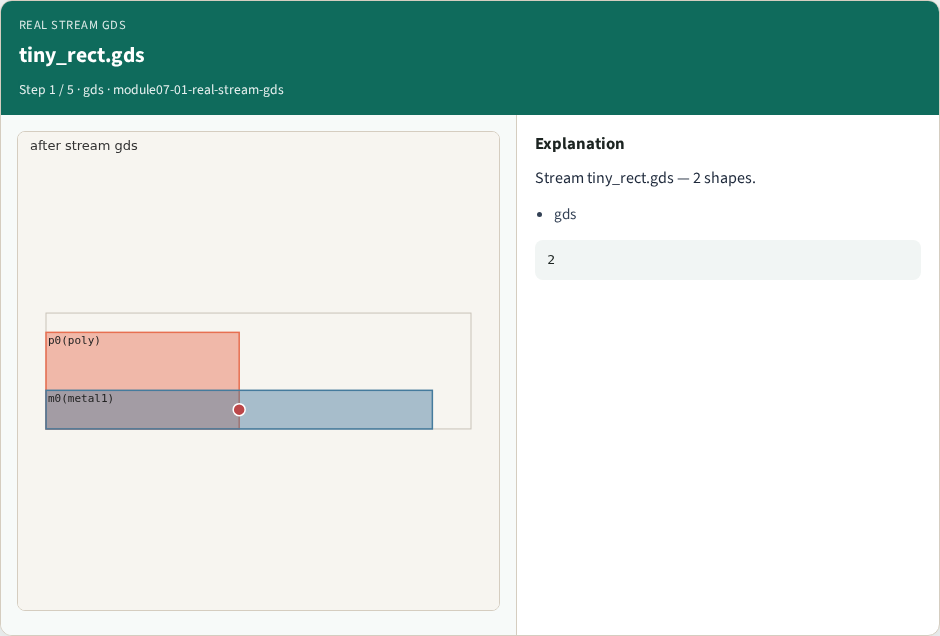
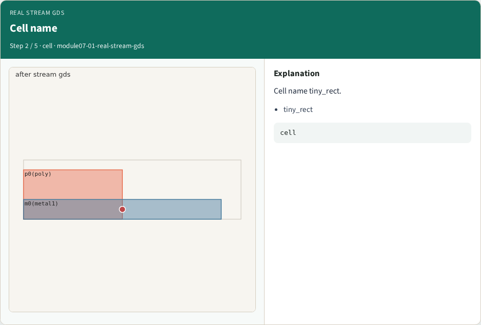
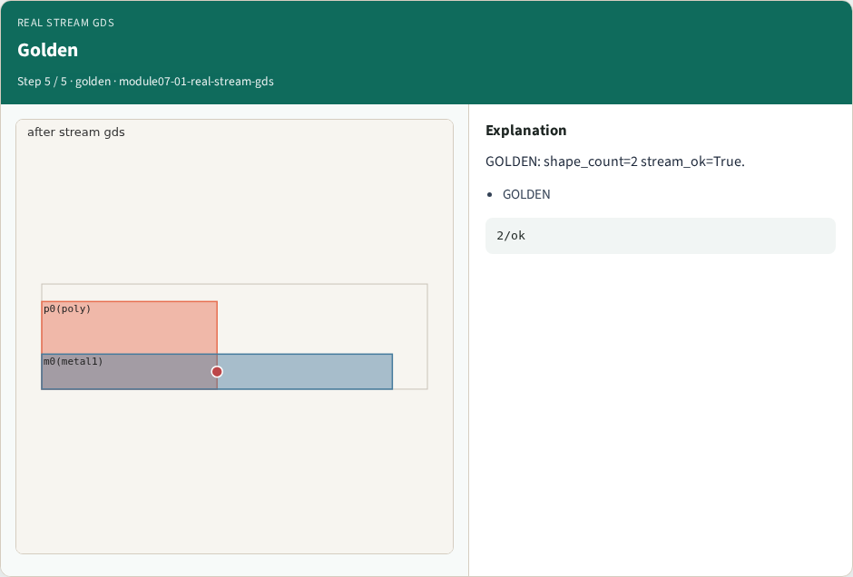

# Real stream GDS — step-by-step (for slides / transcript)

**Module:** `module07-01-real-stream-gds`  
**Lab / algo:** `real-stream-gds`  
**Viewer:** `/tools/algorithm-walkthrough/?algo=real-stream-gds&step=1`

Use each **Caption** as spoken prose (or a shortened slide note).
Use **Bullets** on the PPT; pair with the PNG in `assets/steps/`.

## Step 1 — tiny_rect.gds



**Caption (transcript):** Stream tiny_rect.gds — 2 shapes.

**Slide bullets:**

- gds

**On-screen metrics:**

```
2
```

## Step 2 — Cell name



**Caption (transcript):** Cell name tiny_rect.

**Slide bullets:**

- tiny_rect

**On-screen metrics:**

```
cell
```

## Step 3 — Layer map


**Caption (transcript):** poly and metal1 from layer map.

**Slide bullets:**

- layers

**On-screen metrics:**

```
2
```

## Step 4 — stream ok


**Caption (transcript):** Stream completes without error.

**Slide bullets:**

- stream_ok

**On-screen metrics:**

```
True
```

## Step 5 — Golden



**Caption (transcript):** GOLDEN: shape_count=2 stream_ok=True.

**Slide bullets:**

- GOLDEN

**On-screen metrics:**

```
2/ok
```

