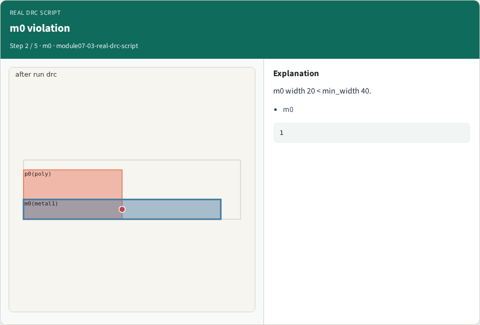
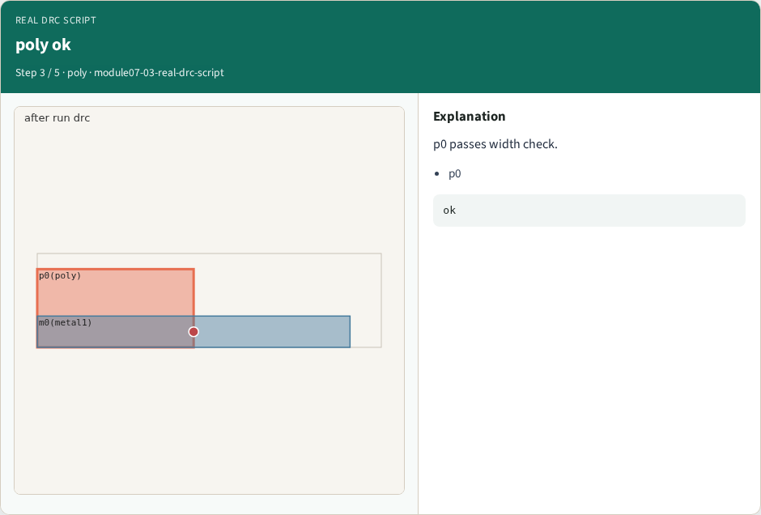
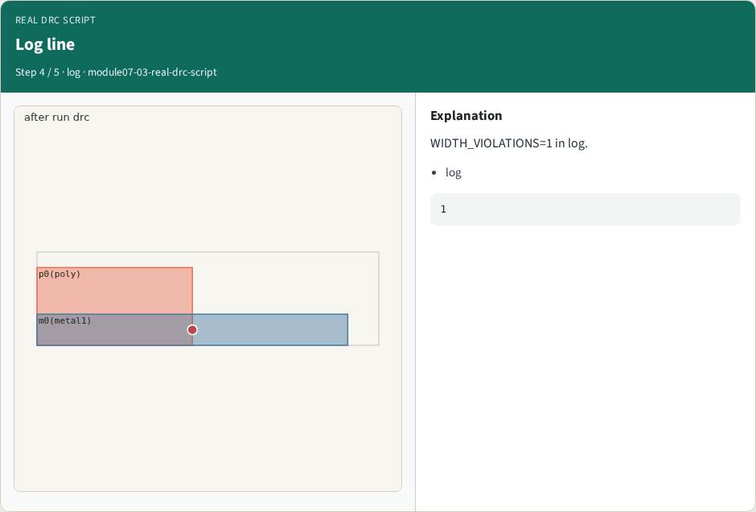
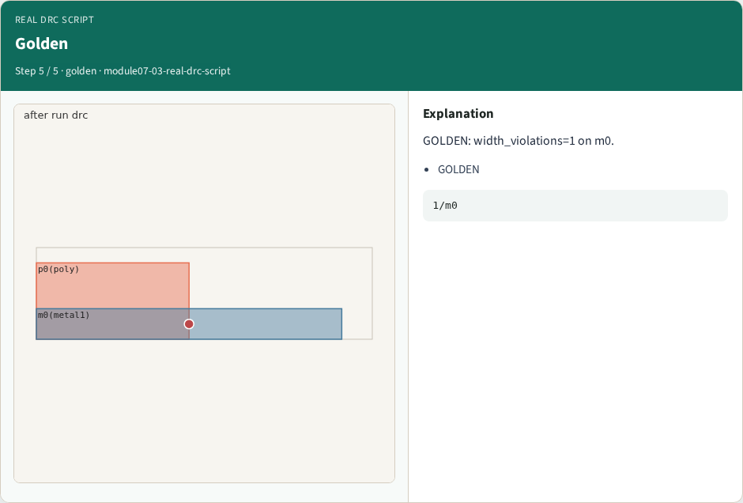

# Real DRC script

**Module id:** module07-03-real-drc-script
**Lab:** real-drc-script

## Slide 1 — Why real KLayout

Run width rules on streamed layout.

## Slide 2 — The idea

GOLDEN: width_violations=1 on m0.

<!-- algorithm-walkthrough -->

## Slide 3 — run drc


DRC script finds width violations.

## Slide 4 — m0 violation



m0 width 20 < min_width 40.

## Slide 5 — poly ok



p0 passes width check.

## Slide 6 — Log line



WIDTH_VIOLATIONS=1 in log.

## Slide 7 — Golden



GOLDEN: width_violations=1 on m0.

<!-- /algorithm-walkthrough -->


## Slide 8 — Browser lab

Open **real-drc-script**.

## Slide 9 — Implement track

Run real_solvers.py — REAL_KLAYOUT_OK.

## Slide 10 — Pitfalls

Editing goldens without re-running scripts.

## Slide 11 — Try these

From the common folder, run the real KLayout self-test.

```bash
cd courses/learn_klayout/common
python3 real_solvers.py
```

## Slide 12 — Pseudocode

Here is the check in plain steps.

```text
width_violations=1 on m0.
ok if goldens match
```

## Slide 13 — Next

Continue Part B evidence track.
