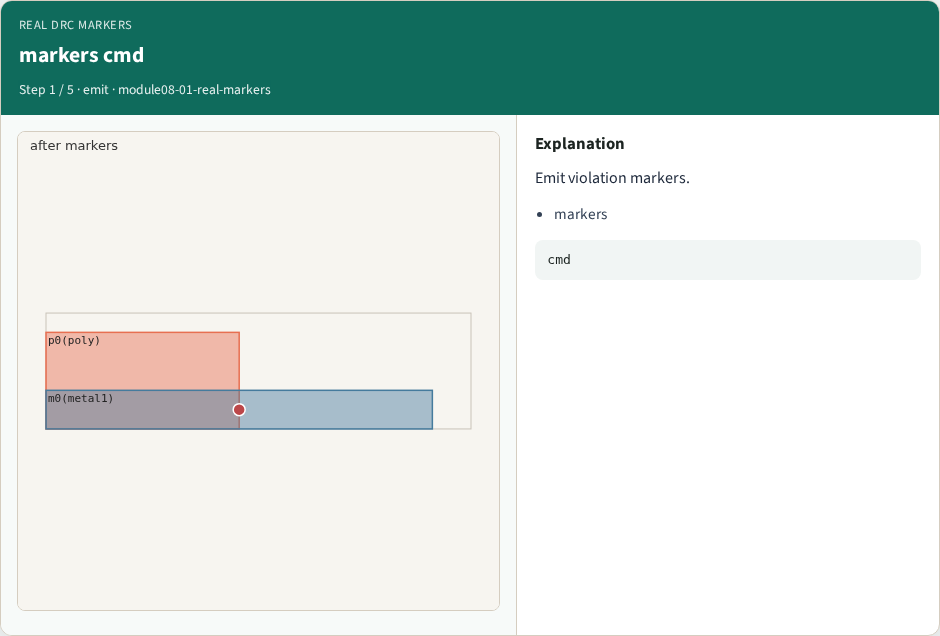
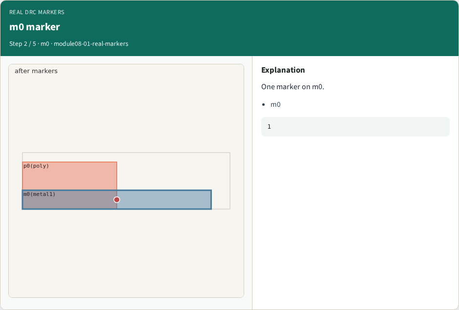
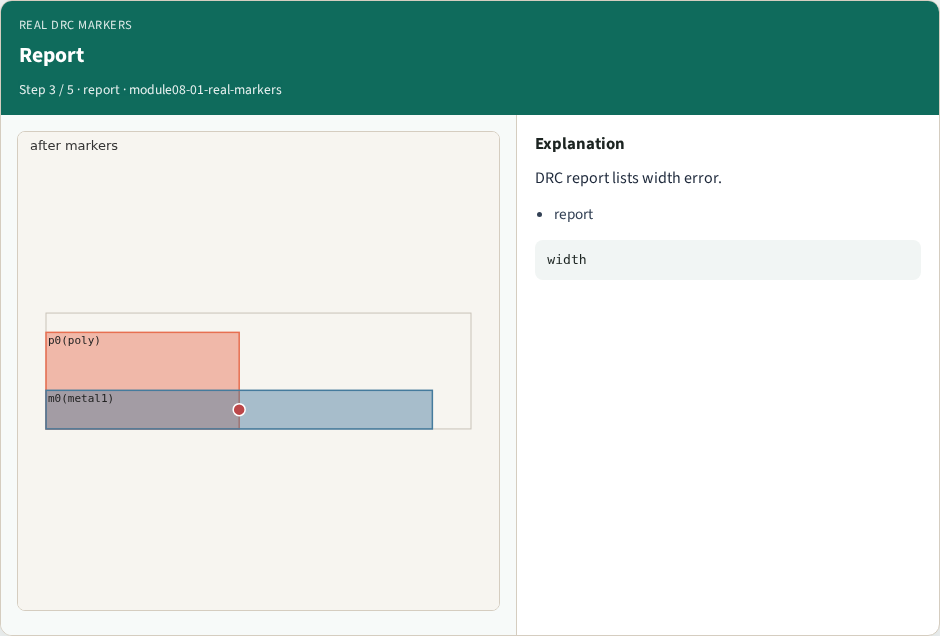
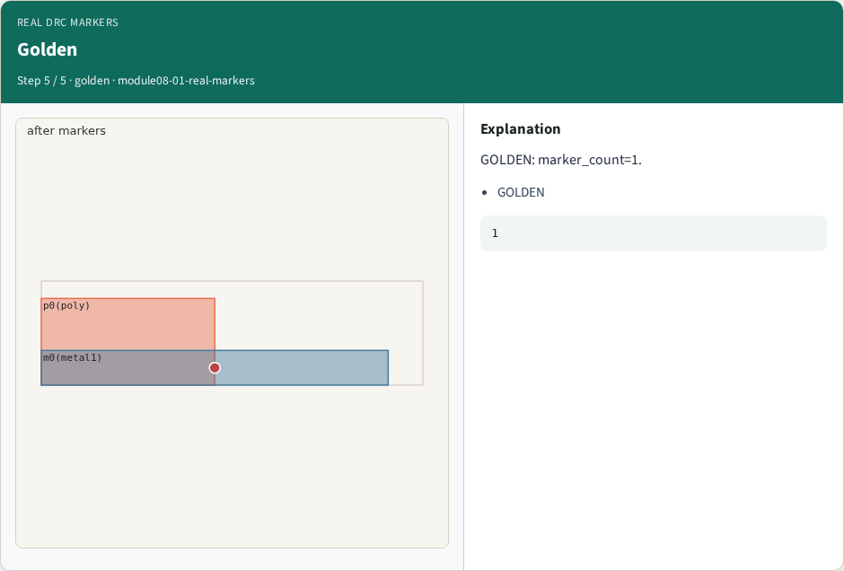

# Real DRC markers

**Module id:** module08-01-real-markers
**Lab:** real-markers

## Slide 1 — Why real KLayout

Emit DRC markers for violations.

## Slide 2 — The idea

GOLDEN: marker_count=1 on m0.

<!-- algorithm-walkthrough -->

## Slide 3 — markers cmd



Emit violation markers.

## Slide 4 — m0 marker



One marker on m0.

## Slide 5 — Report



DRC report lists width error.

## Slide 6 — Count


MARKER_COUNT=1.

## Slide 7 — Golden



GOLDEN: marker_count=1.

<!-- /algorithm-walkthrough -->


## Slide 8 — Browser lab

Open **real-markers**.

## Slide 9 — Implement track

Run real_solvers.py — REAL_KLAYOUT_OK.

## Slide 10 — Pitfalls

Editing goldens without re-running scripts.

## Slide 11 — Try these

From the common folder, run the real KLayout self-test.

```bash
cd courses/learn_klayout/common
python3 real_solvers.py
```

## Slide 12 — Pseudocode

Here is the check in plain steps.

```text
marker_count=1 on m0.
ok if goldens match
```

## Slide 13 — Next

Continue Part B evidence track.
