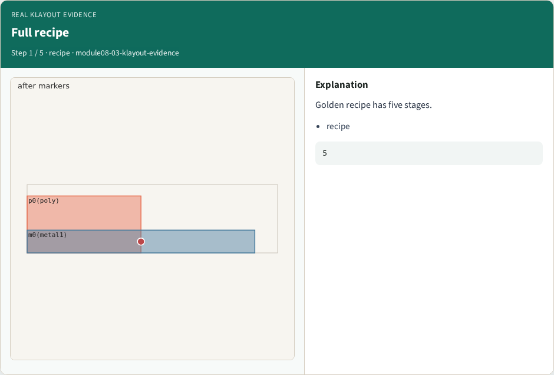
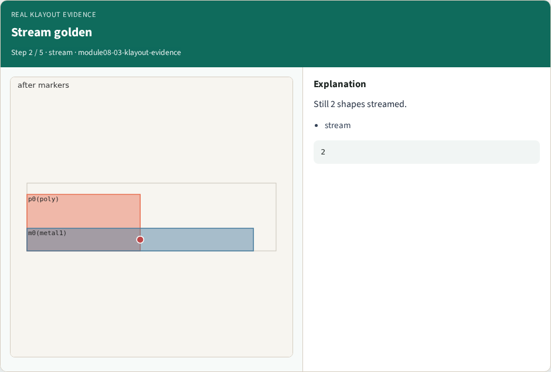
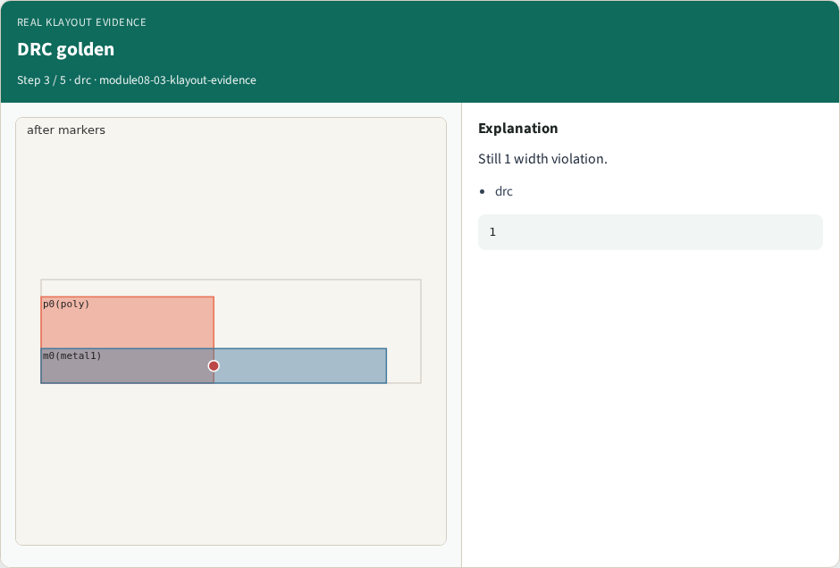
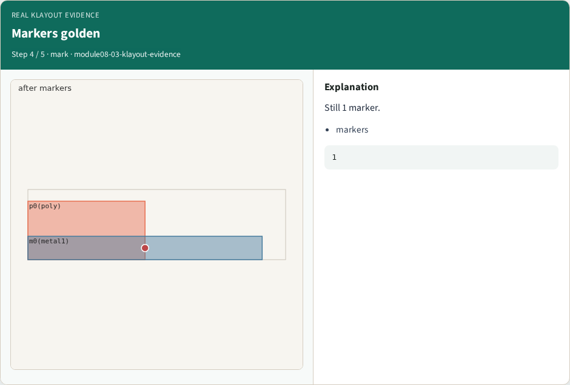
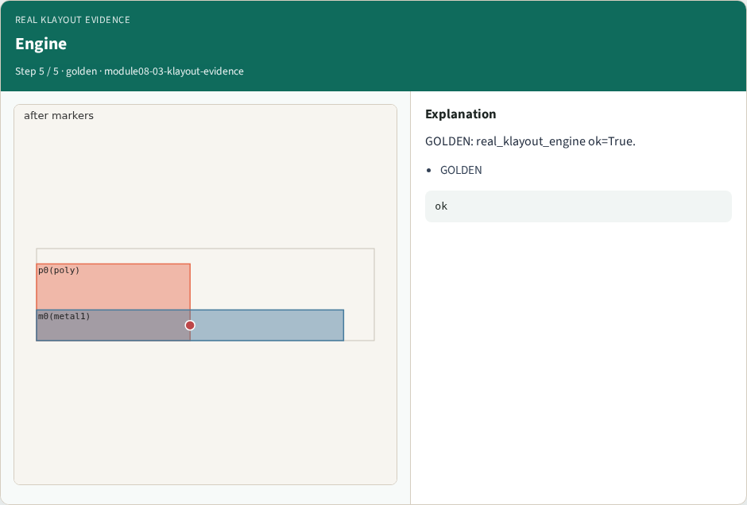

# Real KLayout evidence — step-by-step (for slides / transcript)

**Module:** `module08-03-klayout-evidence`  
**Lab / algo:** `klayout-evidence`  
**Viewer:** `/tools/algorithm-walkthrough/?algo=klayout-evidence&step=1`

Use each **Caption** as spoken prose (or a shortened slide note).
Use **Bullets** on the PPT; pair with the PNG in `assets/steps/`.

## Step 1 — Full recipe



**Caption (transcript):** Golden recipe has five stages.

**Slide bullets:**

- recipe

**On-screen metrics:**

```
5
```

## Step 2 — Stream golden



**Caption (transcript):** Still 2 shapes streamed.

**Slide bullets:**

- stream

**On-screen metrics:**

```
2
```

## Step 3 — DRC golden



**Caption (transcript):** Still 1 width violation.

**Slide bullets:**

- drc

**On-screen metrics:**

```
1
```

## Step 4 — Markers golden



**Caption (transcript):** Still 1 marker.

**Slide bullets:**

- markers

**On-screen metrics:**

```
1
```

## Step 5 — Engine



**Caption (transcript):** GOLDEN: real_klayout_engine ok=True.

**Slide bullets:**

- GOLDEN

**On-screen metrics:**

```
ok
```

