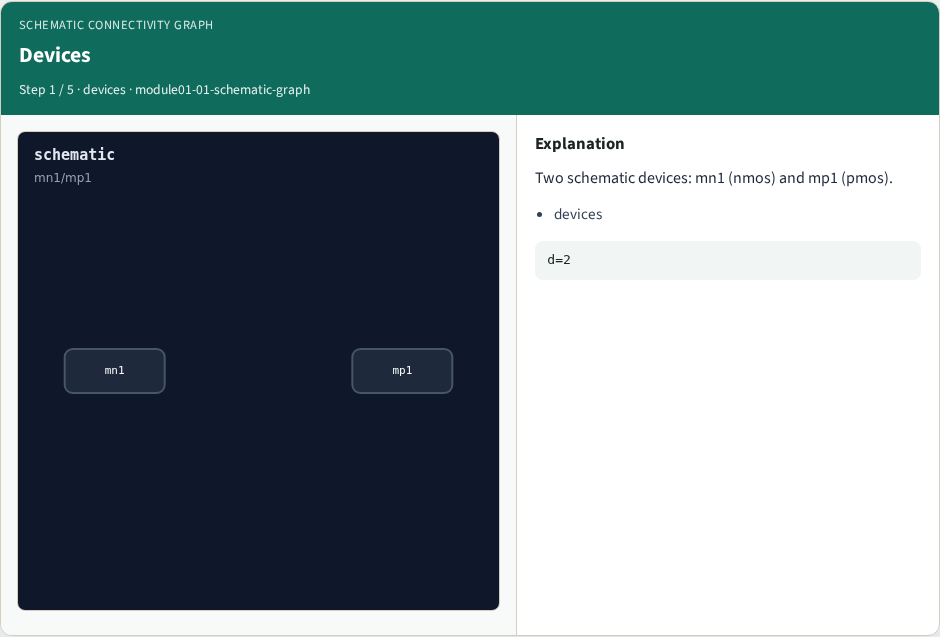
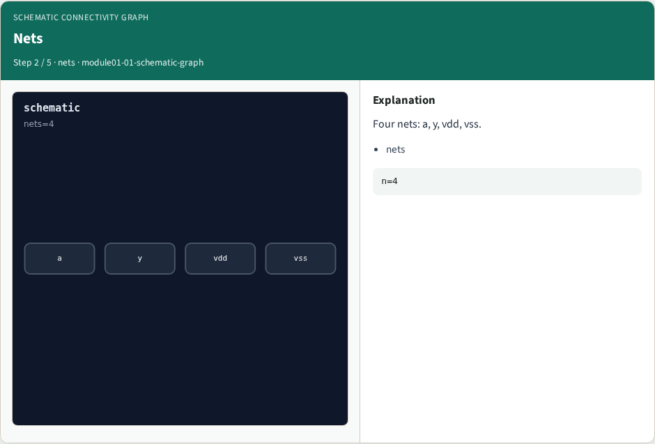
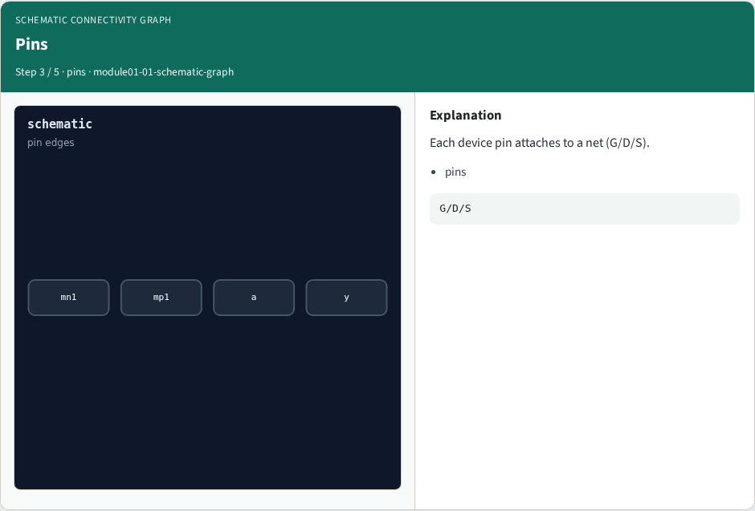
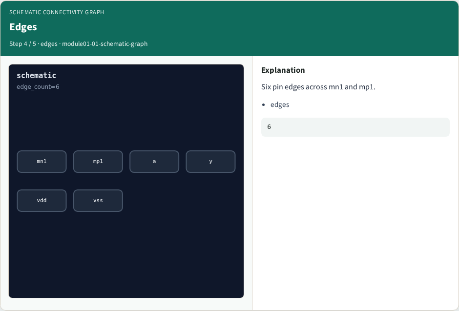
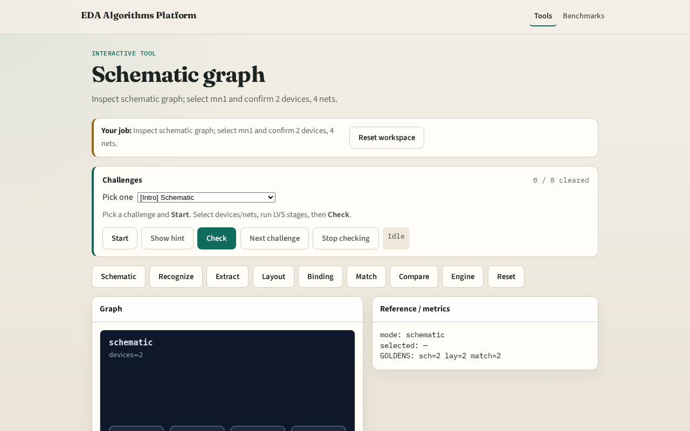

# Schematic connectivity graph

**Module id:** module01-01-schematic-graph
**Lab:** schematic-graph
**Tracks:** A (implement) · B (browser lab)

## Slide 1 — Schematic graph

LVS starts from the schematic — devices, nets, and pin edges before layout extract.

## Slide 2 — The idea

GOLDEN: 2 devices, 4 nets, mn1/mp1.

<!-- algorithm-walkthrough -->

## Slide 3 — Devices

Two schematic devices: mn1 (nmos) and mp1 (pmos).

## Slide 4 — Nets

Four nets: a, y, vdd, vss.

## Slide 5 — Pins

Each device pin attaches to a net (G/D/S).

## Slide 6 — Edges

Six pin edges across mn1 and mp1.

## Slide 7 — Golden

GOLDEN: device_count=2, net_count=4.

<!-- /algorithm-walkthrough -->

## Slide 8 — Browser lab track

Open **schematic-graph**. Inspect tiny_lvs; confirm mn1/mp1 and 4 nets.

## Slide 9 — Implement track

Call schematic_graph(); assert device_count==2 and net_count==4.

## Slide 10 — Pitfalls

Counting layout shapes as schematic devices. Missing supply nets.

## Slide 11 — Your turn

Next: device recognition.
