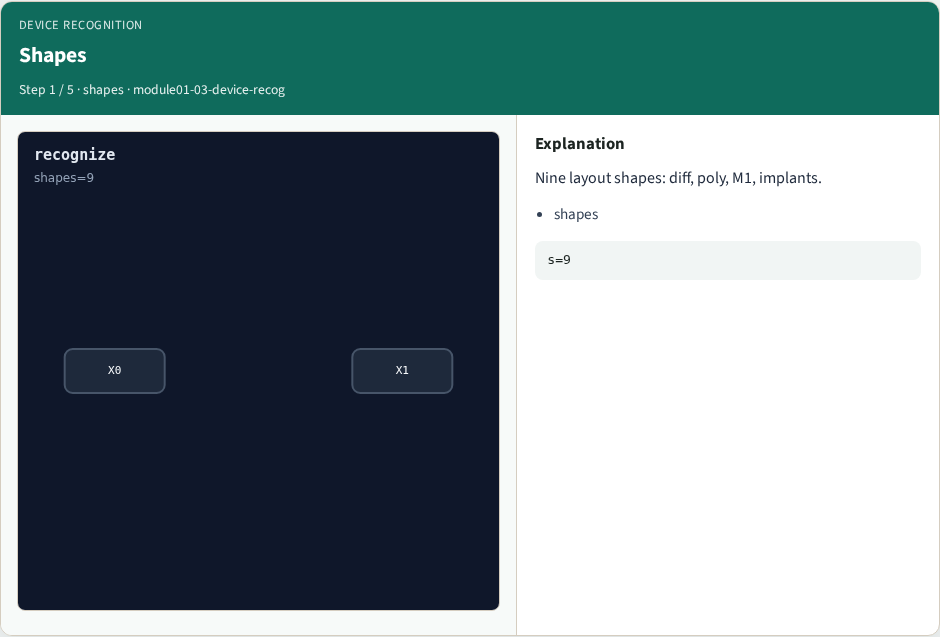
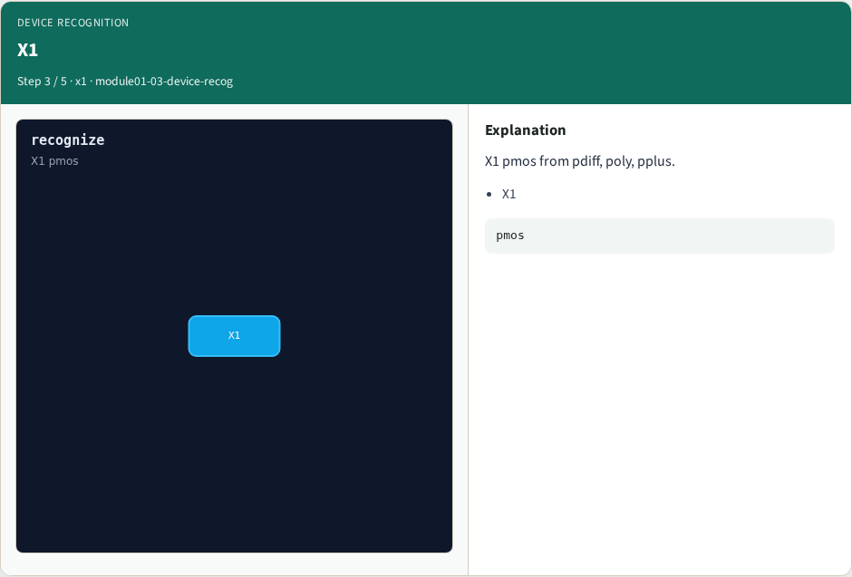
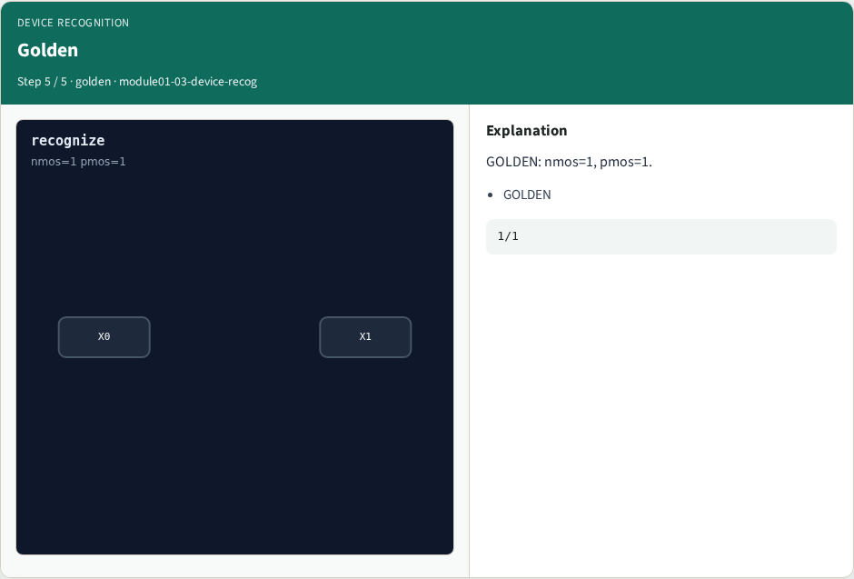
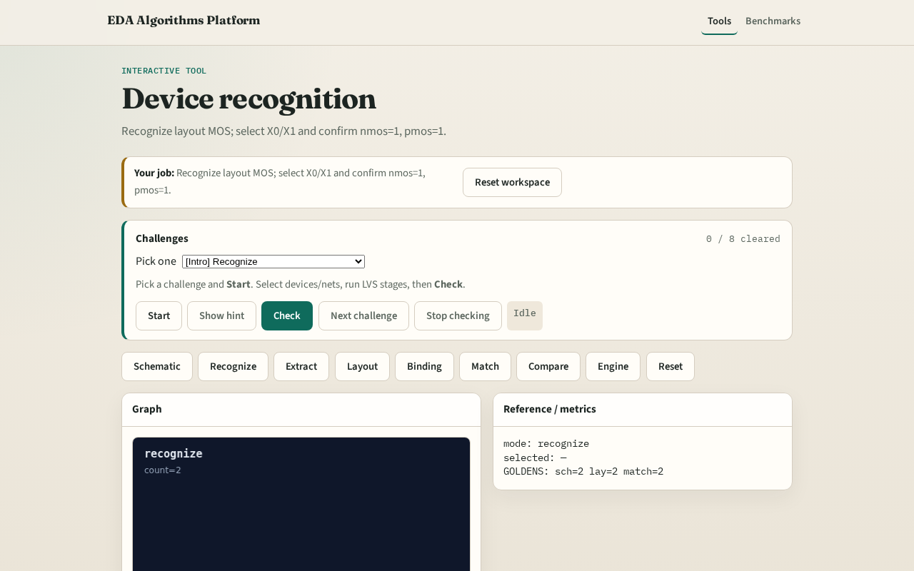

# Device recog

Device recognition maps layout shapes to MOS instances , nmos vs pmos

---

## The idea
- GOLDEN: nmos=1 pmos=1 (X0/X1)

---

## Shapes

---

## X0

---

## X1

---

## Types

---

## Golden

---

## Browser lab track

---

## Implement track
- Call recognize_devices(); assert nmos==1 and pmos==1

---

## Pitfalls
- Counting shapes instead of devices
- Swapping nmos/pmos polarity

---

## Your turn
- Next: net extraction

