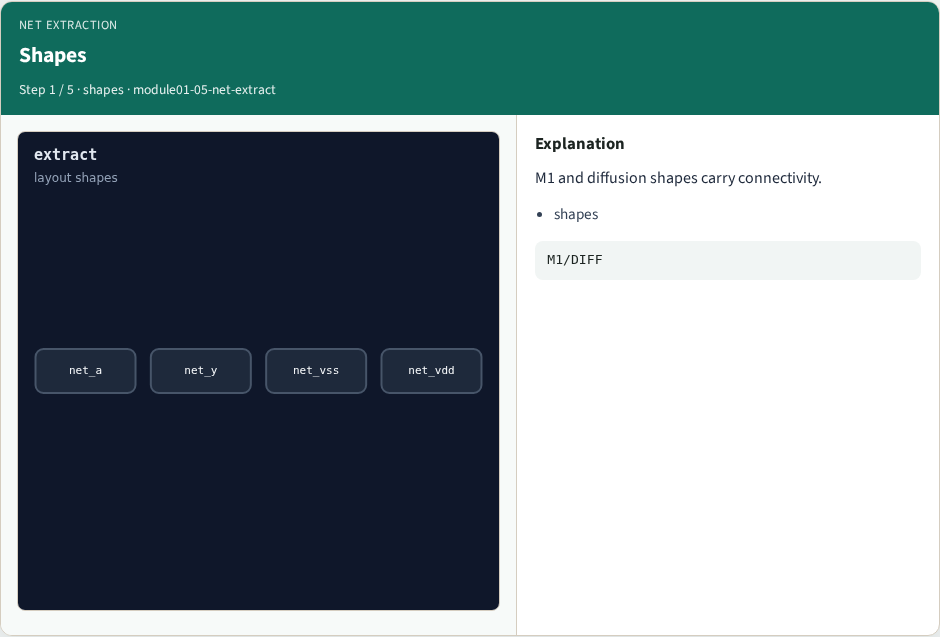
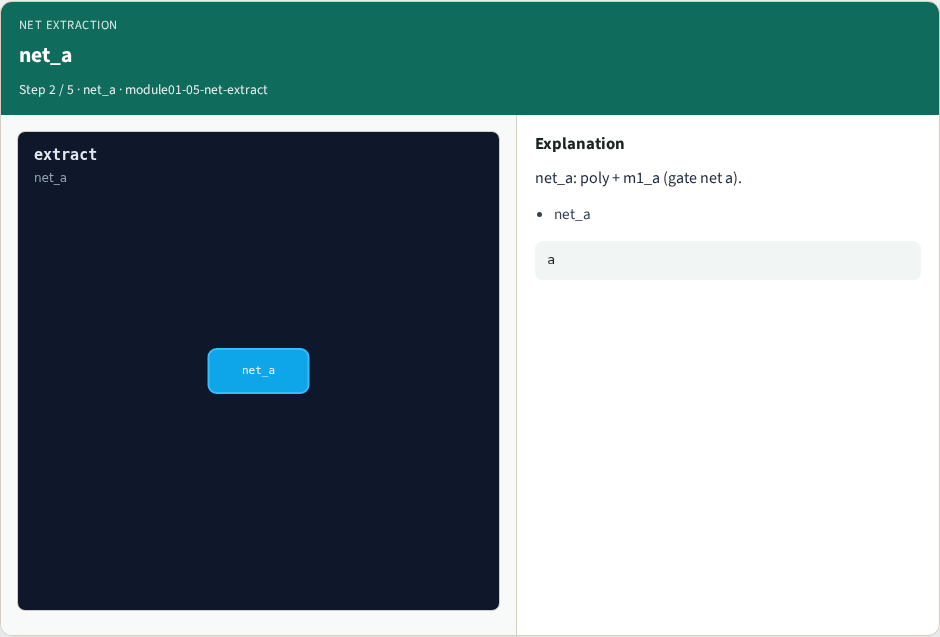
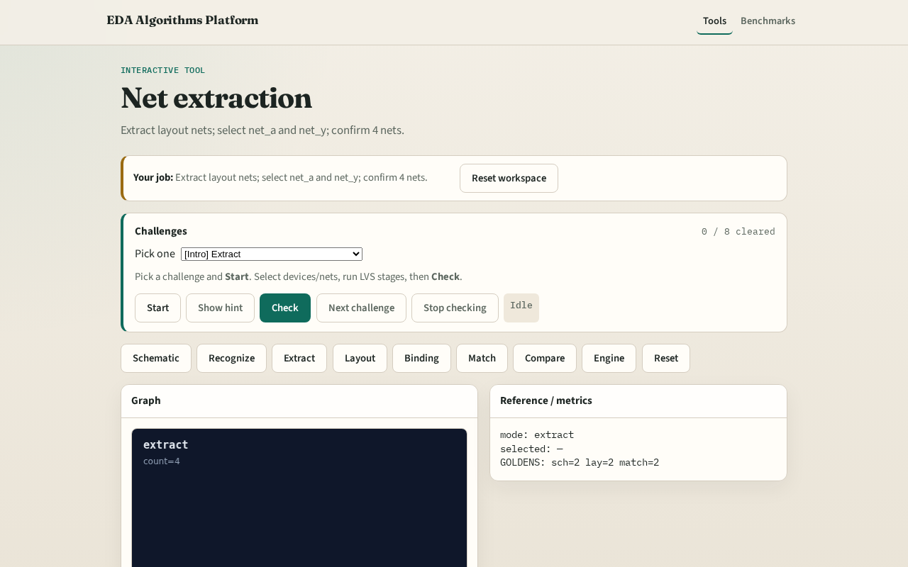

# Net extract

Net extraction groups layout shapes into electrically connected nets

---

## The idea
- GOLDEN: 4 layout nets net_a/y/vss/vdd

---

## Shapes

---

## net_a

---

## net_y

---

## Supplies

---

## Golden

---

## Browser lab track

---

## Implement track
- Call extract_nets(); assert count==4 and ids include net_a, net_y

---

## Pitfalls
- Splitting a net at a via
- Missing port annotation on supplies

---

## Your turn
- Next: layout device–net graph

