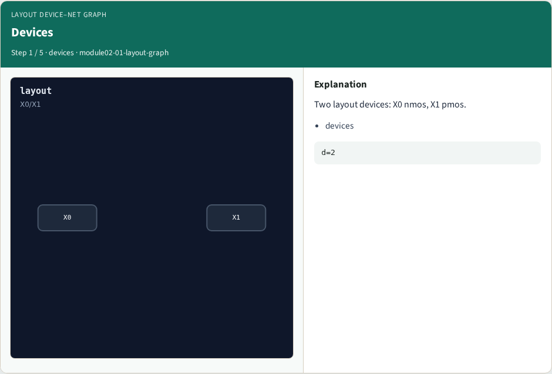
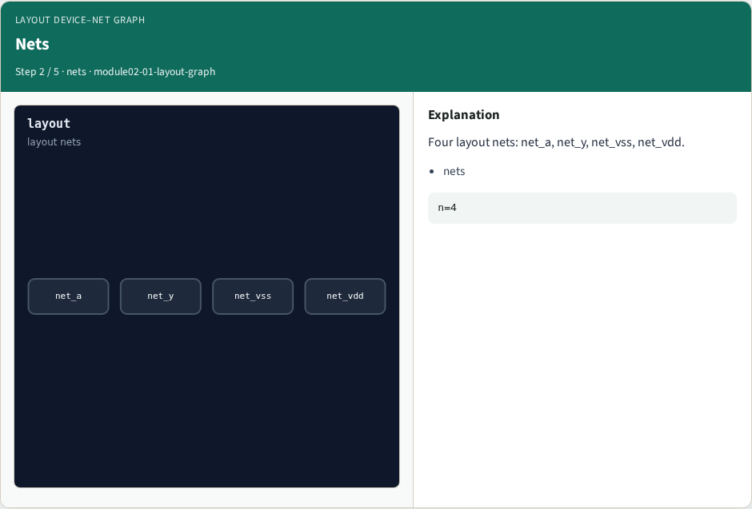
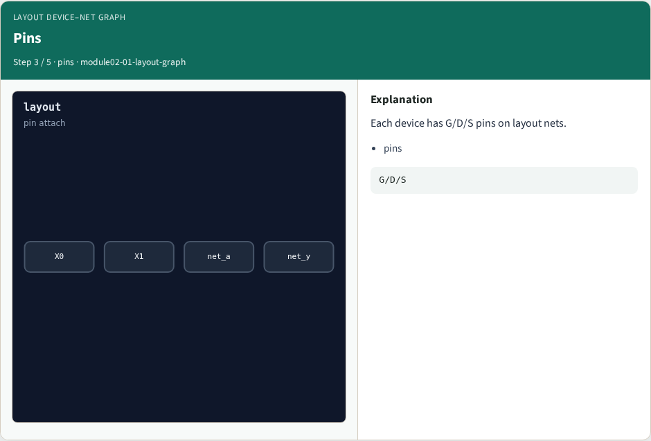
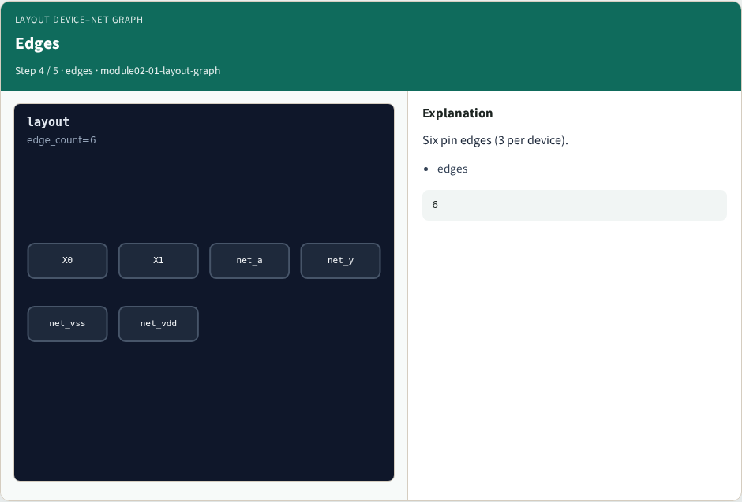
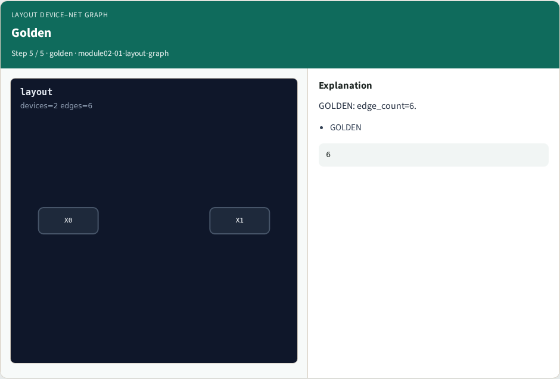
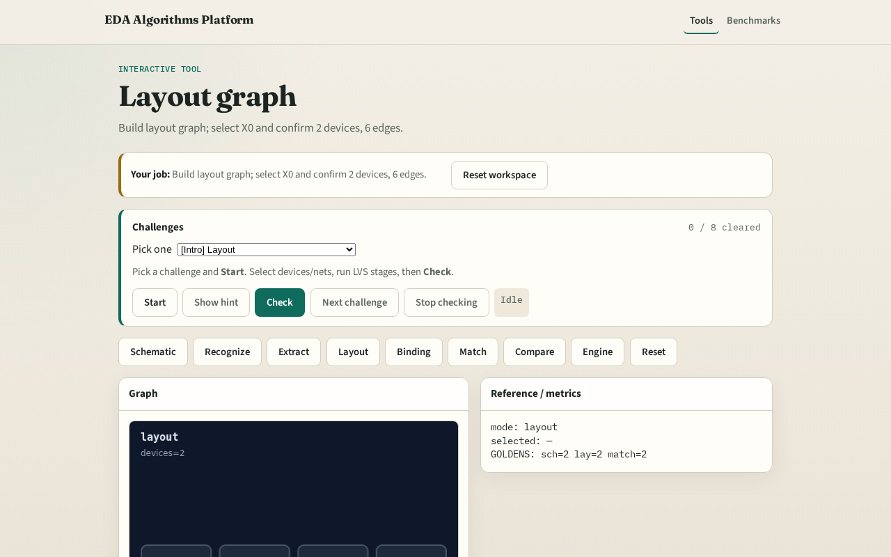

# Layout device–net graph

**Module id:** module02-01-layout-graph
**Lab:** layout-graph
**Tracks:** A (implement) · B (browser lab)

## Slide 1 — Layout graph

Layout graph mirrors schematic — devices X0/X1 with pin-to-net edges.

## Slide 2 — The idea

GOLDEN: 2 devices, 4 nets, 6 edges.

<!-- algorithm-walkthrough -->

## Slide 3 — Devices

Two layout devices: X0 nmos, X1 pmos.

## Slide 4 — Nets

Four layout nets: net_a, net_y, net_vss, net_vdd.

## Slide 5 — Pins

Each device has G/D/S pins on layout nets.

## Slide 6 — Edges

Six pin edges (3 per device).

## Slide 7 — Golden

GOLDEN: edge_count=6.

<!-- /algorithm-walkthrough -->

## Slide 8 — Browser lab track

Open **layout-graph**. Confirm X0/X1 and 6 pin edges.

## Slide 9 — Implement track

Call layout_graph(); assert device_count==2 and edge_count==6.

## Slide 10 — Pitfalls

Using schematic net names on layout graph. Missing a pin edge.

## Slide 11 — Your turn

Next: pin / name binding.
