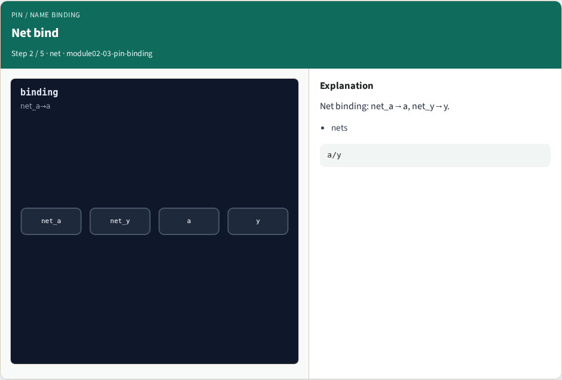

# Pin / name binding — step-by-step (for slides / transcript)

**Module:** `module02-03-pin-binding`  
**Lab / algo:** `pin-binding`  
**Viewer:** `/tools/algorithm-walkthrough/?algo=pin-binding&step=1`

Use each **Caption** as spoken prose (or a shortened slide note).
Use **Bullets** on the PPT; pair with the PNG in `assets/steps/`.

## Step 1 — Dev bind


**Caption (transcript):** Device binding: X0→mn1, X1→mp1.

**Slide bullets:**

- devices

**On-screen metrics:**

```
2
```

## Step 2 — Net bind



**Caption (transcript):** Net binding: net_a→a, net_y→y.

**Slide bullets:**

- nets

**On-screen metrics:**

```
a/y
```

## Step 3 — Supplies


**Caption (transcript):** net_vss→vss, net_vdd→vdd.

**Slide bullets:**

- supplies

**On-screen metrics:**

```
vss/vdd
```

## Step 4 — Pairs


**Caption (transcript):** Four net pairs and two device pairs.

**Slide bullets:**

- pairs

**On-screen metrics:**

```
4/2
```

## Step 5 — Golden


**Caption (transcript):** GOLDEN: device_count=2, net_count=4.

**Slide bullets:**

- GOLDEN

**On-screen metrics:**

```
2/4
```

