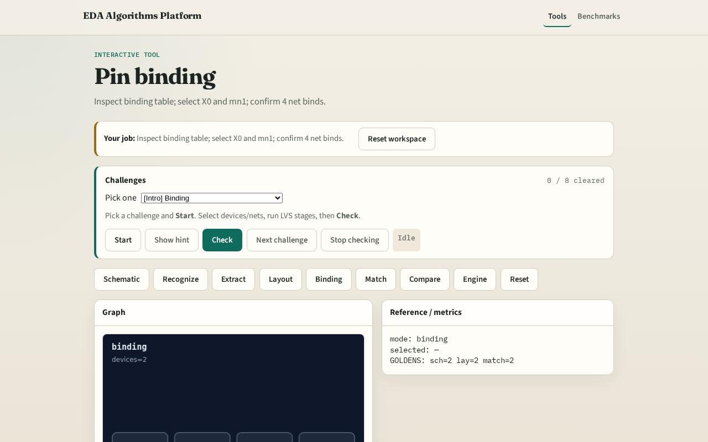

# Pin binding

Binding table maps layout X0→mn1 and layout nets to schematic ports

---

## The idea
- GOLDEN: X0→mn1, X1→mp1; 4 net binds

---

## Dev bind

---

## Net bind

---

## Supplies

---

## Pairs

---

## Golden

---

## Browser lab track

---

## Implement track
- Call pin_binding(); assert devices['X0']=='mn1' and len(nets)==4

---

## Pitfalls
- Binding by position instead of connectivity
- Missing a supply bind

---

## Your turn
- Next: device matching

