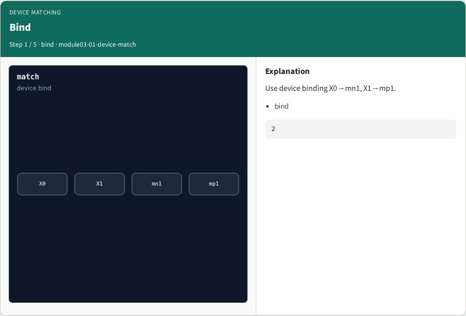
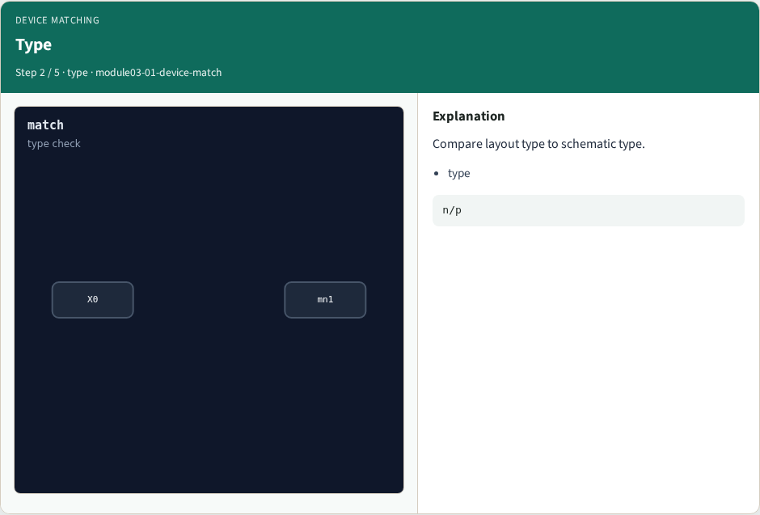
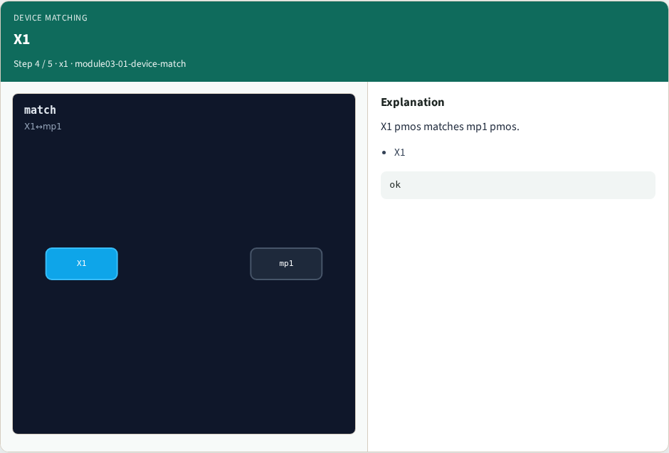
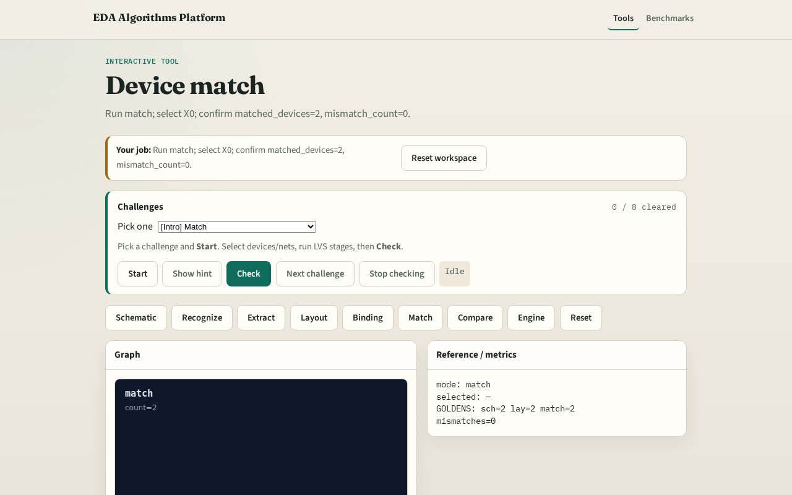

# Device match

Device match checks binding plus type agreement (nmos↔nmos)

---

## The idea
- GOLDEN: matched_devices=2

---

## Bind

---

## Type

---

## X0

---

## X1

---

## Golden

---

## Browser lab track

---

## Implement track
- Call match_devices(); assert count==2 and mismatch_count==0

---

## Pitfalls
- Matching by name only without type check
- Skipping unbound devices

---

## Your turn
- Next: LVS graph compare

