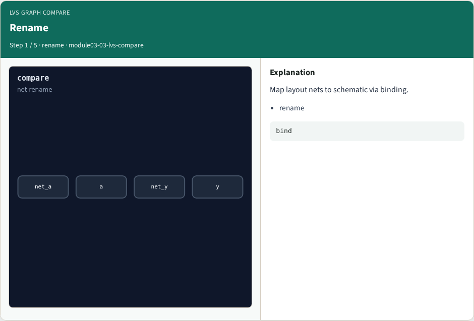
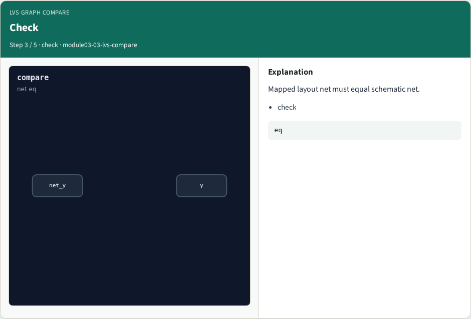
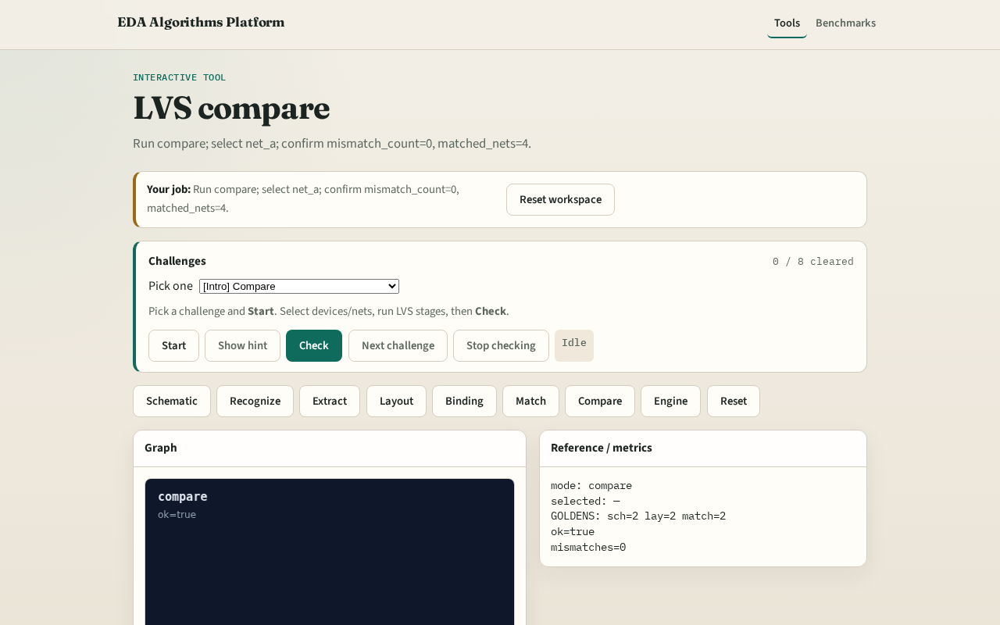

# LVS graph compare

**Module id:** module03-03-lvs-compare
**Lab:** lvs-compare
**Tracks:** A (implement) · B (browser lab)

## Slide 1 — LVS compare

LVS compare checks every pin net after rename — mismatch_count must be zero.

## Slide 2 — The idea

GOLDEN: mismatch_count=0, matched_nets=4.

<!-- algorithm-walkthrough -->

## Slide 3 — Rename

Map layout nets to schematic via binding.

## Slide 4 — Pins

Walk each device pin on both sides.

## Slide 5 — Check

Mapped layout net must equal schematic net.

## Slide 6 — Nets

All four bound nets match.

## Slide 7 — Golden

GOLDEN: mismatch_count=0, matched_nets=4.

<!-- /algorithm-walkthrough -->

## Slide 8 — Browser lab track

Open **lvs-compare**. Run compare; confirm ok and 4 matched nets.

## Slide 9 — Implement track

Call lvs_compare(); assert ok and matched_net_count==4.

## Slide 10 — Pitfalls

Comparing unbound nets. Ignoring pin direction mismatches as net errors.

## Slide 11 — Your turn

Next: LVS engine integration.
