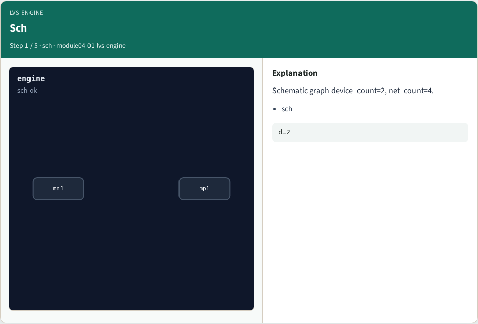
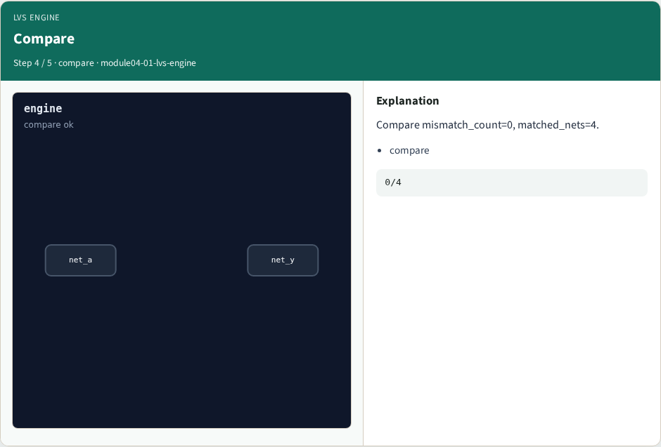
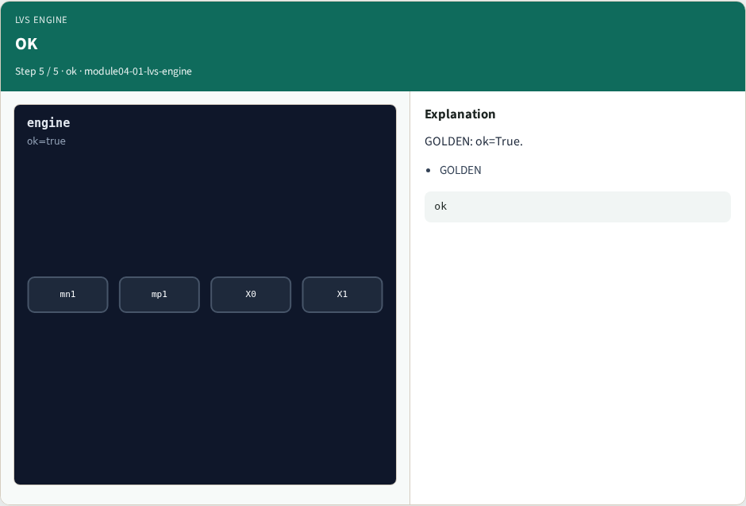

# LVS engine pass — step-by-step (for slides / transcript)

**Module:** `module04-01-lvs-engine`  
**Lab / algo:** `lvs-engine`  
**Viewer:** `/tools/algorithm-walkthrough/?algo=lvs-engine&step=1`

Use each **Caption** as spoken prose (or a shortened slide note).
Use **Bullets** on the PPT; pair with the PNG in `assets/steps/`.

## Step 1 — Sch



**Caption (transcript):** Schematic graph device_count=2, net_count=4.

**Slide bullets:**

- sch

**On-screen metrics:**

```
d=2
```

## Step 2 — Recog


**Caption (transcript):** Recognize nmos=1, pmos=1.

**Slide bullets:**

- recog

**On-screen metrics:**

```
1/1
```

## Step 3 — Extract


**Caption (transcript):** Extract 4 layout nets.

**Slide bullets:**

- extract

**On-screen metrics:**

```
n=4
```

## Step 4 — Compare



**Caption (transcript):** Compare mismatch_count=0, matched_nets=4.

**Slide bullets:**

- compare

**On-screen metrics:**

```
0/4
```

## Step 5 — OK



**Caption (transcript):** GOLDEN: ok=True.

**Slide bullets:**

- GOLDEN

**On-screen metrics:**

```
ok
```

