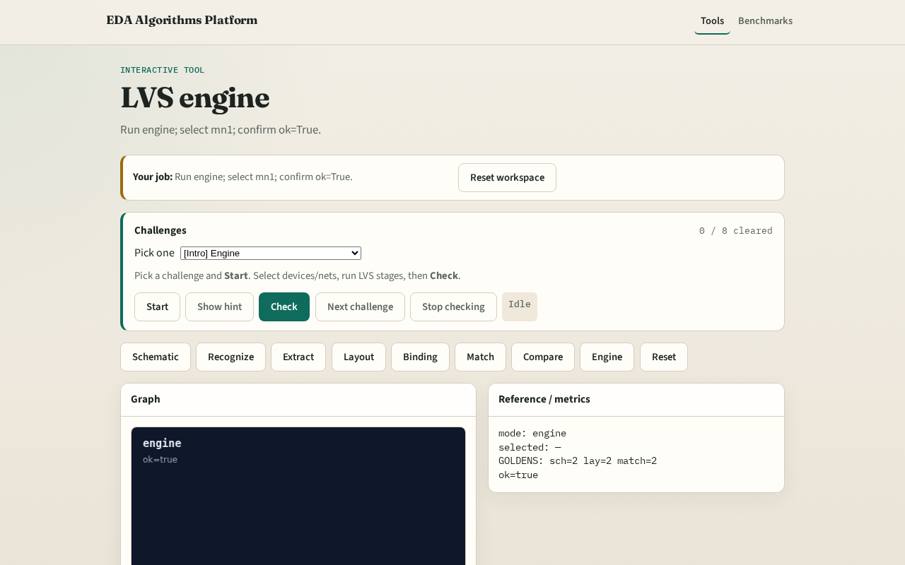

# Engine

A tiny engine chains every LVS stage and reports ok when goldens match

---

## The idea
- GOLDEN: ok=True

---

## Sch

---

## Recog

---

## Extract

---

## Compare

---

## OK

---

## Browser lab track

---

## Implement track
- Call lvs_engine(); assert ok is True

---

## Pitfalls
- Reporting partial stages
- Changing toy without updating goldens

---

## Your turn
- Next: offline compare, then wrap

