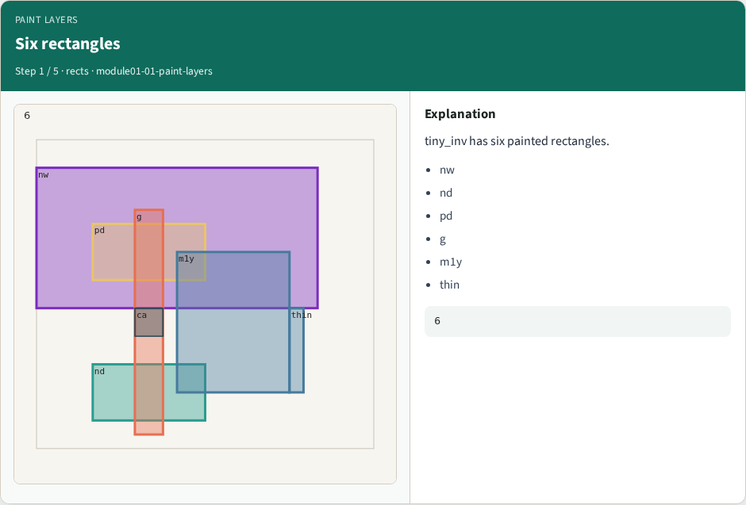
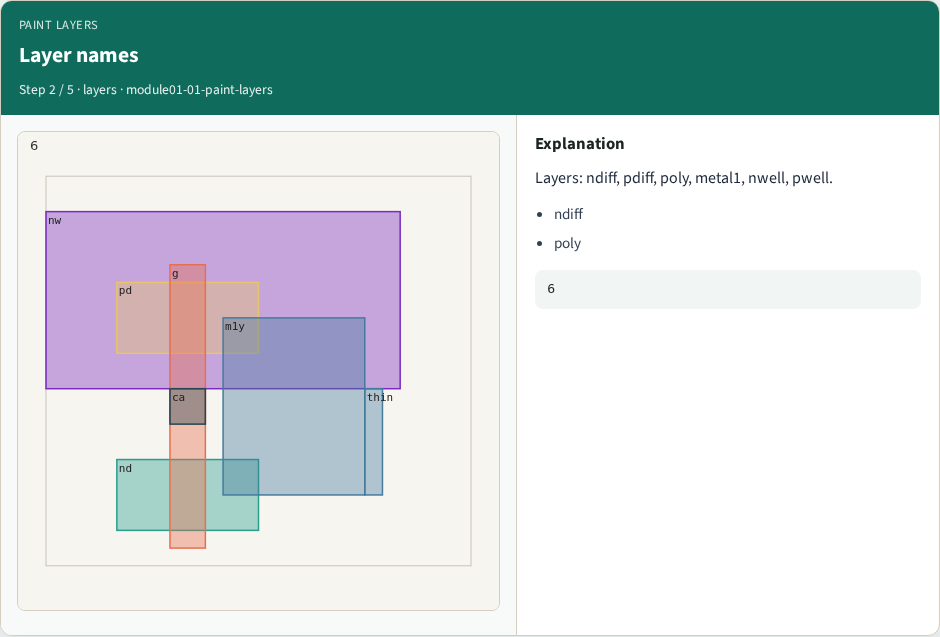
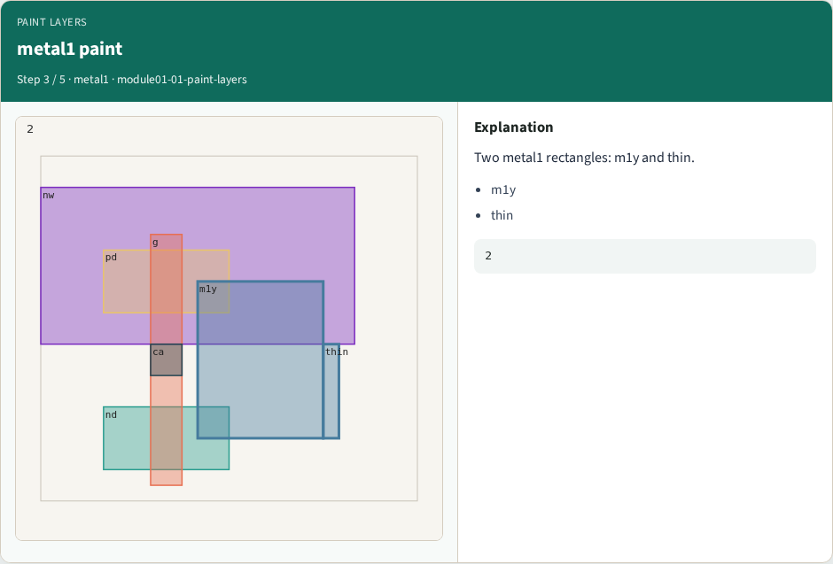
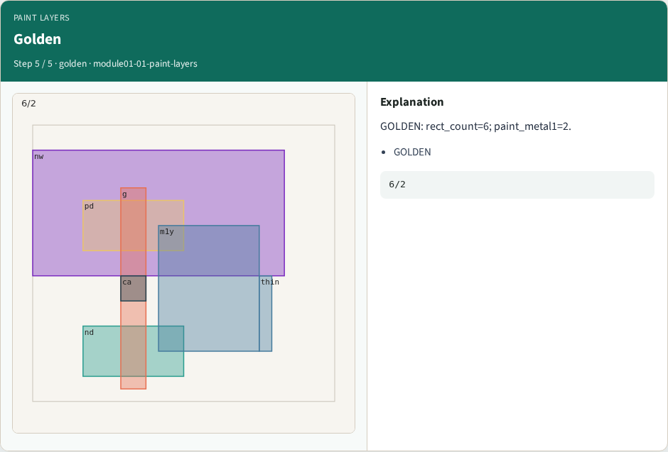

# Paint layers — step-by-step (for slides / transcript)

**Module:** `module01-01-paint-layers`  
**Lab / algo:** `paint-layers`  
**Viewer:** `/tools/algorithm-walkthrough/?algo=paint-layers&step=1`

Use each **Caption** as spoken prose (or a shortened slide note).
Use **Bullets** on the PPT; pair with the PNG in `assets/steps/`.

## Step 1 — Six rectangles



**Caption (transcript):** tiny_inv has six painted rectangles.

**Slide bullets:**

- nw
- nd
- pd
- g
- m1y
- thin

**On-screen metrics:**

```
6
```

## Step 2 — Layer names



**Caption (transcript):** Layers: ndiff, pdiff, poly, metal1, nwell, pwell.

**Slide bullets:**

- ndiff
- poly

**On-screen metrics:**

```
6
```

## Step 3 — metal1 paint



**Caption (transcript):** Two metal1 rectangles: m1y and thin.

**Slide bullets:**

- m1y
- thin

**On-screen metrics:**

```
2
```

## Step 4 — Paint command


**Caption (transcript):** Magic paint places rects on the active layer.

**Slide bullets:**

- paint

**On-screen metrics:**

```
map
```

## Step 5 — Golden



**Caption (transcript):** GOLDEN: rect_count=6; paint_metal1=2.

**Slide bullets:**

- GOLDEN

**On-screen metrics:**

```
6/2
```

