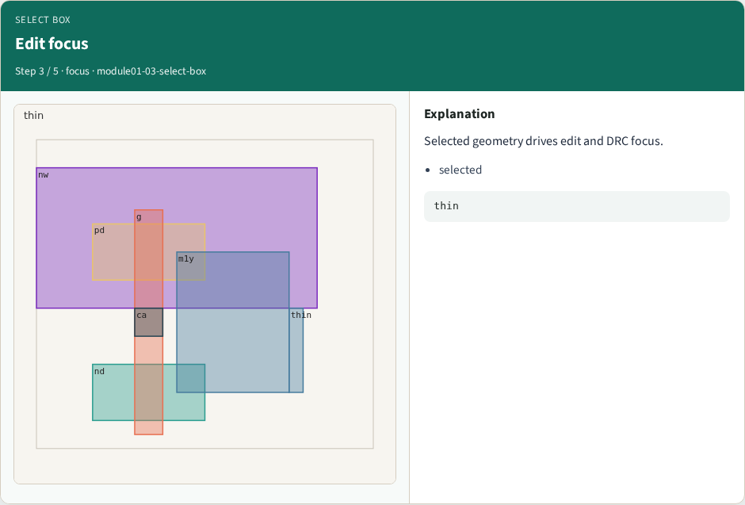
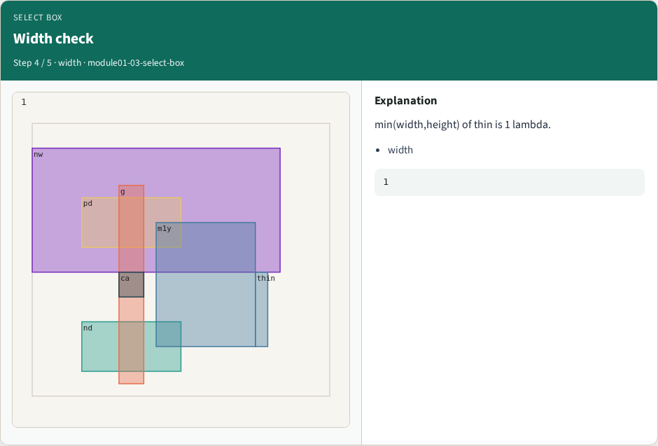
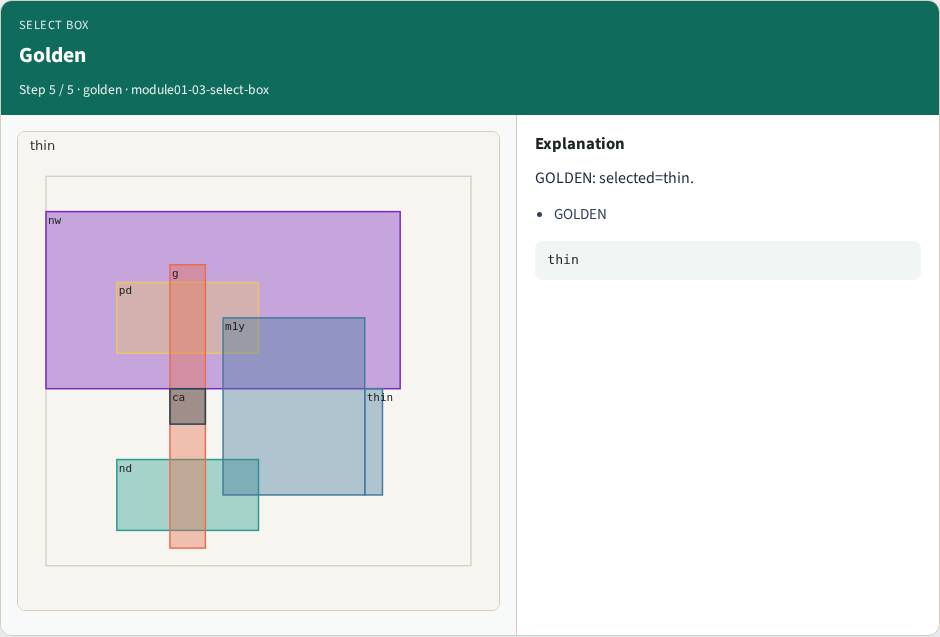

# Select box — step-by-step (for slides / transcript)

**Module:** `module01-03-select-box`  
**Lab / algo:** `select-box`  
**Viewer:** `/tools/algorithm-walkthrough/?algo=select-box&step=1`

Use each **Caption** as spoken prose (or a shortened slide note).
Use **Bullets** on the PPT; pair with the PNG in `assets/steps/`.

## Step 1 — Box select


**Caption (transcript):** Magic box + select picks one shape.

**Slide bullets:**

- box

**On-screen metrics:**

```
select
```

## Step 2 — thin shape


**Caption (transcript):** The thin metal1 rect has width 1.

**Slide bullets:**

- thin

**On-screen metrics:**

```
1
```

## Step 3 — Edit focus



**Caption (transcript):** Selected geometry drives edit and DRC focus.

**Slide bullets:**

- selected

**On-screen metrics:**

```
thin
```

## Step 4 — Width check



**Caption (transcript):** min(width,height) of thin is 1 lambda.

**Slide bullets:**

- width

**On-screen metrics:**

```
1
```

## Step 5 — Golden



**Caption (transcript):** GOLDEN: selected=thin.

**Slide bullets:**

- GOLDEN

**On-screen metrics:**

```
thin
```

