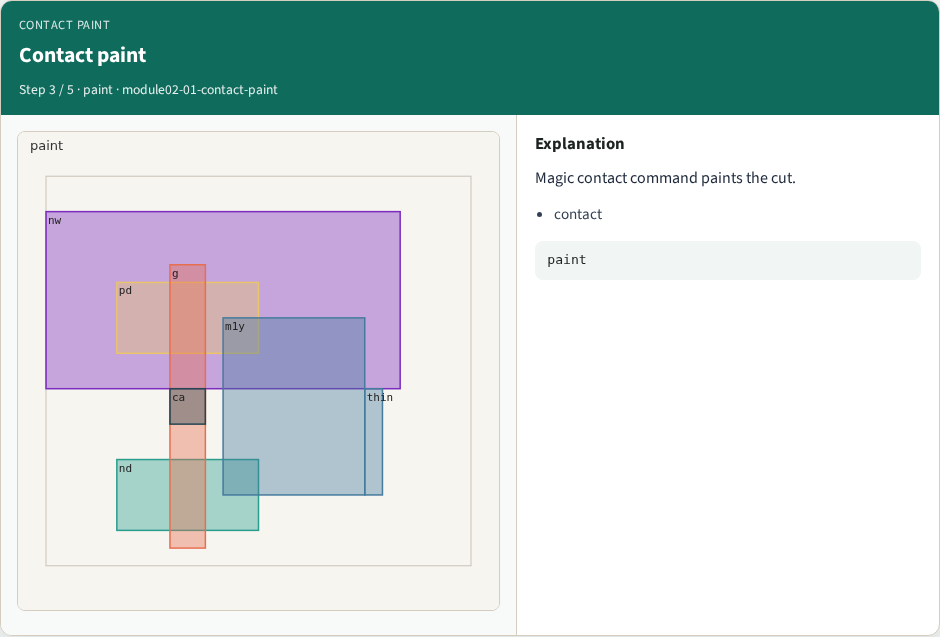
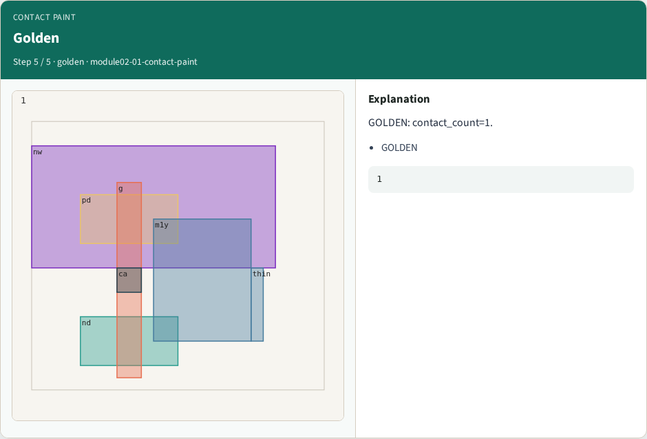

# Contact paint — step-by-step (for slides / transcript)

**Module:** `module02-01-contact-paint`  
**Lab / algo:** `contact-paint`  
**Viewer:** `/tools/algorithm-walkthrough/?algo=contact-paint&step=1`

Use each **Caption** as spoken prose (or a shortened slide note).
Use **Bullets** on the PPT; pair with the PNG in `assets/steps/`.

## Step 1 — Contact ca


**Caption (transcript):** One contact between poly and metal1.

**Slide bullets:**

- ca

**On-screen metrics:**

```
1
```

## Step 2 — Between layers


**Caption (transcript):** Contact bridges poly (g) and metal1 (m1y).

**Slide bullets:**

- g
- m1y

**On-screen metrics:**

```
bridge
```

## Step 3 — Contact paint



**Caption (transcript):** Magic contact command paints the cut.

**Slide bullets:**

- contact

**On-screen metrics:**

```
paint
```

## Step 4 — Highlight


**Caption (transcript):** Contact + gate + m1y highlighted.

**Slide bullets:**

- ca
- g

**On-screen metrics:**

```
3
```

## Step 5 — Golden



**Caption (transcript):** GOLDEN: contact_count=1.

**Slide bullets:**

- GOLDEN

**On-screen metrics:**

```
1
```

