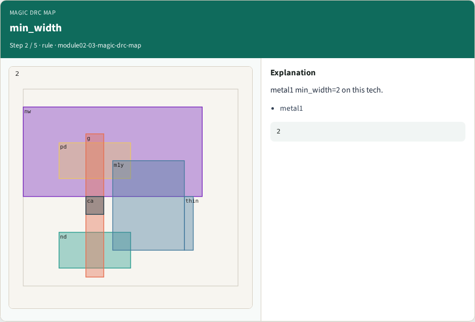
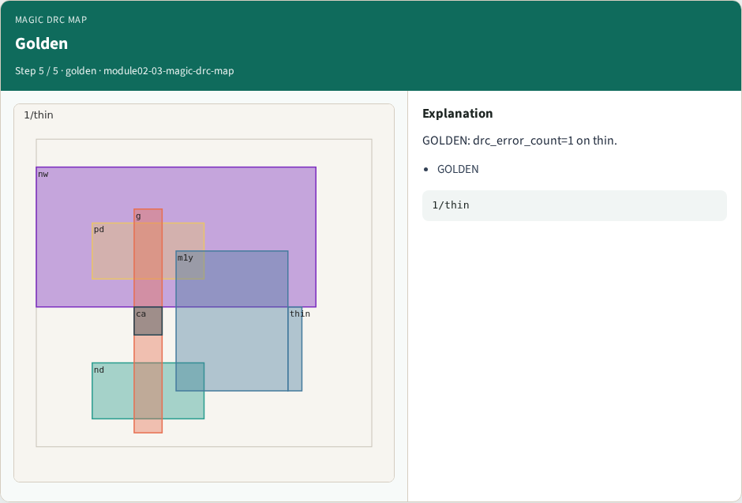

# Why Magic

Run DRC width check; find violation on thin metal1

---

## The idea
- GOLDEN: drc_error_count=1 on thin

---

## drc check


---

## min_width


---

## Violation


---

## Error count


---

## Golden


---

## Browser lab track
- Open **magic-drc-map**
- Run the stage buttons and Check the goldens

---

## Implement track
- From common/, run solvers.py and confirm MAGIC_PARTA_OK

---

## Pitfalls
- Mixing KLayout viewer shortcuts with Magic paint commands
- Forgetting min_width when reading DRC errors

---

## Try these
- From the common folder, run the Magic map self-test

---

## Try these — try these

```
cd courses/learn_magic/common
python3 solvers.py
```

---

## Pseudocode
- Here is the check in plain steps

---

## Pseudocode — try these

```
drc_error_count=1 on thin.
ok if goldens match
```

---

## Next
- Complete the quiz for this part
- Continue the Magic Part A map, then the real CLI track

