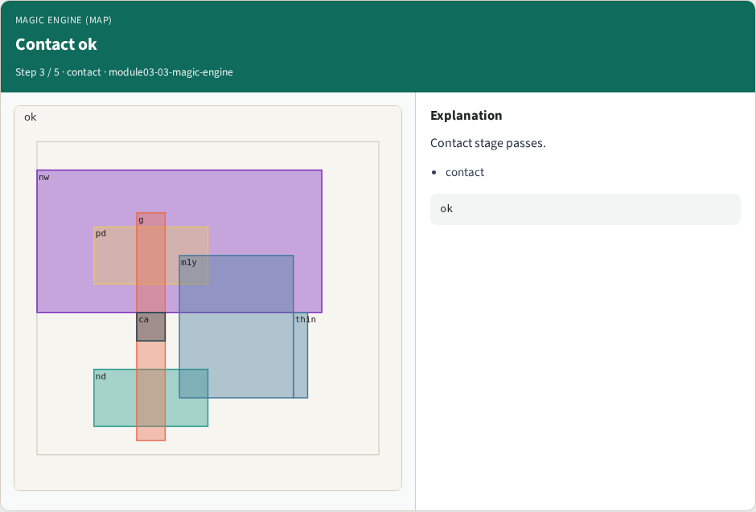
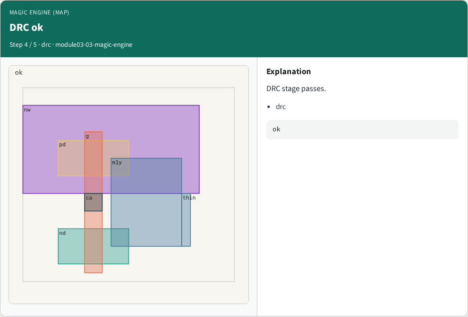
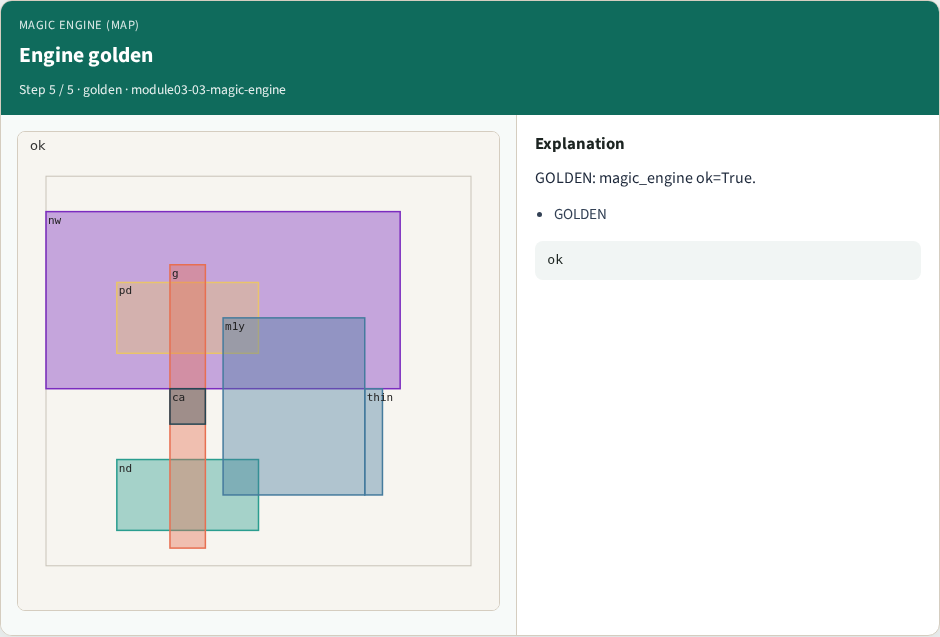

# Magic engine (map) — step-by-step (for slides / transcript)

**Module:** `module03-03-magic-engine`  
**Lab / algo:** `magic-engine`  
**Viewer:** `/tools/algorithm-walkthrough/?algo=magic-engine&step=1`

Use each **Caption** as spoken prose (or a shortened slide note).
Use **Bullets** on the PPT; pair with the PNG in `assets/steps/`.

## Step 1 — Paint ok


**Caption (transcript):** Paint layers stage passes.

**Slide bullets:**

- paint

**On-screen metrics:**

```
ok
```

## Step 2 — Select ok


**Caption (transcript):** Select box stage passes.

**Slide bullets:**

- select

**On-screen metrics:**

```
ok
```

## Step 3 — Contact ok



**Caption (transcript):** Contact stage passes.

**Slide bullets:**

- contact

**On-screen metrics:**

```
ok
```

## Step 4 — DRC ok



**Caption (transcript):** DRC stage passes.

**Slide bullets:**

- drc

**On-screen metrics:**

```
ok
```

## Step 5 — Engine golden



**Caption (transcript):** GOLDEN: magic_engine ok=True.

**Slide bullets:**

- GOLDEN

**On-screen metrics:**

```
ok
```

