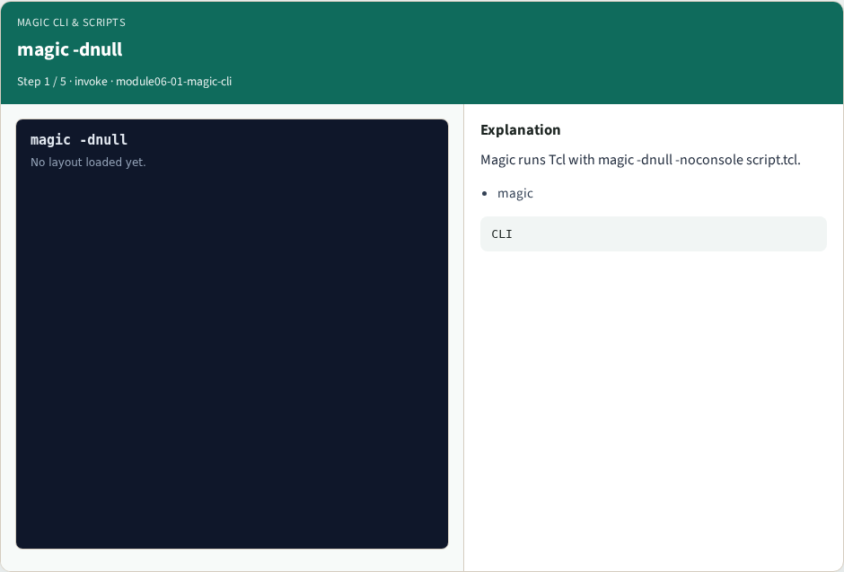
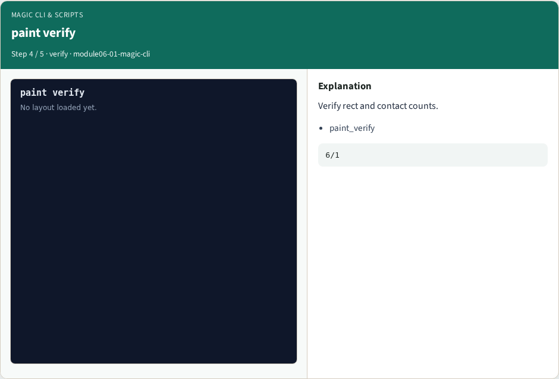
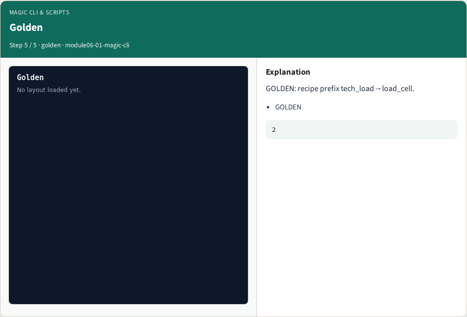

# Why real Magic

Invoke magic -dnull -noconsole script.tcl; recipe starts tech_load→load_cell

---

## The idea
- GOLDEN: First two cmds: tech_load, load_cell

---

## magic -dnull


---

## tech load


---

## load cell


---

## paint verify


---

## Golden


---

## Browser lab track
- Open **magic-cli**
- Build the Magic recipe or open evidence stages, then Check

---

## Implement track
- From common/, run real_solvers.py and confirm REAL_MAGIC_OK

---

## Pitfalls
- Editing goldens by hand without re-running scripts
- Confusing Part A map JSON with checked-in logs

---

## Try these
- From the common folder, run the real Magic self-test

---

## Try these — try these

```
cd courses/learn_magic/common
python3 real_solvers.py
```

---

## Pseudocode
- Here is the check in plain steps

---

## Pseudocode — try these

```
First two cmds: tech_load, load_cell.
ok if goldens match
```

---

## Next
- Complete the quiz for this part
- Continue the Part B evidence track, then algorithms and internals

