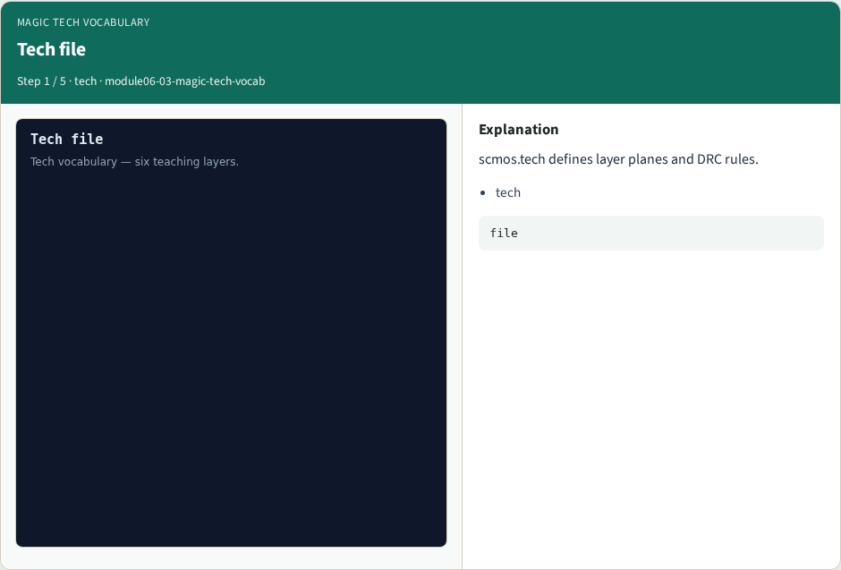
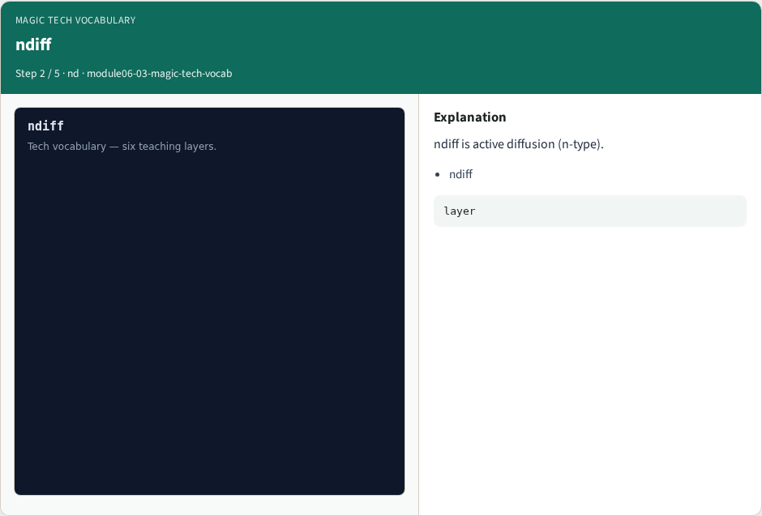
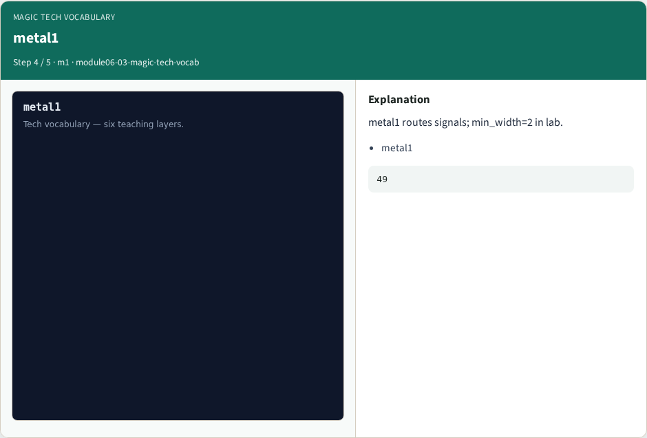
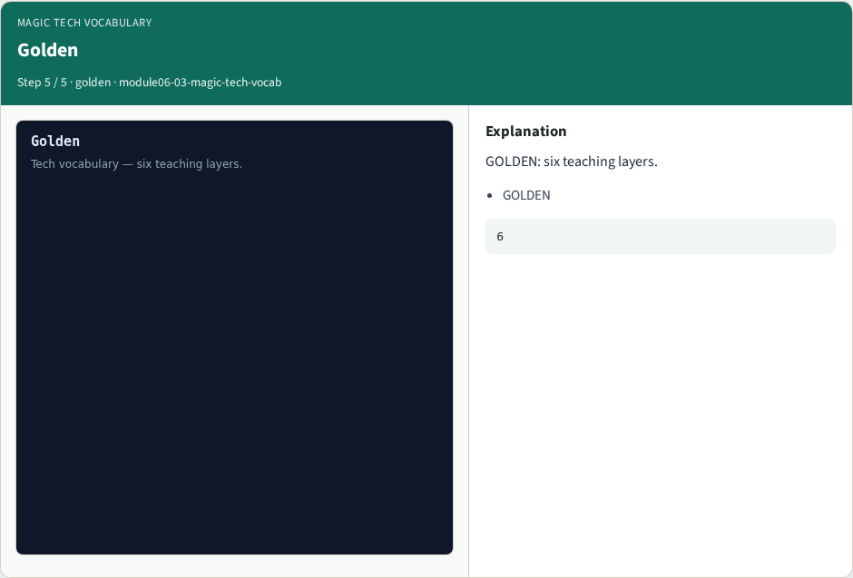

# Magic tech vocabulary

**Module id:** module06-03-magic-tech-vocab
**Lab:** magic-tech-vocab
**Tracks:** A (implement) · B (browser lab)

## Slide 1 — Why real Magic

Name the six teaching layers in scmos.tech.

## Slide 2 — The idea

GOLDEN: Layers ndiff,pdiff,poly,metal1,nwell,contact; count=6.

<!-- algorithm-walkthrough -->

## Slide 3 — Tech file



scmos.tech defines layer planes and DRC rules.

## Slide 4 — ndiff



ndiff is active diffusion (n-type).

## Slide 5 — poly


poly is the gate layer.

## Slide 6 — metal1



metal1 routes signals; min_width=2 in lab.

## Slide 7 — Golden



GOLDEN: six teaching layers.

<!-- /algorithm-walkthrough -->


## Slide 8 — Browser lab track

Open **magic-tech-vocab**. Build the Magic recipe or open evidence stages, then Check.

## Slide 9 — Implement track

From common/, run real_solvers.py and confirm REAL_MAGIC_OK.

## Slide 10 — Pitfalls

Editing goldens by hand without re-running scripts. Confusing Part A map JSON with checked-in logs.

## Slide 11 — Try these

From the common folder, run the real Magic self-test.

```bash
cd courses/learn_magic/common
python3 real_solvers.py
```

## Slide 12 — Pseudocode

Here is the check in plain steps.

```text
Layers ndiff,pdiff,poly,metal1,nwell,contact; count=6.
ok if goldens match
```

## Slide 13 — Next

Continue the Part B evidence track, then algorithms and internals.
