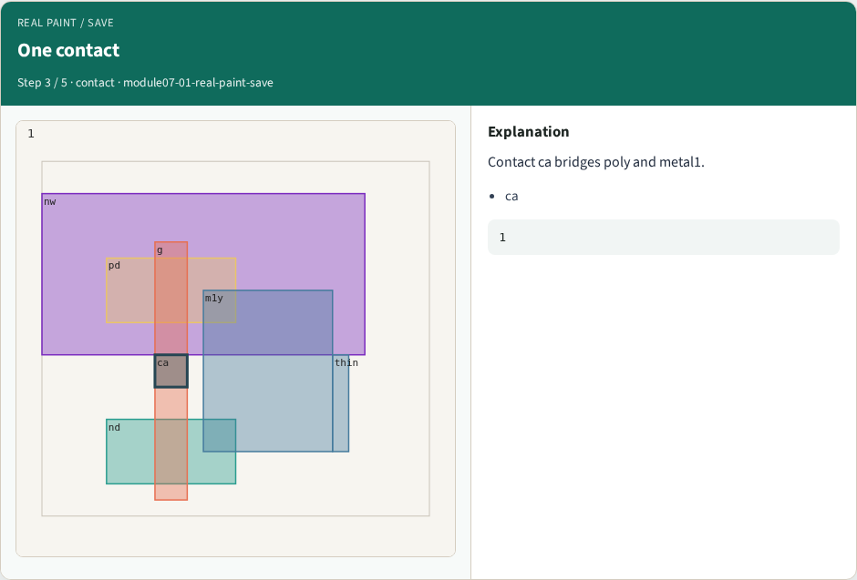
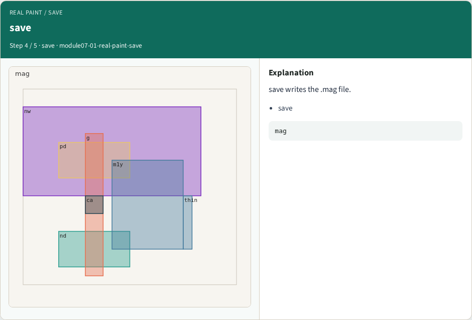
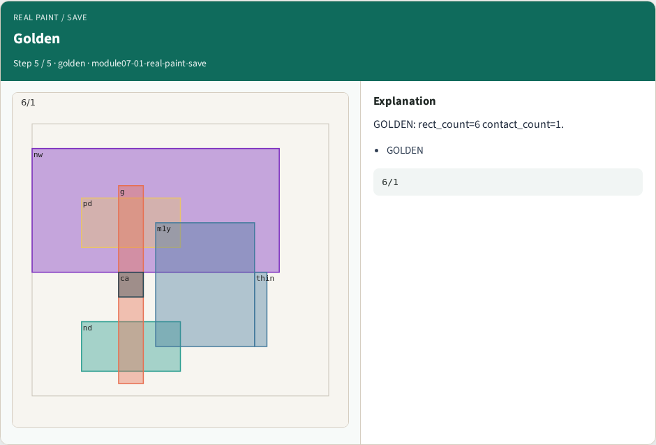

# Real paint / save — step-by-step (for slides / transcript)

**Module:** `module07-01-real-paint-save`  
**Lab / algo:** `real-paint-save`  
**Viewer:** `/tools/algorithm-walkthrough/?algo=real-paint-save&step=1`

Use each **Caption** as spoken prose (or a shortened slide note).
Use **Bullets** on the PPT; pair with the PNG in `assets/steps/`.

## Step 1 — tiny_inv


**Caption (transcript):** Load cell tiny_inv from layouts/.

**Slide bullets:**

- tiny_inv

**On-screen metrics:**

```
cell
```

## Step 2 — Six rects


**Caption (transcript):** Paint verify counts six rectangles.

**Slide bullets:**

- rects

**On-screen metrics:**

```
6
```

## Step 3 — One contact



**Caption (transcript):** Contact ca bridges poly and metal1.

**Slide bullets:**

- ca

**On-screen metrics:**

```
1
```

## Step 4 — save



**Caption (transcript):** save writes the .mag file.

**Slide bullets:**

- save

**On-screen metrics:**

```
mag
```

## Step 5 — Golden



**Caption (transcript):** GOLDEN: rect_count=6 contact_count=1.

**Slide bullets:**

- GOLDEN

**On-screen metrics:**

```
6/1
```

