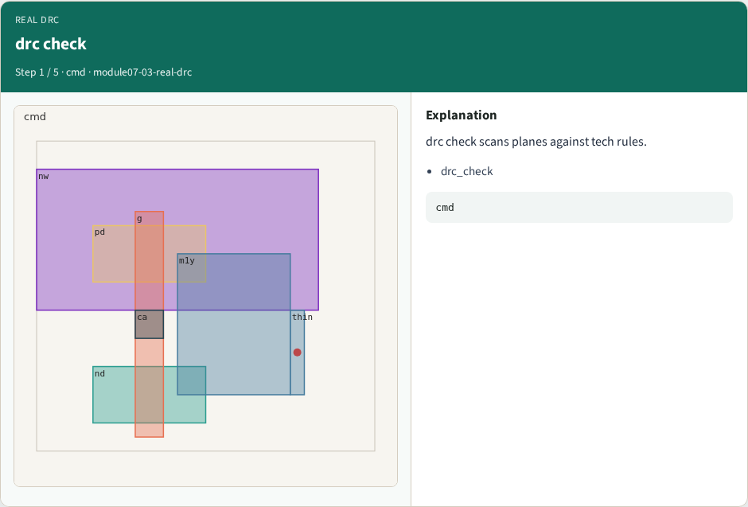
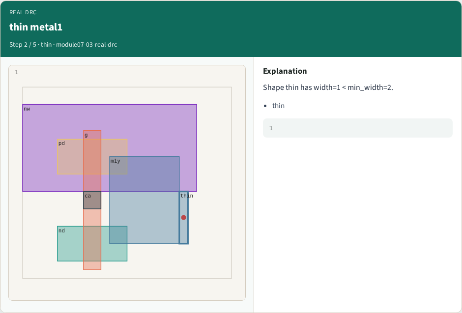

# Real DRC — step-by-step (for slides / transcript)

**Module:** `module07-03-real-drc`  
**Lab / algo:** `real-drc`  
**Viewer:** `/tools/algorithm-walkthrough/?algo=real-drc&step=1`

Use each **Caption** as spoken prose (or a shortened slide note).
Use **Bullets** on the PPT; pair with the PNG in `assets/steps/`.

## Step 1 — drc check



**Caption (transcript):** drc check scans planes against tech rules.

**Slide bullets:**

- drc_check

**On-screen metrics:**

```
cmd
```

## Step 2 — thin metal1



**Caption (transcript):** Shape thin has width=1 < min_width=2.

**Slide bullets:**

- thin

**On-screen metrics:**

```
1
```

## Step 3 — metal1


**Caption (transcript):** Violation is on metal1.

**Slide bullets:**

- metal1

**On-screen metrics:**

```
layer
```

## Step 4 — One error


**Caption (transcript):** Teaching log reports DRC_ERRORS=1.

**Slide bullets:**

- DRC

**On-screen metrics:**

```
1
```

## Step 5 — Golden


**Caption (transcript):** GOLDEN: drc_error_count=1 on thin.

**Slide bullets:**

- GOLDEN

**On-screen metrics:**

```
1
```

