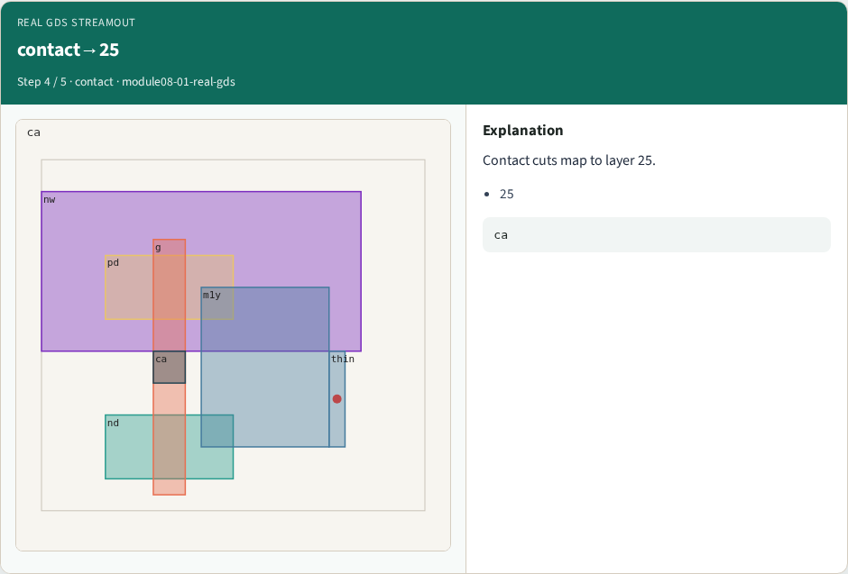

# Real GDS streamout

**Module id:** module08-01-real-gds
**Lab:** real-gds
**Tracks:** A (implement) · B (browser lab)

## Slide 1 — Why real Magic

gds write and read layer map from log.

## Slide 2 — The idea

GOLDEN: gds_layer_count=6; metal1→49.

<!-- algorithm-walkthrough -->

## Slide 3 — gds write


gds write streams layout to GDSII.

## Slide 4 — Six layers


GDS map covers six layer types.

## Slide 5 — metal1→49


metal1 maps to GDS layer 49.

## Slide 6 — contact→25



Contact cuts map to layer 25.

## Slide 7 — Golden


GOLDEN: gds_layer_count=6.

<!-- /algorithm-walkthrough -->


## Slide 8 — Browser lab track

Open **real-gds**. Build the Magic recipe or open evidence stages, then Check.

## Slide 9 — Implement track

From common/, run real_solvers.py and confirm REAL_MAGIC_OK.

## Slide 10 — Pitfalls

Editing goldens by hand without re-running scripts. Confusing Part A map JSON with checked-in logs.

## Slide 11 — Try these

From the common folder, run the real Magic self-test.

```bash
cd courses/learn_magic/common
python3 real_solvers.py
```

## Slide 12 — Pseudocode

Here is the check in plain steps.

```text
gds_layer_count=6; metal1→49.
ok if goldens match
```

## Slide 13 — Next

Continue the Part B evidence track, then algorithms and internals.
