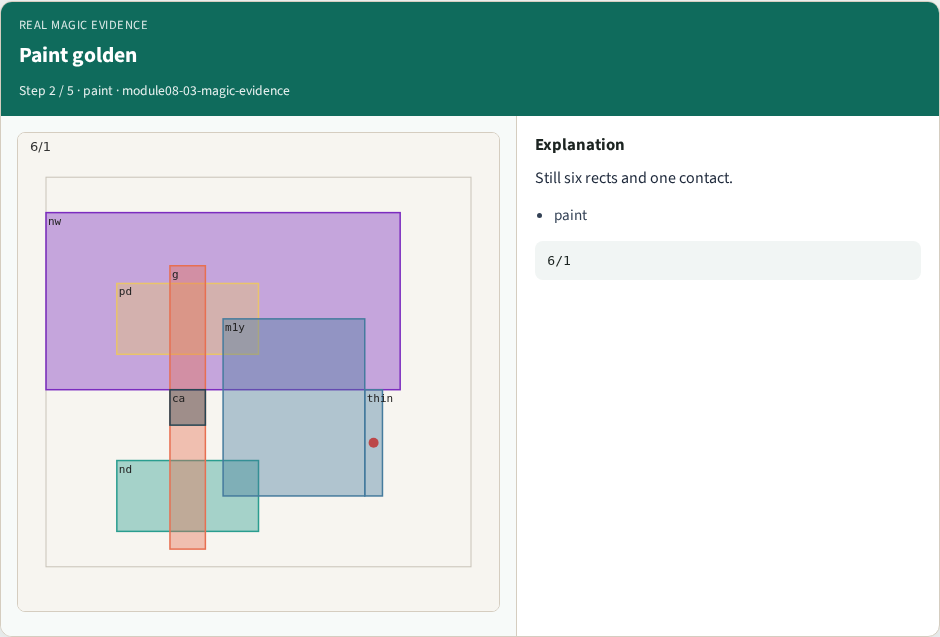
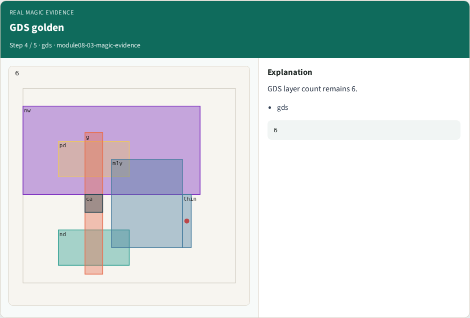
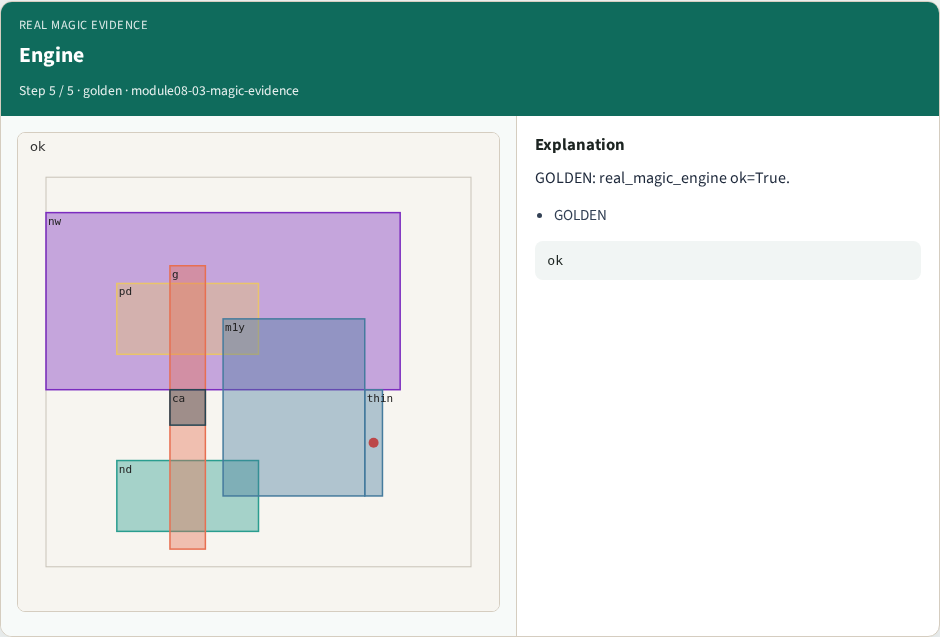

# Why real Magic

Run the full real Magic engine against goldens

---

## The idea
- GOLDEN: real_magic_engine ok=True

---

## Full recipe


---

## Paint golden


---

## DRC golden


---

## GDS golden


---

## Engine


---

## Browser lab track
- Open **magic-evidence**
- Build the Magic recipe or open evidence stages, then Check

---

## Implement track
- From common/, run real_solvers.py and confirm REAL_MAGIC_OK

---

## Pitfalls
- Editing goldens by hand without re-running scripts
- Confusing Part A map JSON with checked-in logs

---

## Try these
- From the common folder, run the real Magic self-test

---

## Try these — try these

```
cd courses/learn_magic/common
python3 real_solvers.py
```

---

## Pseudocode
- Here is the check in plain steps

---

## Pseudocode — try these

```
real_magic_engine ok=True.
ok if goldens match
```

---

## Next
- Complete the quiz for this part
- Continue the Part B evidence track, then algorithms and internals

