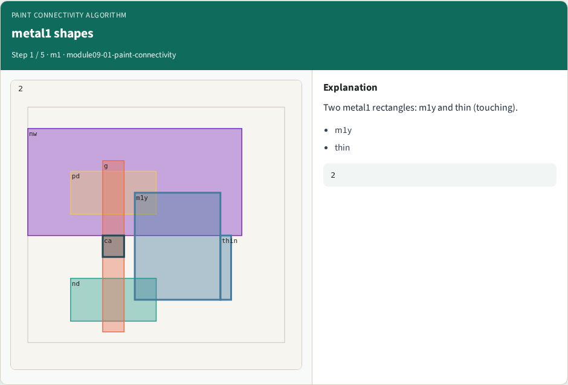
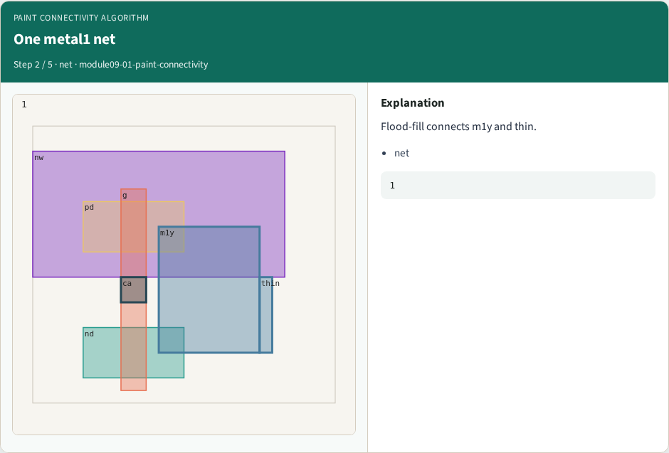
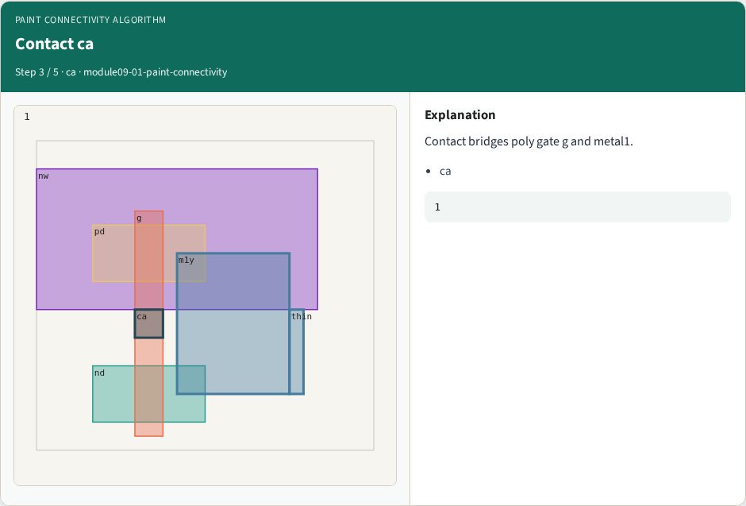
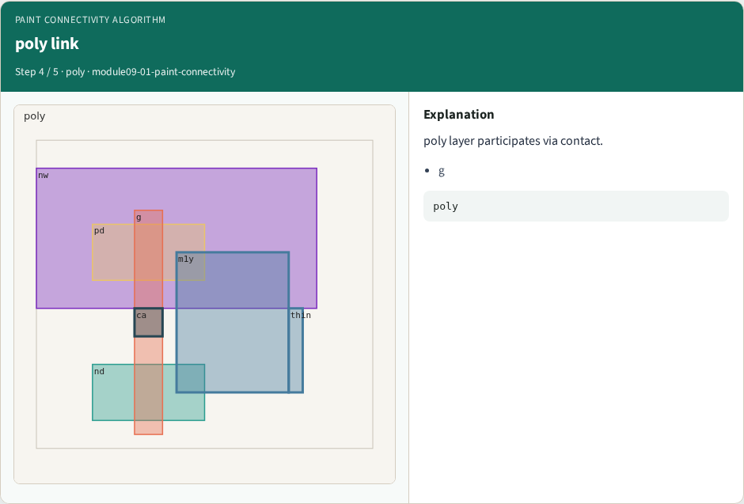

# Paint connectivity algorithm

**Module id:** module09-01-paint-connectivity
**Lab:** paint-connectivity
**Tracks:** A (implement) · B (browser lab)

## Slide 1 — Why algorithms

Flood-fill metal1 nets; contact bridges poly and metal1.

## Slide 2 — The idea

GOLDEN: metal1_net_shapes=2; contact_count=1.

<!-- algorithm-walkthrough -->

## Slide 3 — metal1 shapes



Two metal1 rectangles: m1y and thin (touching).

## Slide 4 — One metal1 net



Flood-fill connects m1y and thin.

## Slide 5 — Contact ca



Contact bridges poly gate g and metal1.

## Slide 6 — poly link



poly layer participates via contact.

## Slide 7 — Golden


GOLDEN: metal1_net_shapes=2 contact=1.

<!-- /algorithm-walkthrough -->


## Slide 8 — Browser lab track

Open **paint-connectivity**. Run connectivity / DRC / extract / bind, then Check.

## Slide 9 — Implement track

From common/, run algo_solvers.py and partc_bind.py.

## Slide 10 — Pitfalls

Changing tiny_algo_magic without updating Part B goldens. Ignoring the bind side.

## Slide 11 — Try these

From the common folder, run the Part C self-tests.

```bash
cd courses/learn_magic/common
python3 algo_solvers.py
python3 partc_bind.py
```

## Slide 12 — Pseudocode

Here is the check in plain steps.

```text
metal1_net_shapes=2; contact_count=1.
ok if goldens match and bind
```

## Slide 13 — Next

Continue Part C, then internals literacy.
