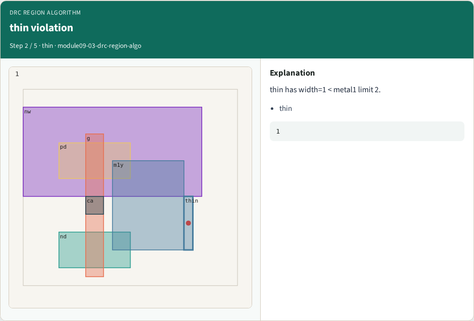
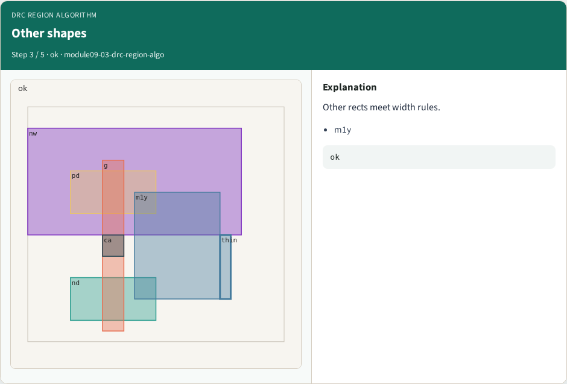
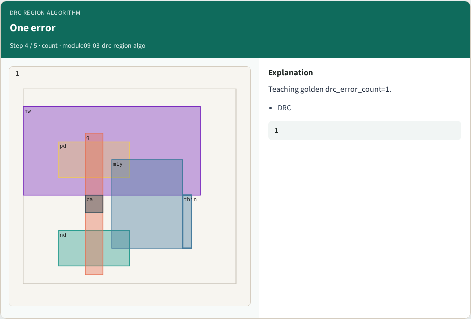

# DRC region algorithm

**Module id:** module09-03-drc-region-algo
**Lab:** drc-region-algo
**Tracks:** A (implement) · B (browser lab)

## Slide 1 — Why algorithms

Region scan for width violations on painted rects.

## Slide 2 — The idea

GOLDEN: drc_error_count=1 on thin metal1.

<!-- algorithm-walkthrough -->

## Slide 3 — Region scan


Walk each painted rect; check min_width.

## Slide 4 — thin violation



thin has width=1 < metal1 limit 2.

## Slide 5 — Other shapes



Other rects meet width rules.

## Slide 6 — One error



Teaching golden drc_error_count=1.

## Slide 7 — Golden


GOLDEN: error on thin metal1.

<!-- /algorithm-walkthrough -->


## Slide 8 — Browser lab track

Open **drc-region-algo**. Run connectivity / DRC / extract / bind, then Check.

## Slide 9 — Implement track

From common/, run algo_solvers.py and partc_bind.py.

## Slide 10 — Pitfalls

Changing tiny_algo_magic without updating Part B goldens. Ignoring the bind side.

## Slide 11 — Try these

From the common folder, run the Part C self-tests.

```bash
cd courses/learn_magic/common
python3 algo_solvers.py
python3 partc_bind.py
```

## Slide 12 — Pseudocode

Here is the check in plain steps.

```text
drc_error_count=1 on thin metal1.
ok if goldens match and bind
```

## Slide 13 — Next

Continue Part C, then internals literacy.
