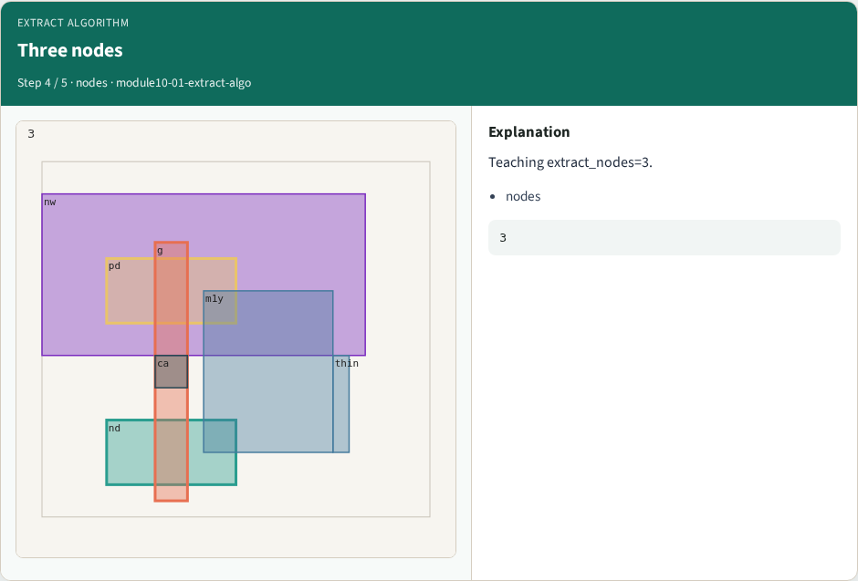

# Extract algorithm — step-by-step (for slides / transcript)

**Module:** `module10-01-extract-algo`  
**Lab / algo:** `extract-algo`  
**Viewer:** `/tools/algorithm-walkthrough/?algo=extract-algo&step=1`

Use each **Caption** as spoken prose (or a shortened slide note).
Use **Bullets** on the PPT; pair with the PNG in `assets/steps/`.

## Step 1 — Gate poly


**Caption (transcript):** Extract poly shape g as gate node.

**Slide bullets:**

- g

**On-screen metrics:**

```
poly
```

## Step 2 — ndiff


**Caption (transcript):** Extract nd as source/drain region.

**Slide bullets:**

- nd

**On-screen metrics:**

```
ndiff
```

## Step 3 — pdiff


**Caption (transcript):** Extract pd as source/drain region.

**Slide bullets:**

- pd

**On-screen metrics:**

```
pdiff
```

## Step 4 — Three nodes



**Caption (transcript):** Teaching extract_nodes=3.

**Slide bullets:**

- nodes

**On-screen metrics:**

```
3
```

## Step 5 — Golden


**Caption (transcript):** GOLDEN: extract_nodes=3.

**Slide bullets:**

- GOLDEN

**On-screen metrics:**

```
3
```

