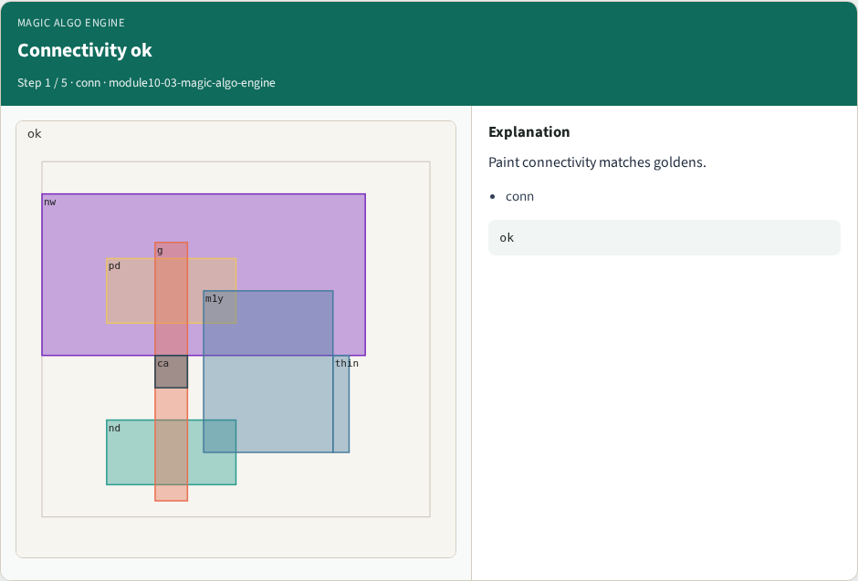
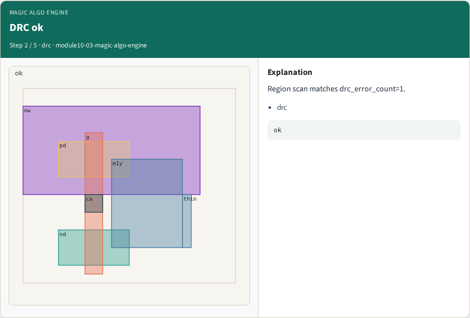
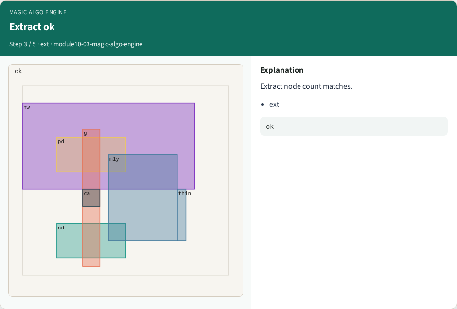

# Why algorithms

Run the full Part C engine and bind to real Magic goldens

---

## The idea
- GOLDEN: engine ok; bind drc 1↔1, gds 6↔6

---

## Connectivity ok


---

## DRC ok


---

## Extract ok


---

## Bind real


---

## Engine


---

## Browser lab track
- Open **magic-algo-engine**
- Run connectivity / DRC / extract / bind, then Check

---

## Implement track
- From common/, run algo_solvers.py and partc_bind.py

---

## Pitfalls
- Changing tiny_algo_magic without updating Part B goldens
- Ignoring the bind side

---

## Try these
- From the common folder, run the Part C self-tests

---

## Try these — try these

```
cd courses/learn_magic/common
python3 algo_solvers.py
python3 partc_bind.py
```

---

## Pseudocode
- Here is the check in plain steps

---

## Pseudocode — try these

```
engine ok; bind drc 1↔1, gds 6↔6.
ok if goldens match and bind
```

---

## Next
- Complete the quiz for this part
- Continue Part C, then internals literacy

