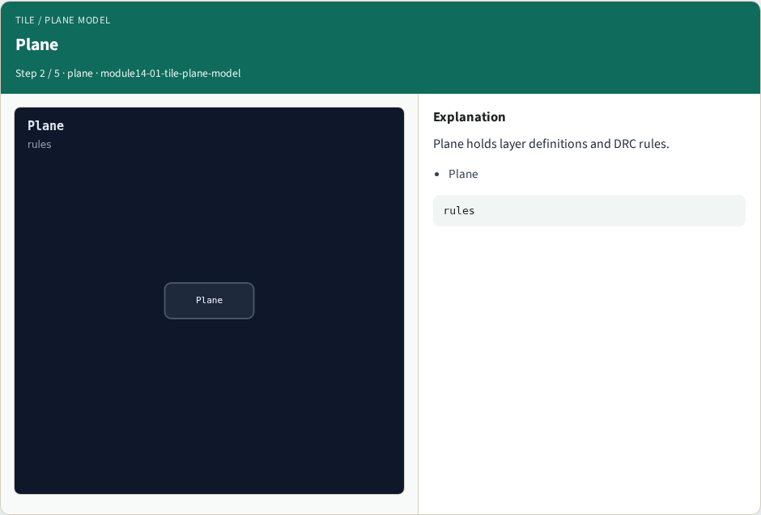
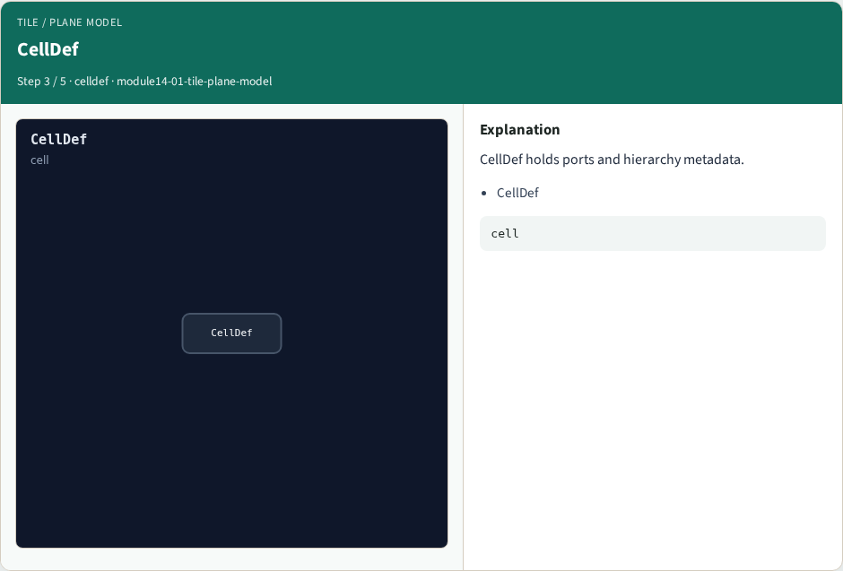

# Tile / Plane model — step-by-step (for slides / transcript)

**Module:** `module14-01-tile-plane-model`  
**Lab / algo:** `tile-plane-model`  
**Viewer:** `/tools/algorithm-walkthrough/?algo=tile-plane-model&step=1`

Use each **Caption** as spoken prose (or a shortened slide note).
Use **Bullets** on the PPT; pair with the PNG in `assets/steps/`.

## Step 1 — Tile


**Caption (transcript):** Tile holds painted rectangles and labels.

**Slide bullets:**

- Tile

**On-screen metrics:**

```
geom
```

## Step 2 — Plane



**Caption (transcript):** Plane holds layer definitions and DRC rules.

**Slide bullets:**

- Plane

**On-screen metrics:**

```
rules
```

## Step 3 — CellDef



**Caption (transcript):** CellDef holds ports and hierarchy metadata.

**Slide bullets:**

- CellDef

**On-screen metrics:**

```
cell
```

## Step 4 — Nesting


**Caption (transcript):** Tiles live on Planes; CellDef wraps the cell view.

**Slide bullets:**

- nest

**On-screen metrics:**

```
3
```

## Step 5 — Golden


**Caption (transcript):** GOLDEN: Tile, Plane, CellDef — three pillars.

**Slide bullets:**

- GOLDEN

**On-screen metrics:**

```
3
```

