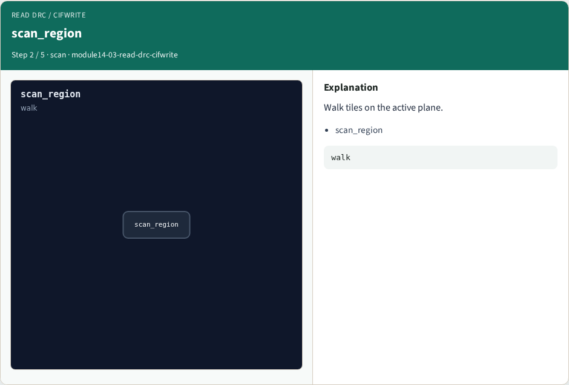
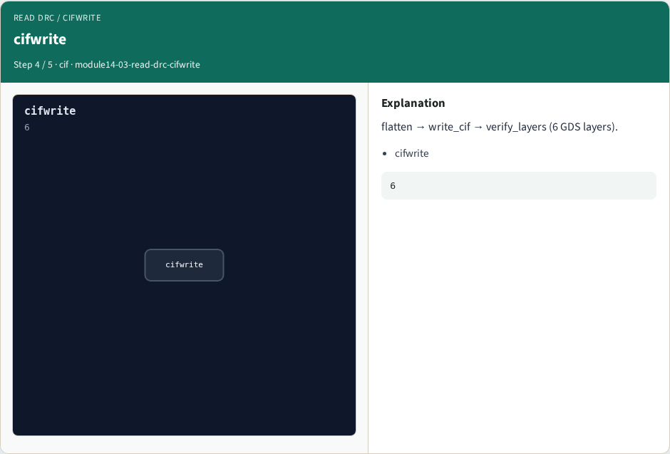

# Why Magic internals

Read the DRC scan → marker shape bound to Part B goldens

---

## The idea
- GOLDEN: load_rules → scan_region → emit_marker (drc=1); cifwrite stages

---

## load_rules


---

## scan_region


---

## emit_marker


---

## cifwrite


---

## Golden


---

## Browser lab track
- Open **read-drc-cifwrite**
- Click through stages and check goldens

---

## Implement track
- Call read_drc_cifwrite() in internals_solvers; assert golden match

---

## Pitfalls
- Treating browser JSON as the C API
- Confusing Tile with OpenSTA Graph

---

## Try these
- From the common folder, run the internals self-test

---

## Try these — try these

```
cd courses/learn_magic/common
python3 internals_solvers.py
```

---

## Pseudocode
- Here is the checklist in plain steps

---

## Pseudocode — try these

```
load_rules → scan_region → emit_marker (drc=1); cifwrite stages.
```

---

## Next
- Complete the quiz for this part
- Wrap the Magic path , map, CLI evidence, algorithms, and C tree literacy

