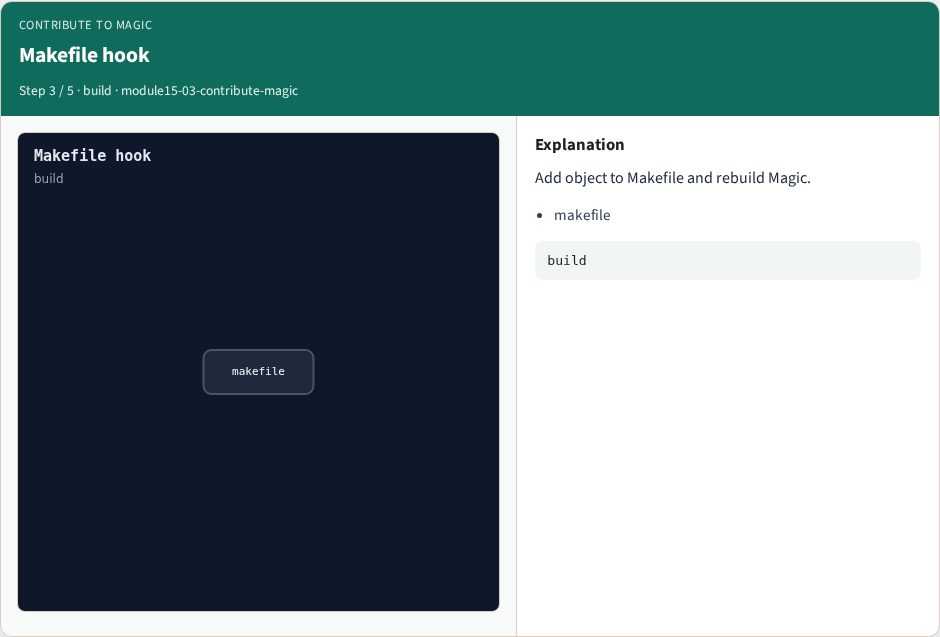
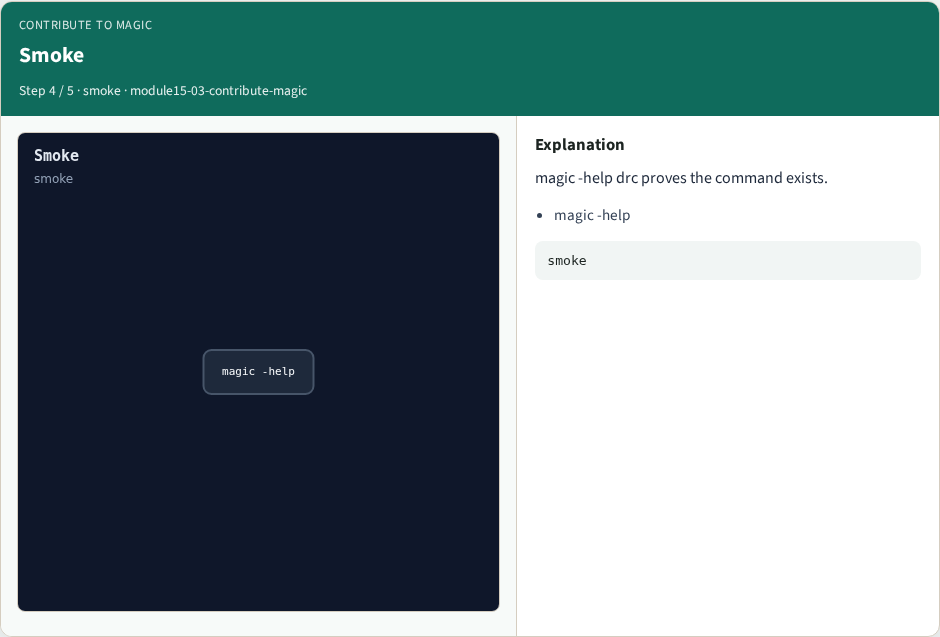
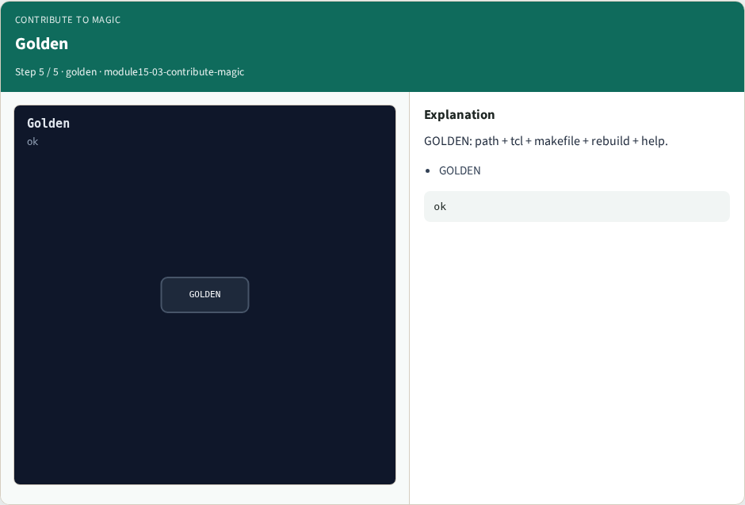

# Contribute to Magic

**Module id:** module15-03-contribute-magic
**Lab:** contribute-magic
**Tracks:** A (implement) · B (browser lab)

## Slide 1 — Why Magic internals

Know where a new Tcl command lives and the minimal stub to build.

## Slide 2 — The idea

GOLDEN: commands/cmd_drc.c + Tcl register + Makefile + magic -help drc.

<!-- algorithm-walkthrough -->

## Slide 3 — Tree layout


tiles/planes/cells hold layout; commands/ holds Tcl.

## Slide 4 — Stub file


Minimal .c: Tcl command drc registration.

## Slide 5 — Makefile hook



Add object to Makefile and rebuild Magic.

## Slide 6 — Smoke



magic -help drc proves the command exists.

## Slide 7 — Golden



GOLDEN: path + tcl + makefile + rebuild + help.

<!-- /algorithm-walkthrough -->


## Slide 8 — Browser lab track

Open **contribute-magic**. Click through stages and check goldens.

## Slide 9 — Implement track

Call contribute_magic() in internals_solvers; assert golden match.

## Slide 10 — Pitfalls

Treating browser JSON as the C API. Confusing Tile with OpenSTA Graph.

## Slide 11 — Try these

From the common folder, run the internals self-test.

```bash
cd courses/learn_magic/common
python3 internals_solvers.py
```

## Slide 12 — Pseudocode

Here is the checklist in plain steps.

```text
commands/cmd_drc.c + Tcl register + Makefile + magic -help drc.
```

## Slide 13 — Next

Wrap the Magic path — map, CLI evidence, algorithms, and C tree literacy.
