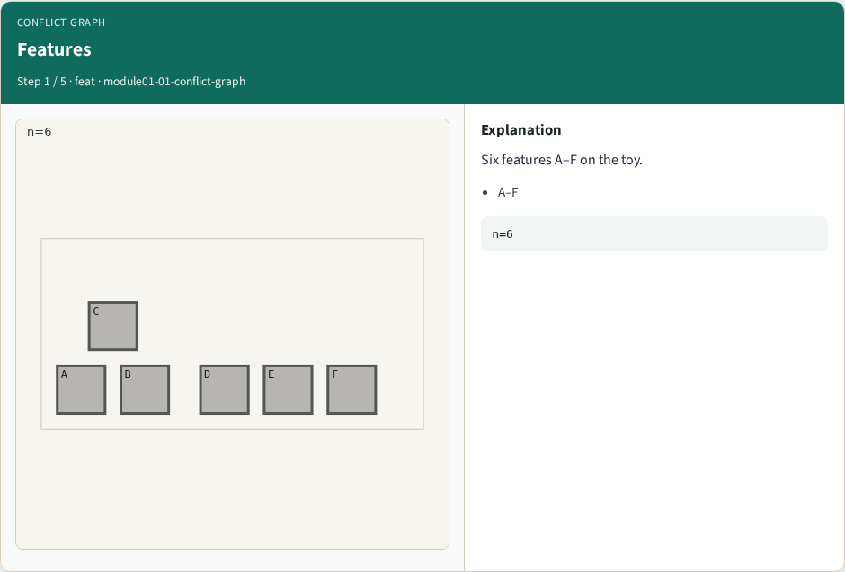
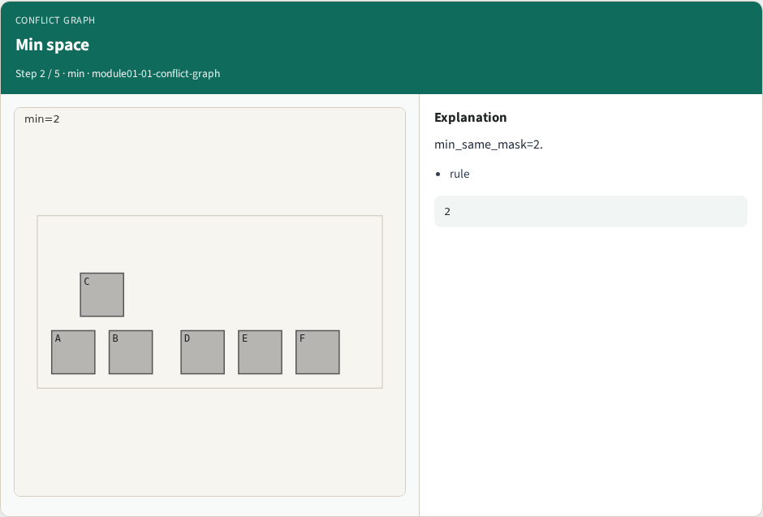
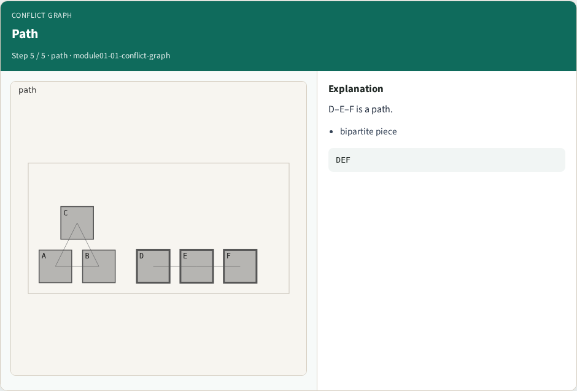

# Conflict graph construction — step-by-step (for slides / transcript)

**Module:** `module01-01-conflict-graph`  
**Lab / algo:** `conflict-graph`  
**Viewer:** `/tools/algorithm-walkthrough/?algo=conflict-graph&step=1`

Use each **Caption** as spoken prose (or a shortened slide note).
Use **Bullets** on the PPT; pair with the PNG in `assets/steps/`.

## Step 1 — Features



**Caption (transcript):** Six features A–F on the toy.

**Slide bullets:**

- A–F

**On-screen metrics:**

```
n=6
```

## Step 2 — Min space



**Caption (transcript):** min_same_mask=2.

**Slide bullets:**

- rule

**On-screen metrics:**

```
2
```

## Step 3 — Edges


**Caption (transcript):** Conflict if gap < 2 → 5 edges.

**Slide bullets:**

- graph

**On-screen metrics:**

```
E=5
```

## Step 4 — Triangle


**Caption (transcript):** A–B–C form a triangle.

**Slide bullets:**

- odd

**On-screen metrics:**

```
ABC
```

## Step 5 — Path



**Caption (transcript):** D–E–F is a path.

**Slide bullets:**

- bipartite piece

**On-screen metrics:**

```
DEF
```

