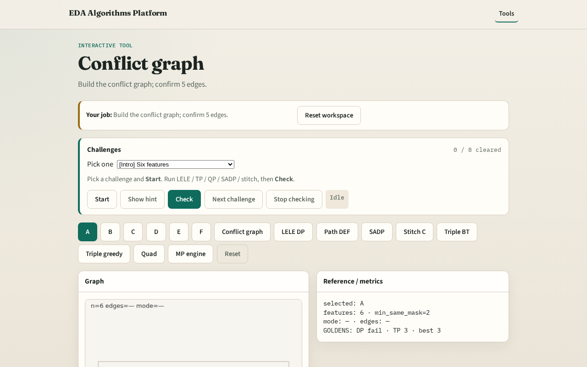

# Why conflicts

Multi-patterning starts by finding which features cannot share the same mask

---

## The idea
- GOLDEN: 6 nodes, 5 edges (A-B, A-C, B-C, D-E, E-F), min_same_mask=2

---

## Features

---

## Min space

---

## Edges

---

## Triangle

---

## Path

---

## Browser lab track

---

## Implement track
- Call build_conflict_graph(); assert feature_count==6 and edge_count==5

---

## Pitfalls
- Using center distance instead of bbox gap
- Forgetting min_same_mask from JSON

---

## Your turn
- Next: LELE double patterning as 2-coloring

