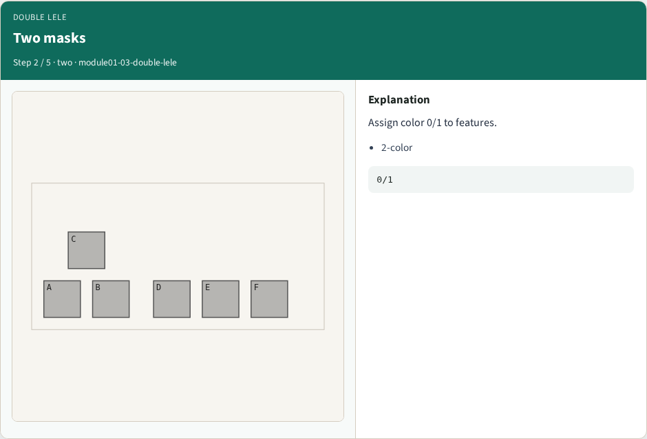
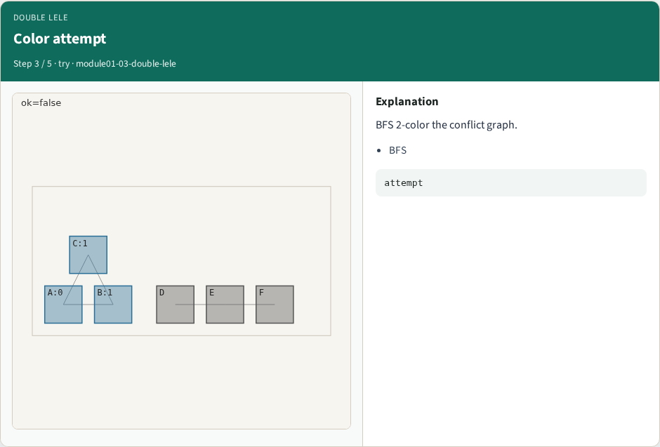
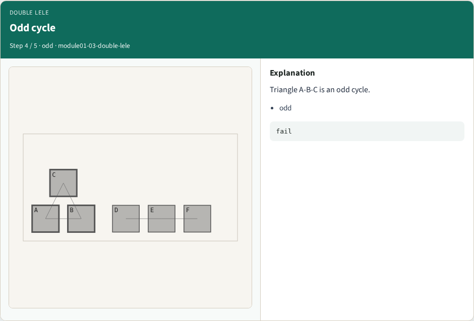
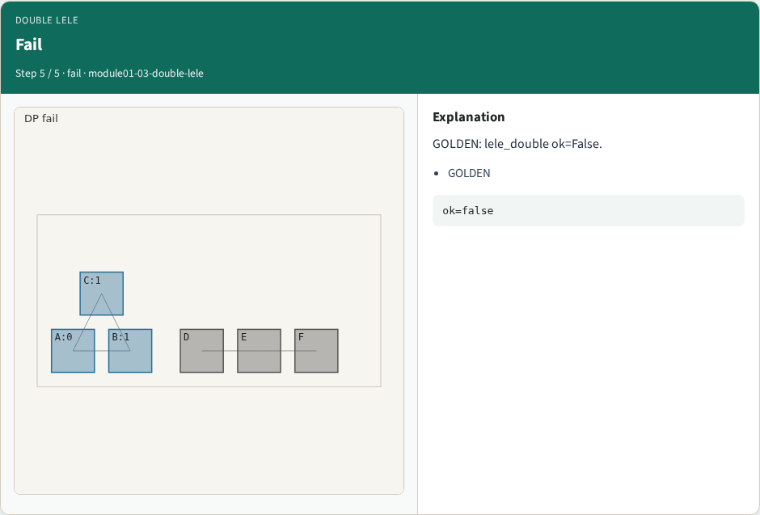

# LELE overview

LELE double patterning assigns two lithography masks by 2-coloring conflicts

---

## The idea
- GOLDEN: lele_double ok=False on the full graph (triangle A-B-C)

---

## LELE idea

---

## Two masks

---

## Color attempt

---

## Odd cycle

---

## Fail

---

## Browser lab track

---

## Implement track
- Call lele_double(); assert ok is False

---

## Pitfalls
- Assuming DP always works
- Ignoring odd cycles in the full layout

---

## Your turn
- Next: bipartite check on a subgraph

