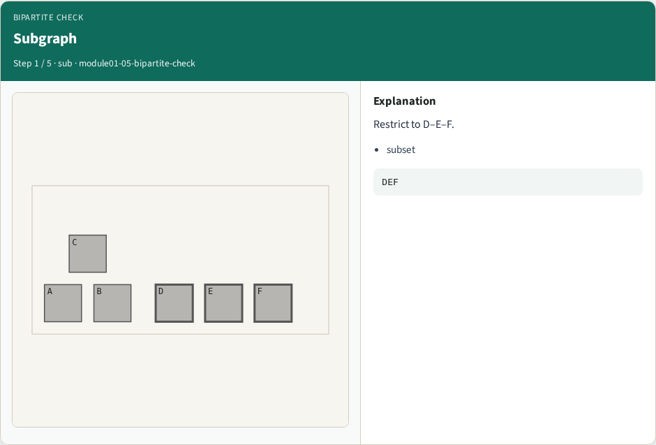
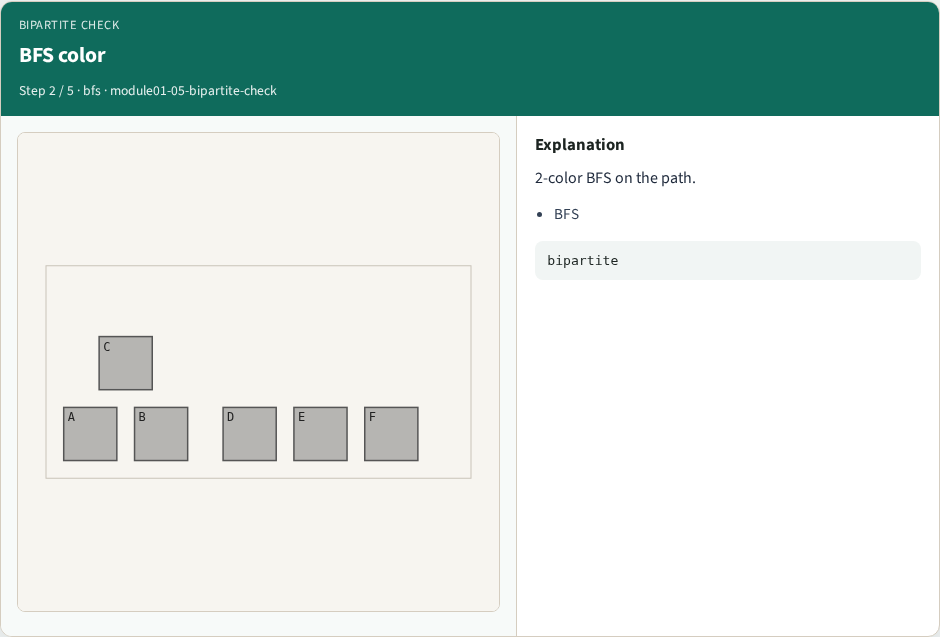
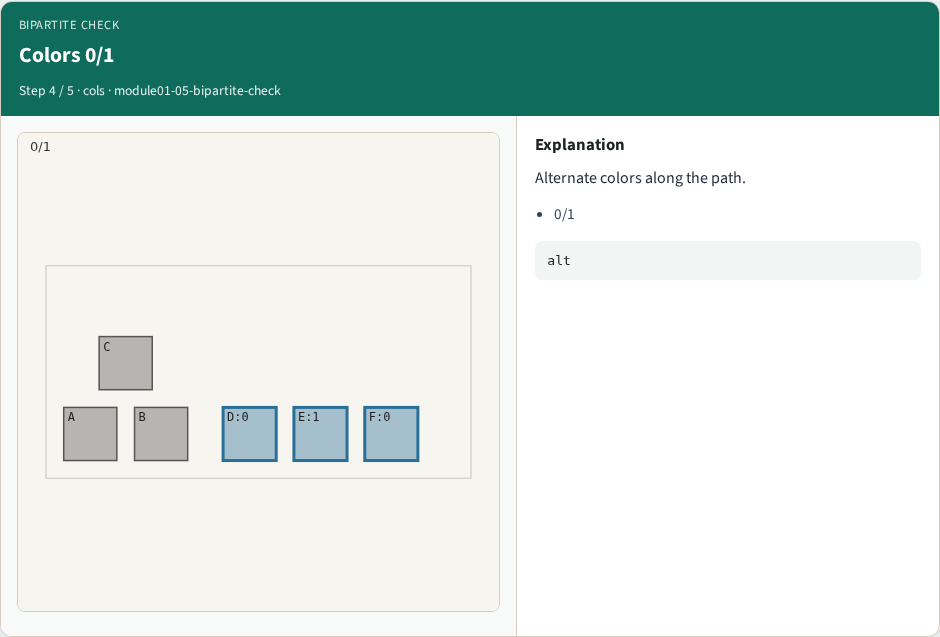
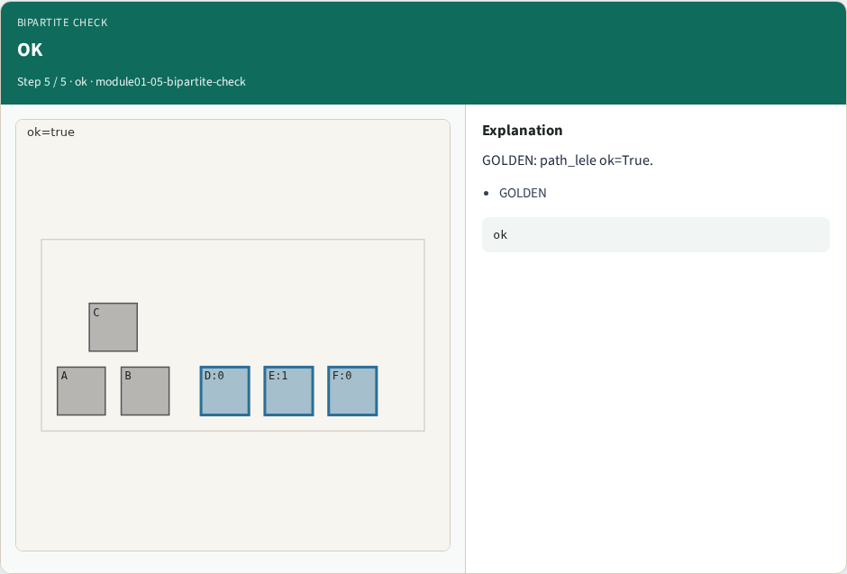
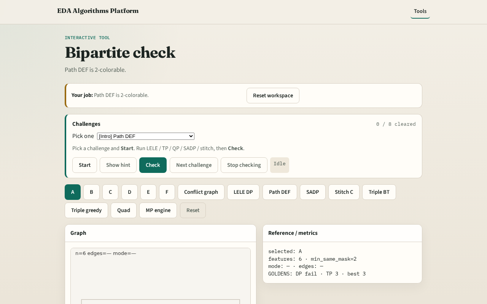

# DP feasibility

A subgraph that is bipartite can still be double-patterned even when the full chip is not

---

## The idea
- GOLDEN: path_lele ok=True on nodes D, E, F

---

## Subgraph

---

## BFS color

---

## Path DEF

---

## Colors 0/1

---

## OK

---

## Browser lab track

---

## Implement track
- Call path_lele(); assert ok is True

---

## Pitfalls
- Testing full graph when the lesson is subgraph feasibility
- Confusing LELE with SADP

---

## Your turn
- Next: SADP mandrel assignment

