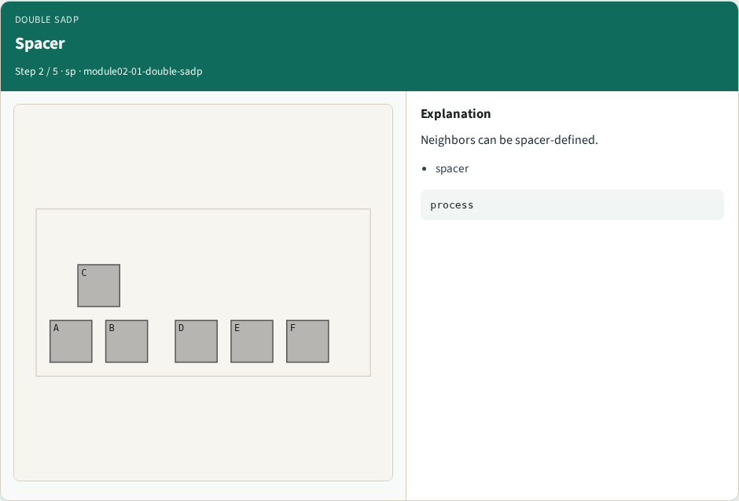
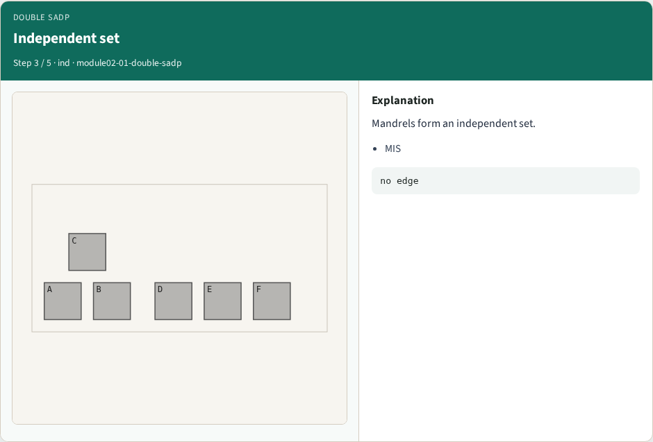
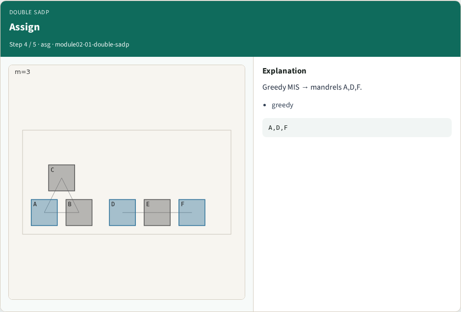
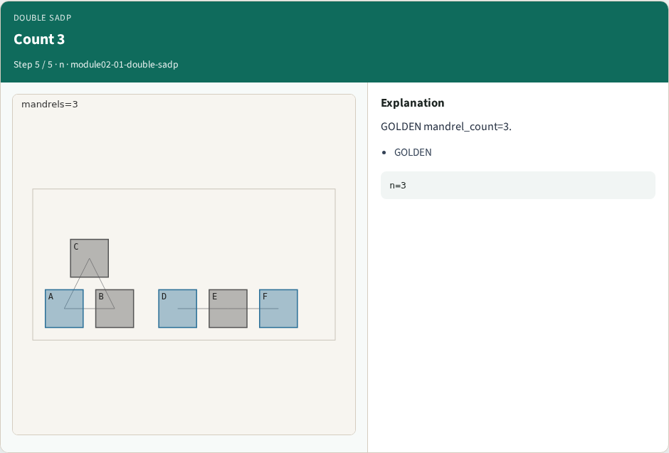

# SADP lite (mandrels + spacers) — step-by-step (for slides / transcript)

**Module:** `module02-01-double-sadp`  
**Lab / algo:** `double-sadp`  
**Viewer:** `/tools/algorithm-walkthrough/?algo=double-sadp&step=1`

Use each **Caption** as spoken prose (or a shortened slide note).
Use **Bullets** on the PPT; pair with the PNG in `assets/steps/`.

## Step 1 — Mandrel


**Caption (transcript):** SADP starts from mandrel features.

**Slide bullets:**

- mandrel

**On-screen metrics:**

```
core
```

## Step 2 — Spacer



**Caption (transcript):** Neighbors can be spacer-defined.

**Slide bullets:**

- spacer

**On-screen metrics:**

```
process
```

## Step 3 — Independent set



**Caption (transcript):** Mandrels form an independent set.

**Slide bullets:**

- MIS

**On-screen metrics:**

```
no edge
```

## Step 4 — Assign



**Caption (transcript):** Greedy MIS → mandrels A,D,F.

**Slide bullets:**

- greedy

**On-screen metrics:**

```
A,D,F
```

## Step 5 — Count 3



**Caption (transcript):** GOLDEN mandrel_count=3.

**Slide bullets:**

- GOLDEN

**On-screen metrics:**

```
n=3
```

