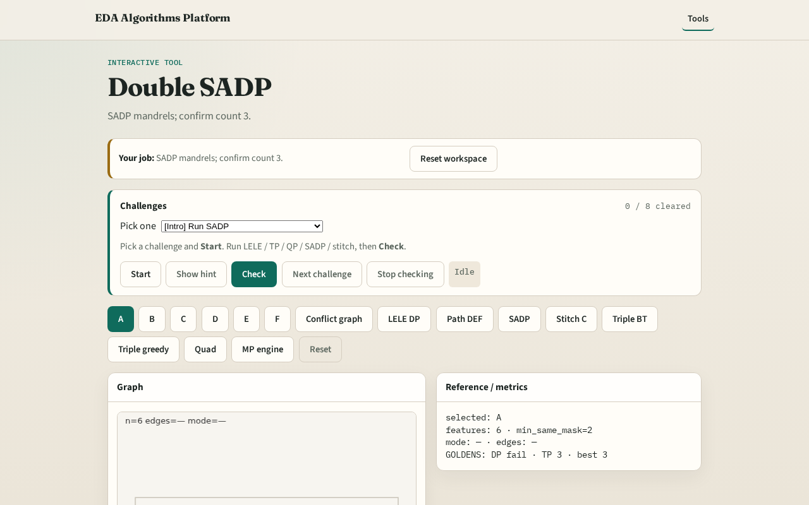

# SADP lite

SADP is not LELE coloring , mandrels print first; spacers form between mandrels

---

## The idea
- GOLDEN: mandrel_count=3 (A, D, F on the toy greedy pick)

---

## Mandrel

---

## Spacer

---

## Independent set

---

## Assign

---

## Count 3

---

## Browser lab track

---

## Implement track
- Call sadp_assign(); assert mandrel_count==3

---

## Pitfalls
- Treating SADP as 2-coloring
- Expecting same result as LELE

---

## Your turn
- Next: stitch to break odd cycles

