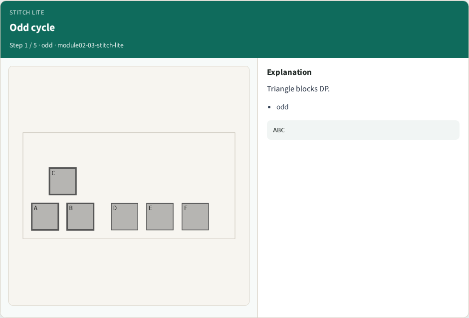
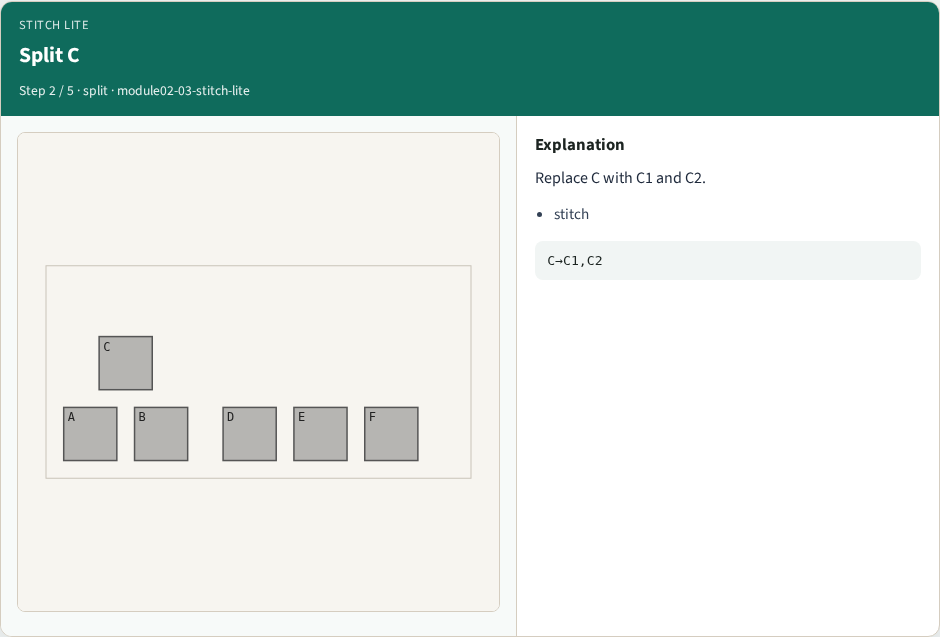
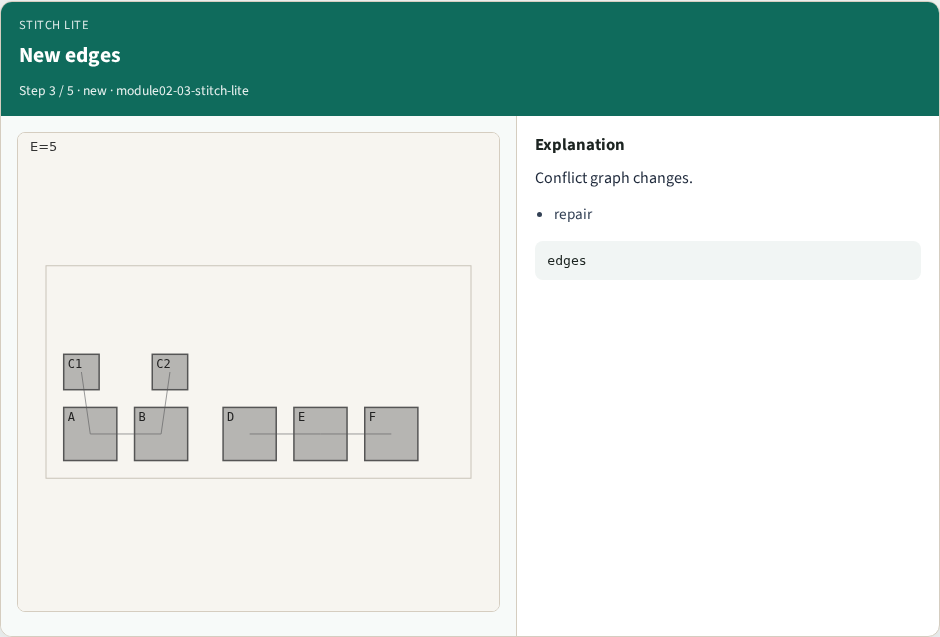
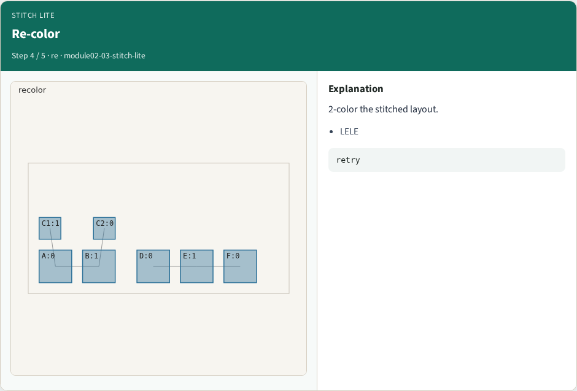
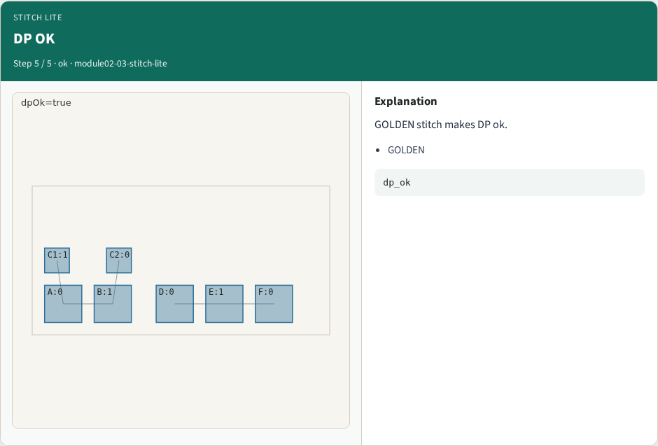
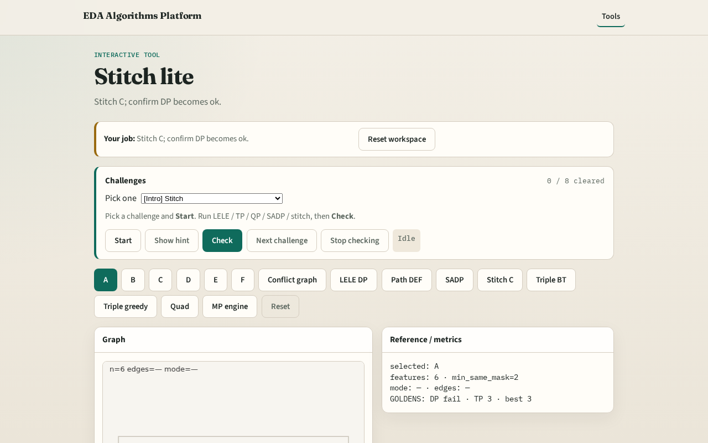

# Stitch lite (break odd cycle)

**Module id:** module02-03-stitch-lite
**Lab:** stitch-lite
**Tracks:** A (implement) · B (browser lab)

## Slide 1 — Stitch overview

Stitching splits a feature so conflicts drop — restoring DP feasibility without extra masks.

## Slide 2 — The idea

GOLDEN: stitch_makes_dp True after splitting C → C1, C2.

<!-- algorithm-walkthrough -->

## Slide 3 — Odd cycle

Triangle blocks DP.

## Slide 4 — Split C

Replace C with C1 and C2.

## Slide 5 — New edges

Conflict graph changes.

## Slide 6 — Re-color

2-color the stitched layout.

## Slide 7 — DP OK

GOLDEN stitch makes DP ok.

<!-- /algorithm-walkthrough -->

## Slide 8 — Browser lab track

Open **stitch-lite**. Run stitch; confirm dp_ok=True.

## Slide 9 — Implement track

Call stitch_feature('C'); assert dp_ok is True.

## Slide 10 — Pitfalls

Splitting without reducing conflicts. Assuming stitch always needs TP.

## Slide 11 — Your turn

Next: triple patterning with 3 colors.
