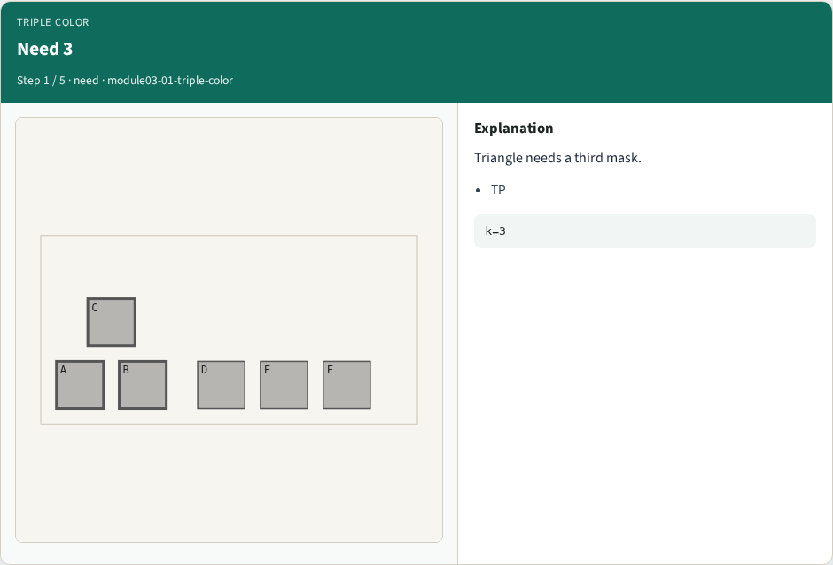
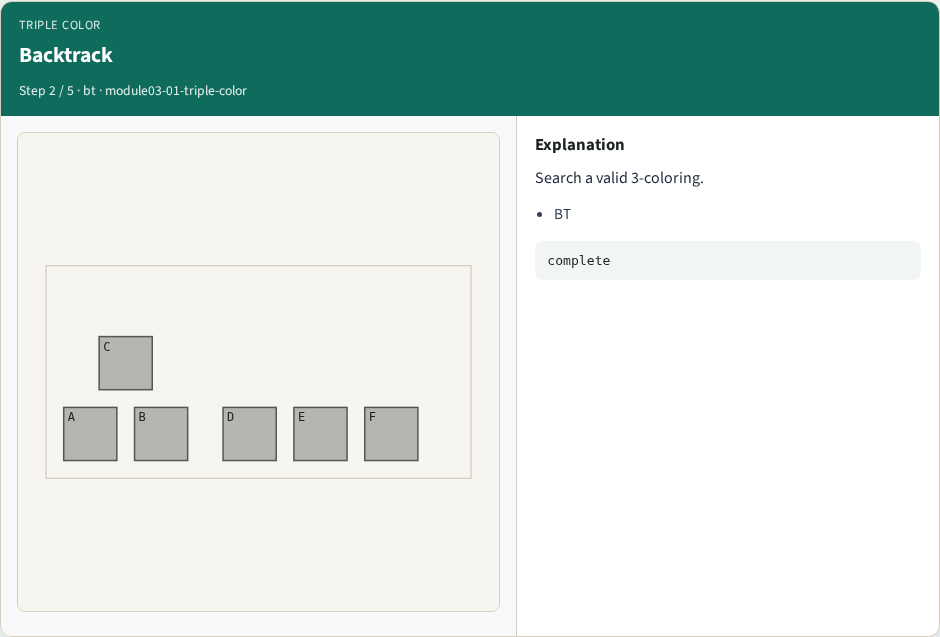
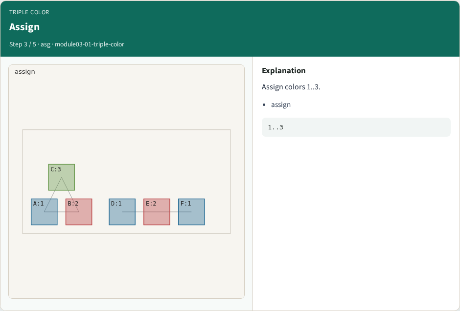
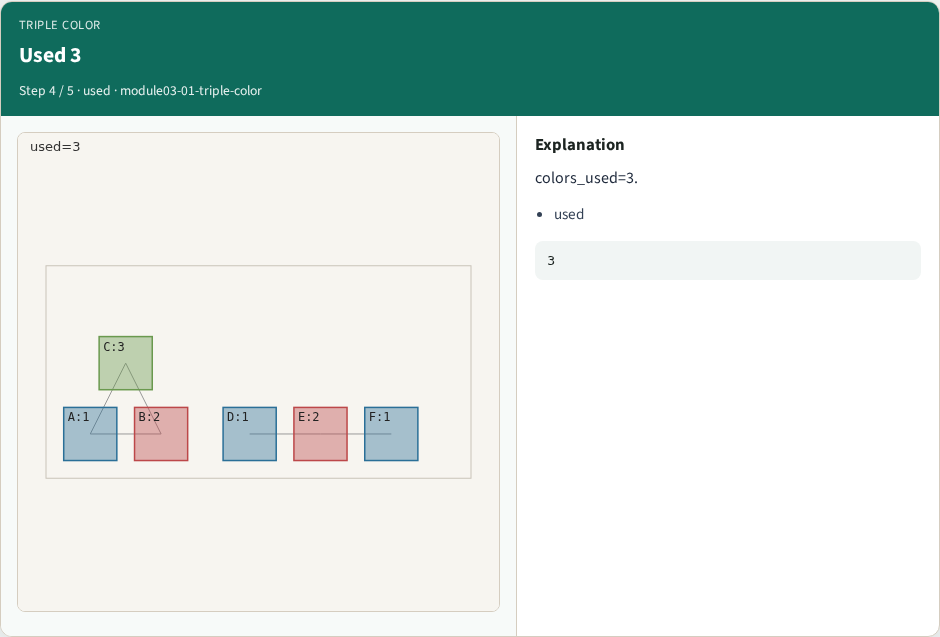
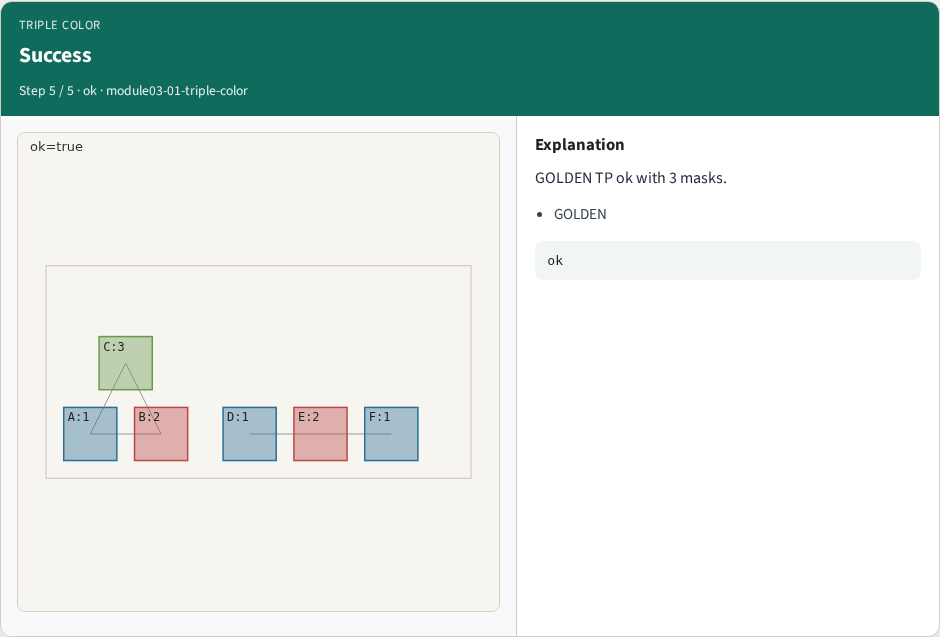

# Triple patterning (3-color) — step-by-step (for slides / transcript)

**Module:** `module03-01-triple-color`  
**Lab / algo:** `triple-color`  
**Viewer:** `/tools/algorithm-walkthrough/?algo=triple-color&step=1`

Use each **Caption** as spoken prose (or a shortened slide note).
Use **Bullets** on the PPT; pair with the PNG in `assets/steps/`.

## Step 1 — Need 3



**Caption (transcript):** Triangle needs a third mask.

**Slide bullets:**

- TP

**On-screen metrics:**

```
k=3
```

## Step 2 — Backtrack



**Caption (transcript):** Search a valid 3-coloring.

**Slide bullets:**

- BT

**On-screen metrics:**

```
complete
```

## Step 3 — Assign



**Caption (transcript):** Assign colors 1..3.

**Slide bullets:**

- assign

**On-screen metrics:**

```
1..3
```

## Step 4 — Used 3



**Caption (transcript):** colors_used=3.

**Slide bullets:**

- used

**On-screen metrics:**

```
3
```

## Step 5 — Success



**Caption (transcript):** GOLDEN TP ok with 3 masks.

**Slide bullets:**

- GOLDEN

**On-screen metrics:**

```
ok
```

