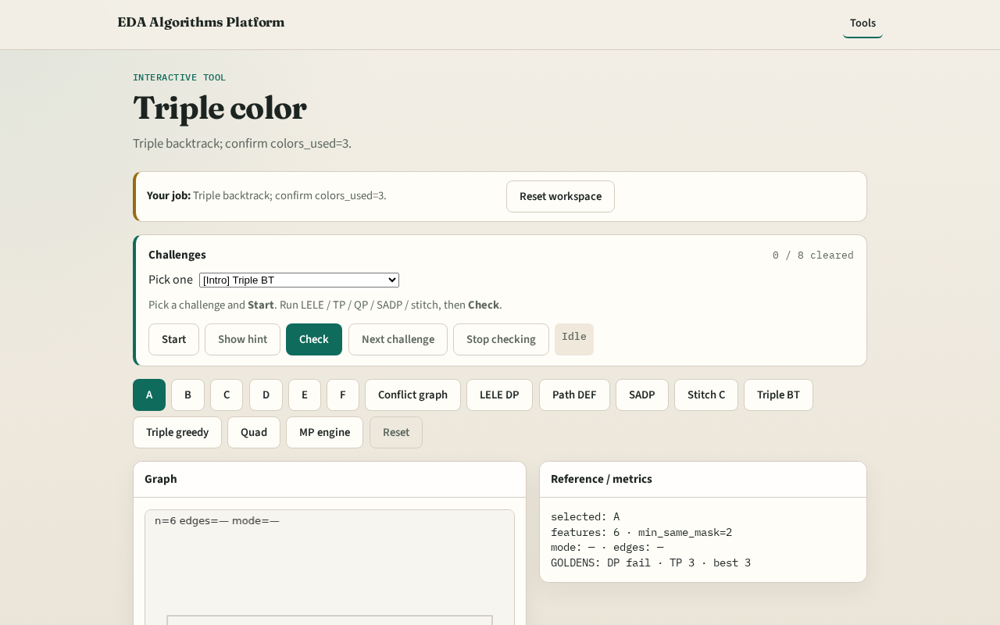

# Triple patterning (3-color)

**Module id:** module03-01-triple-color
**Lab:** triple-color
**Tracks:** A (implement) · B (browser lab)

## Slide 1 — Triple patterning

When two masks fail, triple patterning assigns three masks with a 3-coloring.

## Slide 2 — The idea

GOLDEN: colors_used=3, ok=True on tiny_mp.

<!-- algorithm-walkthrough -->

## Slide 3 — Need 3

Triangle needs a third mask.

## Slide 4 — Backtrack

Search a valid 3-coloring.

## Slide 5 — Assign

Assign colors 1..3.

## Slide 6 — Used 3

colors_used=3.

## Slide 7 — Success

GOLDEN TP ok with 3 masks.

<!-- /algorithm-walkthrough -->

## Slide 8 — Browser lab track

Open **triple-color**. Run triple backtrack; confirm colors_used=3.

## Slide 9 — Implement track

Call triple_pattern(method='backtrack'); assert ok and colors_used==3.

## Slide 10 — Pitfalls

Greedy-only when backtrack is required. Stopping at 2 colors after stitch lesson.

## Slide 11 — Your turn

Next: compare greedy vs backtrack decompositions.
