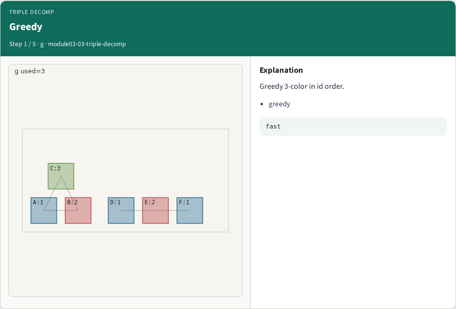
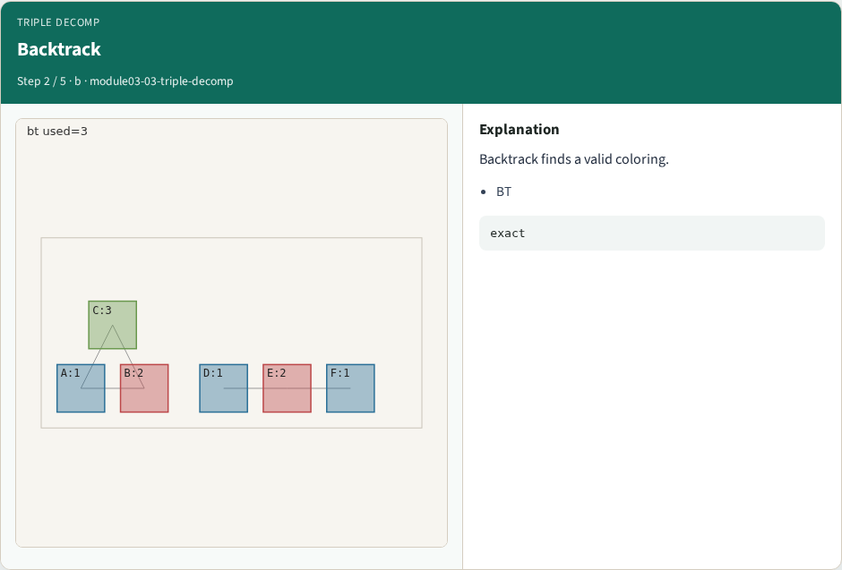
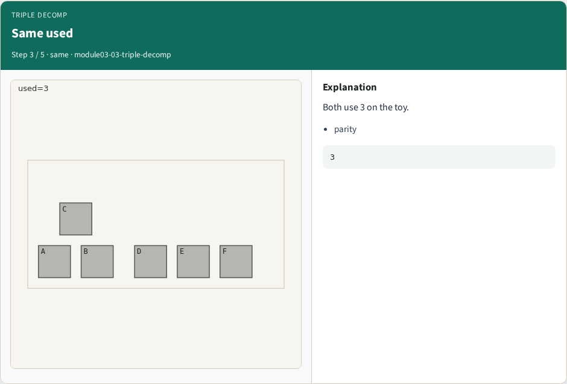
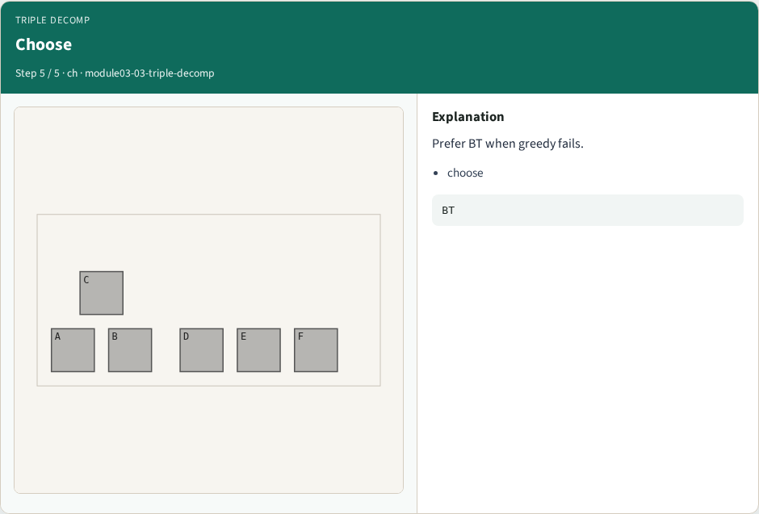
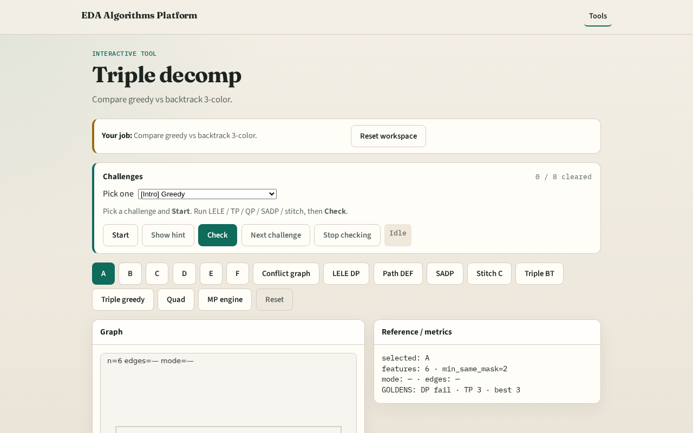

# Decomp literacy

Production flows may use greedy heuristics or exact backtrack , know when they differ

---

## The idea
- On tiny_mp both methods succeed; colors_used=3 for greedy and backtrack

---

## Greedy

---

## Backtrack

---

## Same used

---

## Methods

---

## Choose

---

## Browser lab track

---

## Implement track
- Compare color_greedy(G,3) vs color_backtrack(G,3); assert both ok

---

## Pitfalls
- Assuming greedy always equals backtrack
- Ignoring failure cases on larger graphs

---

## Your turn
- Next: quad patterning with headroom

